# Machine Guardian — ML Model Development and Training Results (version 2)

MAC-Attack senior capstone. From the original Ottawa motor model, through the redesign on the Paderborn run-to-failure
bearing data, to Training Run 3. **Version 2** (3 November 2026): adds Training Run 3 on seven development bearings;
version 1, covering Runs 1–2, is kept unchanged. Prepared with Claude Code from the project's code, logs, earlier
reports and saved experiment results. Every number below is taken from a file in the repository; the main sources are
listed in section 14.

## 1. Executive Summary

### What we are trying to accomplish

Machine Guardian is an on-device condition monitor for rotating machines. A small neural network reads vibration (and,
in the current design, temperature and shaft speed) from a motor and decides whether its bearing has started to
deteriorate. The network is small enough to run in INT8 arithmetic on our own **8 × 8 systolic-array accelerator** on a
**ZedBoard (Xilinx Zynq XC7Z020) FPGA**. The ARM processor on the same chip does the feature extraction and the
alarm logic.

### What we have completed

- **Hardware.** An INT8 matrix-multiply accelerator ran on the board at 250 MHz (24/24 board tests). An on-chip MLP
  engine was built at 214.286 MHz and passed 30/30 board tests with test models.
- **First model (Ottawa motor dataset).**
  - A healthy/faulty classifier (E3): 27 of 28 test faults found, no false alarms.
  - A single-accelerometer version: 8 → 32 → 16 → 1, the shape the current model reuses.
  - INT8 export with no decision changes, and a bit-exact check on the accelerator RTL.
- **Redesign on run-to-failure data (Paderborn bearings).**
  - Four bearings processed and validated: B01–B04, 3,221 measurements.
  - A label-free anomaly detector built as the reference to beat.
  - The new 8 → 32 → 16 → 2 multi-task MLP: 850 parameters, two output heads.
  - A locked test set, and provisional labels.
- **Training Runs 1 and 2.** The deterioration head was trained by leave-one-bearing-out validation (9 networks). Run 2
  added a latched alarm, a calibration study, and an INT8 + RTL check of the **trained** networks.
- **Training Run 3.**
  - Four more bearings processed (B08, B09, B11, B12), giving 7 labelled bearings.
  - Five configurations compared with nested leave-one-bearing-out validation; log-compressed inputs and weight decay
    selected, with the temperature input fed as 0 (configuration E). C, the same with temperature, was chosen on 4 of
    7 nested folds, trails E by only 2 alarm transitions in 35 runs, and was exported as the alternative.
  - An INT8 export bug fixed; 16 trained networks verified bit-exact on the RTL.

### Current progress in one table

| Area | Status |
|---|---|
| 8 × 8 INT8 accelerator on the FPGA | done; board-tested (250 MHz matrix multiply, 214.286 MHz on-chip MLP) |
| Paderborn data pipeline and checks | done for 8 of 17 bearings (B01–B04, B08, B09, B11, B12) |
| Anomaly detector (reference) | done; alarms on all seven labelled bearings |
| Multi-task MLP, deterioration head | trained (Runs 1–3), 7 bearings in Run 3; latched before the stop on 6 of 7; **not better than the anomaly detector** (never earlier, misses B12) |
| Multi-task MLP, Motor Health Index head | **not trained**: no reliable severity labels exist |
| Trained MLP in INT8 / on the RTL | done in simulation (Runs 2–3; 16 trained networks bit-exact); **not yet on the board** |
| Final test on the locked bearings B06, B07, B13, B17 | not started (kept locked on purpose) |

> **Key finding:** on seven bearings (Run 3), the trained network raises one steady, latched alarm on 6 of 7, with no
> healthy-reference false alarms. Log-compressed inputs and weight decay make it far steadier than in Runs 1–2. But the
> simpler, label-free anomaly detector alarms at the same time or earlier on every bearing and also catches B12, so the
> network has not yet earned its place.

> **Caution:** the network's output is a **deterioration score**, not a validated probability of physical failure.
> Nothing so far measures how likely a bearing is to fail, or how far it has worn.

## 2. Model Development History

### 2.1 From the proposal to the first model

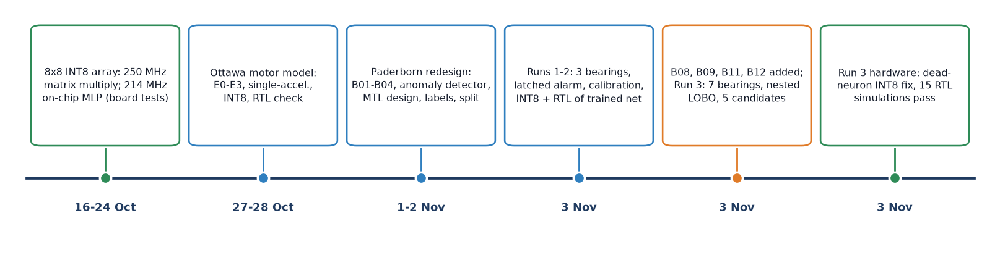

- **Original proposal:** acoustic anomaly detection with a DCASE-style autoencoder (project log, 20 Oct entry).
- **20 Oct:** the professor approved a **multi-task MLP on vibration, temperature and RPM**, to be trained first and then
  run on the accelerator. The Paderborn or KAIST datasets were named as candidates because they record those signals.
- **21 Oct:** the hardware rules for any model were agreed: at most 64 inputs, at most 4 layers, every width at most 64
  (multiples of 8 keep all lanes busy), and linear output heads merged into one last layer.
- **27 Oct:** to build on James's existing baseline, the team first built a **single-output** model on the **University
  of Ottawa electric-motor dataset**, with the same dataset, sensors and split as that baseline.

### 2.2 The Ottawa motor model (27–28 Oct)

The Ottawa dataset has 128 ten-second recordings at 42 kHz of one electric motor: 16 healthy and 112 with one of 7
faults. The split is by speed code: train on codes 3, 4, 5, 8; validate on 2, 7; test on 1, 6. Each model was a small
MLP (K → 32 → 16 → 1) trained with Adam, and the decision averaged ten 1-second windows.

| Experiment | Inputs | Test faults found (of 28) | False alarms (of 4) | Test ROC-AUC |
|---|---|---|---|---|
| E0 (James's baseline, rebuilt) | 16 statistics, accelerometers 2 + 3, per recording | 18 | 0 | 0.875 |
| E1 | log amplitudes + shape + ln f | 15 | 0 | 0.929 |
| E2 | E1 on 1-s windows | 24 | 0 | 1.000 |
| E3 (22 → 32 → 16 → 1) | 7 statistics × 3 accelerometers + ln f | **27** | 0 | 1.000 |
| E3 single accelerometer a1 (8 → 32 → 16 → 1, 833 parameters) | one accelerometer on the motor | 28 | 0 | 1.000 |

Seed 42 results. E3 over three seeds: test accuracy 0.948 ± 0.029, recall 0.940 ± 0.034, F1 0.969 ± 0.018.

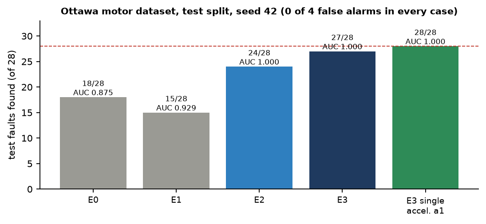

Further results:

- **INT8 export:** E3 and a1 were exported to INT8 with **0 decisions changed** in every split.
- **RTL:** both passed a bit-exact check on the accelerator RTL. E3 takes 566 cycles per window; a1 takes 382 cycles
  (1.78 µs).
- **Health index H1:** a distance from the healthy reference, built as the second output. It reached a test ROC-AUC of
  only **0.527**.
- **Choosing a1 for deployment was a post-test team decision,** made because of where its accelerometer is mounted. The
  validation rule had picked accelerometer 2, and the report flags a1's 28/28 as "not an unbiased estimate".

### 2.3 Why we moved to the Paderborn run-to-failure data

The project documents give four reasons the Ottawa data could not support the goal:

1. **No temperature or RPM inputs.** The approved design uses three sensors; the Ottawa models used vibration only.
2. **No degradation levels.** Each fault appears at one severity, in separate 10-s recordings. A "how far gone"
   output can be neither trained nor tested; that needs **run-to-failure** data, where a machine is recorded from new
   until it fails.
3. **Only one healthy motor.** It is quieter than every faulty recording, so "every result here may partly be 'this
   motor' rather than 'healthy'" (project log).
4. **Bandwidth.** The strongest early-damage band found later (20–64 kHz) is invisible at Ottawa's 42 kHz.

The **Paderborn LDM run-to-failure ball-bearing dataset** fixes the first three. Its 17 bearings were each run from new
until a vibration or temperature limit stopped the test, with vibration, two housing temperatures, speed and load all
recorded.

### 2.4 The redesign, step by step (1–3 Nov)

| Date | Step | What it produced |
|---|---|---|
| 1 Nov | B01 analysis | one abrupt change at measurement M0208 on every vibration feature; B01 supports change detection only (no labels) |
| 1 Nov | Anomaly detector (prototype) | label-free, per-bearing detector; alarms on B01 at M0208 and B03 at M0547 (20.4 min before the logged stop) |
| 1 Nov | Multi-task architecture | 8 → 32 → 16 → 2 MLP, 850 parameters, same trunk as the Ottawa hardware model |
| 2 Nov | Dataset validation | 42.67-kHz sensor chain (A42) chosen; thermal-calibration validity rule; B04 half-scale speed logging found |
| 2 Nov | Locked split | 13 development and 4 test bearings, drawn once (seed 20261102) |
| 2 Nov | Labels | healthy start, end-stage end, everything between unlabelled |
| 3 Nov | Training Run 1 | first trained deterioration head |
| 3 Nov | Training Run 2 | latched alarm, calibration study, INT8 + RTL check of trained networks |
| 3 Nov | New bearings | B08, B09, B11, B12 extracted, verified, logs transcribed, processed |
| 3 Nov | Training Run 3 | 7 bearings, nested leave-one-bearing-out, 5 candidates; INT8 dead-neuron fix; 16 RTL simulations |

### 2.5 What improved from the Ottawa design to the Paderborn design

| | Ottawa model (E3 / a1) | Paderborn multi-task model |
|---|---|---|
| Data | one motor, separate fault recordings | 17 bearings run from new to failure (8 processed, 7 labelled) |
| Inputs | vibration statistics only | 6 vibration features + RPM + temperature residual |
| Normalisation | one global standardiser | **per motor**, against its own first 100 measurements (as a new machine would be commissioned) |
| Outputs | healthy / faulty | deterioration score + Motor Health Index (second head reserved) |
| Validation | split by speed code (one motor) | **leave one bearing out**: always tested on an unseen bearing |
| Reference to beat | none | label-free anomaly detector and the rig's own stop rule |
| Test set | used during development | 4 bearings **locked** until one model is frozen |
| Hardware fit | 8 → 32 → 16 → 1 | 8 → 32 → 16 → 2: same trunk, 17 more parameters, same 382 cycles |

## 3. Dataset Overview

### 3.1 University of Ottawa electric motor dataset (first model)

| Property | Value |
|---|---|
| Recordings | 128 CSV files, 10 s each at 42 kHz (420,000 rows) |
| Sensors | accelerometers 1 (motor drive end), 2 and 3 (bearing housings), microphone, temperature |
| Classes | healthy (16 files), faulty: 7 fault types (112 files) |
| Speeds | constant 15, 30, 45, 60 Hz and four ramps |
| Split | train speed codes 3, 4, 5, 8 (8 healthy / 56 faulty); validation 2, 7 (4/28); test 1, 6 (4/28) |

### 3.2 Paderborn LDM run-to-failure bearing dataset (current model)

- **Source:** O. K. Aimiyekagbon, *Run-to-failure data set of ball bearings subjected to time-varying load and speed
  conditions*, v2, 25 Mar 2024, Zenodo doi 10.5281/zenodo.10805042 (CC BY 4.0).
- **Bearings:** 17 type 61806-2RS bearings (B01–B17), 152 GB in total.
- **Measurements:** every measurement is 1.6 s of vibration, taken about every 18–19 s.
  - Accelerometers: two PCB 603C01 units (rear and front of the housing), 100 mV/g.
  - Sampling: 128 kHz for B01–B09, 64 kHz from B10.
  - Also recorded: housing temperatures T1 and T2 (Pt100, 10 Hz), set and measured speed, and static and dynamic load.
- **End of a test:** each test ends when the rear vibration exceeds a limit (set between 6 and 10 g) or the housing
  reaches 110 °C. B01 had no limit pre-set and B05 was deliberately interrupted.

**The eight processed bearings** (B08, B09, B11 and B12 added for Run 3):

| Bearing | Files (= measurements) | Warm-up rows | Operating rows | Segments | Recorded | Test ended by | Defect found |
|---|---|---|---|---|---|---|---|
| B01 | 377 | 51 | 326 | 3 | 19 Oct 2021, 08:47–10:59 | no criterion set | inner race, outer race, ball |
| B02 | 1,116 | 51 | 1,065 | 2 | 25 Oct 2021, 09:00–14:37 | vibration limit | inner race |
| B03 | 614 | 0 | 614 | 1 | 5 Nov 2021, 15:11–18:24 | temperature (110 °C) | inner race |
| B04 | 1,114 | 50 | 1,064 | 1 | 17 Nov 2021, 12:45–18:27 | vibration limit | inner race, ball |
| B08 | 1,827 | 50 | 1,777 | 2 | 4–5 Feb 2022, 14:43–01:21 | temperature limit | inner race, ball |
| B09 | 1,813 | 50 | 1,763 | 1 | 18–19 Feb 2022, 15:52–04:00 | accelerometer limit | outer race, ball |
| B11 | 1,953 | 0 (no warm-up) | 1,953 | 1 | 17 Aug 2022, 09:27–18:17 | accelerometer limit | inner race, outer race, ball |
| B12 | 767 | 0 (no warm-up) | 767 | 1 | 24 Aug 2022, 08:49–11:22 | accelerometer limit | inner race, ball |

B08 and B09 are sampled at 128 kHz and B11 and B12 at 64 kHz, all under Gaussian random load. Notable data-quality
findings, all documented and none repaired:
- an undocumented vibration step inside B12's commissioning window;
- a failing T1 sensor on B11;
- B09's recording starting 4 h after its logged start, and its dynamic load exceeding the logged range;
- on B11 and B12, stops that the rear accelerometer barely registered.

### 3.3 How the data were processed

- **Checking every file.** `paderborn.py` reads every `.mat` file once. It checks that file *k* is row *k* of the
  temperature and operating-condition tables, that the ids are contiguous with none missing, and that the file counts
  match the dataset description. It also writes a `checks.json` per bearing. B02 and B04 pass every hard check.
- **A 42.67 kHz signal.** A second copy of each signal is made at 42.67 kHz (128/3, or 64 × 2/3), the only rate all 17
  bearings can provide. This is the **A42 profile** used for training.
- **Problems found and recorded, not hidden:**
  - B01 continues 272 measurements past its logged stop.
  - B02 was paused at 13:32 after crossing the vibration limit twice.
  - B04's recorded speed and dynamic load are about **0.50 ×** the set values, a suspected logging-scale issue. The
    vibration spectrum supports that the shaft ran at the set speed, and the model inputs are unaffected.
- **Thermal-calibration check.** A rule was written for when a bearing's temperature model is trustworthy: an
  uninterrupted cold start, steady state reached before the first alarm, and a residual of at most 1 °C. B02, B03 and B04
  pass. B01 fails, so its temperature input is set to 0.

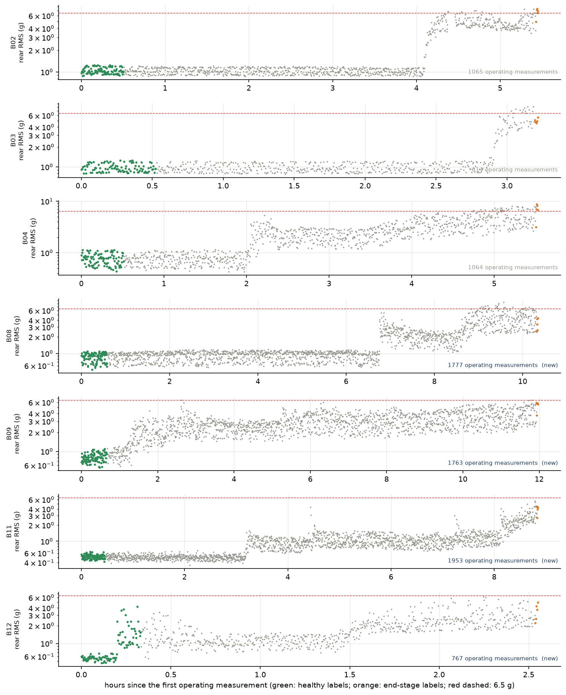

### 3.4 How the training labels were created

The dataset never says when a bearing started to deteriorate. It only says that the bearing began new and was found
damaged when it was taken apart. So the labels are a rule, fixed on 2 Nov before training:

| Bearing | Healthy (label 0) | End-stage (label 1) | Unlabelled |
|---|---|---|---|
| B01 | none | none | all (no labels; left out of training) |
| B02 | first 100 operating rows, M0052–M0151 | last 5, M1112–M1116 | 960 |
| B03 | M0001–M0100 | M0610–M0614 | 509 |
| B04 | M0051–M0150 | M1110–M1114 | 959 |
| B08 | M0051–M0150 | M1823–M1827 | 1,672 |
| B09 | M0051–M0150 | M1809–M1813 | 1,658 |
| B11 | M0001–M0100 | M1949–M1953 | 1,848 |
| B12 | M0001–M0100 | M0763–M0767 | 662 |

That makes 700 healthy, 35 end-stage and 8,268 unlabelled operating rows on the seven bearings (300, 15 and 2,428 on
B02–B04 in Runs 1–2). The rule is unchanged, and the Run 3 label table reproduces the Runs 1–2 table exactly for
B01–B04. Four stated assumptions go with the rule:

1. The last 5 rows are a **provisional end-stage proxy**, not a verified damage state.
2. The bearing defect caused the stop.
3. The end label is **not** the damage onset.
4. The bearing was healthy during its first 100 rows.

A 15-item manual label review with a two-person sign-off was prepared, then removed as a requirement at the team's
request. **The labels have not been reviewed against the dataset documents.**

### 3.5 The locked split

The split was drawn once, on 2 Nov:

- The bearing is the unit, so all of a bearing's measurements are in the same set.
- One test bearing was drawn per operating regime: **B06, B07, B13 and B17**.
- The code (`splits.assert_development`) refuses to load these four until a single model has been frozen.
- The other 13 bearings are for development. Seven of them now have labels (B02–B04, B08, B09, B11, B12). The
  constant-speed regime of B17 is still not covered by any development bearing.

## 4. Neural Network Architecture

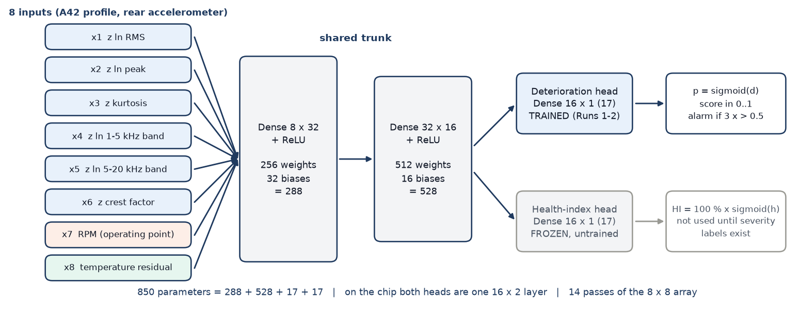

### 4.1 The eight inputs

All eight are computed by the ARM from one 1.6-s measurement. Each vibration feature is first corrected for shaft speed
and then expressed as a z-score against **the same motor's own first 100 operating measurements** (its commissioning
period).

| Input | Signal | Feature | How it is normalised |
|---|---|---|---|
| x1 | rear accelerometer (42.67 kHz) | ln RMS | z = (feature − b0 − b1 · ln rpm) / σ, fitted on the motor's commissioning |
| x2 | rear accelerometer | ln peak | same |
| x3 | rear accelerometer | kurtosis | same |
| x4 | rear accelerometer (full-rate spectrum) | ln energy 1–5 kHz | same |
| x5 | rear accelerometer (full-rate spectrum) | ln energy 5–20 kHz | same |
| x6 | rear accelerometer | crest factor | same |
| x7 | shaft speed | ln rpm | z against the commissioning mean and spread (the operating point) |
| x8 | housing temperature T1 | residual from a per-motor first-order thermal model | (T1 − T_expected) / σ_T; 0 until the thermal calibration is complete |

All inputs are clipped to ±16, which also sets the INT8 input step (16/127). There is no load input and only one
accelerometer, to match what the final hardware can measure.

### 4.2 Layers and the 850 parameters

| Layer | Shape | Weights | Biases | Parameters | Passes of the 8 × 8 array |
|---|---|---|---|---|---|
| Trunk 1 + ReLU | 8 → 32 | 256 | 32 | 288 | 4 |
| Trunk 2 + ReLU | 32 → 16 | 512 | 16 | 528 | 8 |
| Deterioration head | 16 → 1 | 16 | 1 | 17 | 2 (both heads as one 16 × 2 layer) |
| Health-index head | 16 → 1 | 16 | 1 | 17 | (shared) |
| **Total** | | **800** | **50** | **850** | **14** |

### 4.3 The two output heads

- **Deterioration head.** One logit *d*, turned into a score p = sigmoid(d) between 0 and 1. The alarm logic compares p
  with a threshold (0.5). This is the only head trained so far.
- **Motor Health Index head.** One raw value *h*, reported as HI = 100 % × sigmoid(h): a 0–100 % condition indicator.
  It needs **severity labels**, measurements whose true level of wear is known. None exist yet, so this head is kept
  frozen at its random initial weights and the code refuses to report it.

The two heads share the trunk, so on the accelerator they are a single 16 × 2 last layer. The chip returns the two raw
sums, and the ARM adds the biases and applies the sigmoids.

## 5. How Training Works

### 5.1 Preprocessing and normalisation

1. **Warm-up rows removed.** The first 10 minutes run at 750 rpm with no dynamic load.
2. **Speed correction per feature.** On the motor's first 100 operating measurements, fit f = b0 + b1 · ln rpm by least
   squares. Then z = (f − fit) / σ, where σ is the spread of the commissioning residuals.
3. **Temperature model per motor.** A first-order thermal model gives the expected T1 for the current speed. x8 is the
   standardised difference from it, and it is 0 until the model is calibrated.
4. **Clip** every input to ±16.

The idea is the one used in industry: each machine is compared with its own first half hour, not with other machines.

### 5.2 Training and validation: leave one bearing out

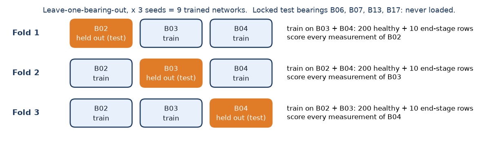

In Runs 1–2 there were only three labelled bearings, so each was held out once: the network trained on the other two
and was scored on **every** measurement of the held-out bearing, with three random seeds (9 networks per run). In Run 3
each of the seven bearings is held out in turn, trained on the other six with five seeds. The training configuration is
chosen by an inner leave-one-out over those six (nested leave-one-bearing-out, section 8). A result therefore always
comes from a bearing the network has never seen.

### 5.3 Loss function, optimiser and class balance

| Setting | Value | Why |
|---|---|---|
| Loss | masked binary cross-entropy on the deterioration logit; the health term is 0 because no row has a health label | rows without a label (NaN) contribute nothing |
| Optimiser | Adam, learning rate 0.001, no weight decay | standard, stable for small networks |
| Steps and batch | 2,000 steps of 64 rows | fixed in advance, not tuned on held-out data |
| Class balance | every batch is half healthy, half end-stage (by sampling) | the training rows are 200 : 10 per fold |
| Temperature dropout | x8 set to 0 in 50 % of training rows | so the network also works on a unit whose temperature model is not calibrated |
| Health head | frozen: no gradient, not in the optimiser, checked bit-identical after training | no severity labels |

The masked loss for a batch is the mean, over the rows that have a label y ∈ {0, 1}, of
−[y · ln p + (1 − y) · ln(1 − p)].

### 5.4 Decision rule and how results are scored

- **Run 1:** the alarm is on while the last three scores are all above 0.5.
- **Run 2:** the same, but **latched**. Once on, the alarm stays on.
- **Each held-out bearing is scored on:**
  - false alarms on its 100 healthy rows;
  - the share of its 5 end-stage rows alarmed;
  - the first alarm (measurement and time);
  - the number of alarm-state changes;
  - descriptively, the alarmed share of the unlabelled middle.
- **Compared on the same bearings with two references:**
  - the **anomaly detector**: per-bearing, label-free. Its score is the root-mean-square of 7 speed-corrected feature
    z-scores, its threshold the 99th percentile of the commissioning scores, and it alarms after 3 scores in a row
    above that.
  - the rig's own stop rule (rear RMS > 6.5 g).

## 6. Training Run 1 Results

Run 1 (3 Nov) was the first time the deterioration head was trained. Training took 5.2 s for all 9 networks.

### 6.1 Training loss

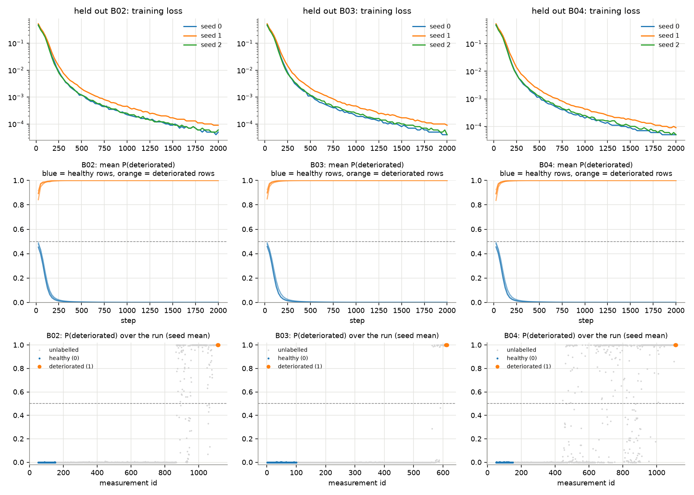

| Held out | Final training loss (seeds 0, 1, 2) | Held-out healthy / end-stage rows on opposite sides of 0.5 from |
|---|---|---|
| B02 | 6.6e-5, 6.6e-5, 4.2e-5 | step 25 (the first checkpoint) |
| B03 | 3.5e-5, 6.1e-5, 4.4e-5 | step 25 |
| B04 | 3.6e-5, 7.3e-5, 8.1e-5 | step 25 |

### 6.2 Accuracy, precision, recall, F1 and confusion matrices

These are computed on the labelled held-out rows: 100 healthy and 5 end-stage rows per bearing, which is 945 rows over
3 bearings × 3 seeds.

| Decision | Accuracy | Precision | Recall | F1 | TN / FP / FN / TP |
|---|---|---|---|---|---|
| Raw score > 0.5 | 1.000 | 1.000 | 1.000 | 1.000 | 900 / 0 / 0 / 45 |
| Run 1 alarm (3 in a row) | 1.000 | 1.000 | 1.000 | 1.000 | 900 / 0 / 0 / 45 |

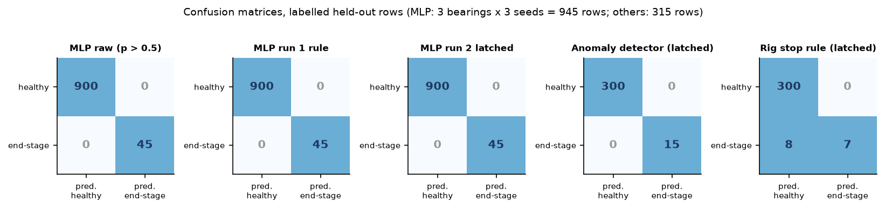

> **Caution:** perfect scores here do not mean the model is perfect. The labelled rows are the two easiest extremes, a
> brand-new bearing and a worn-out one, and there are only 15 end-stage rows from 3 bearings.

### 6.3 Alarm timing (Run 1 rule)

| Held out | First alarm (id), seeds 0, 1, 2 | Minutes before the last record | Anomaly detector | Rig stop rule |
|---|---|---|---|---|
| B02 | 870, 870, 879 | 79.5, 79.5, 76.6 | 864 (81.3 min) | 1109 (2.1 min) |
| B03 | 590, 590, 590 | 7.4 | 549 (20.4 min) | never |
| B04 | 478, 458, 489 | 198.0, 204.4, 194.6 | 442 (209.6 min) | 1113 (0.3 min) |

### 6.4 Weaknesses found in Run 1

1. **Alarm flicker.** After first firing, the alarm switched on and off 8–16 times on B02 and 42–46 times on B04.
2. **Later than the anomaly detector** on every bearing.
3. **Over-confident outputs.** Every probability on a healthy row was below 0.003, and every one on an end-stage row
   was 1.000.
4. **The labels had not been reviewed.**

## 7. Training Run 2 Results

Run 2 kept the network, training, seeds and raw output, and changed only the alarm logic to a **latch**. The 9 networks
were retrained and came out **byte-identical** to Run 1 (SHA-256 of every weight file). Run 1's files were verified
unchanged afterwards.

### 7.1 Latched alarm: the four requested metrics, per bearing

The MLP rows give the range over seeds 0–2. "Healthy FA" is the healthy-reference rows above threshold and alarmed, out
of 100. "Changes" counts every switch on or off over the whole run.

| Bearing | Detector | First alarm (id, time) | Min. before end | Changes | Healthy FA | End-stage recall |
|---|---|---|---|---|---|---|
| B02 | MLP, Run 1 rule | 870–879, 13:17–13:20 | 76.6–79.5 | 9–17 | 0 / 0 | 100 % |
| B02 | **MLP, Run 2 latched** | 870–879, 13:17–13:20 | 76.6–79.5 | **1** | 0 / 0 | 100 % |
| B02 | Anomaly detector (prototype) | 864, 13:15:16 | 81.3 | 1 | 1 / 0 (in-sample) | 100 % |
| B03 | MLP, Run 1 rule | 590, 18:16:15 | 7.4 | 1–3 | 0 / 0 | 100 % |
| B03 | **MLP, Run 2 latched** | 590, 18:16:15 | 7.4 | **1** | 0 / 0 | 100 % |
| B03 | Anomaly detector (prototype) | 549, 18:03:16 | 20.4 | 1 | 1 / 0 (in-sample) | 100 % |
| B04 | MLP, Run 1 rule | 458–489, 15:02–15:12 | 194.6–204.4 | 43–47 | 0 / 0 | 100 % |
| B04 | **MLP, Run 2 latched** | 458–489, 15:02–15:12 | 194.6–204.4 | **1** | 0 / 0 | 100 % |
| B04 | Anomaly detector (prototype) | 442, 14:57:25 | 209.6 | 1 | 1 / 0 (in-sample) | 100 % |

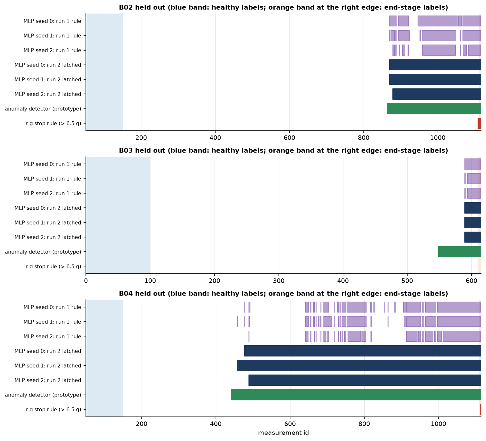

### 7.2 Why the scores are so close to 0 or 1

- **87.1 % of all held-out outputs** are below 0.001 or above 0.999. Only 5.0 % of the unlabelled rows lie between
  0.05 and 0.95.
- **The cause is the labels, not a bug.** Healthy labels are each motor's commissioning period, so their z-inputs sit
  near 0 (within about ±4.5). Every end-stage row is at the +16 clip on four vibration inputs. Five of the eight inputs
  separate the two classes on their own.
- **Training makes it worse.** On data this separable, cross-entropy keeps falling as the weights grow, so nothing
  stops the logits from growing. The mean |logit| on unlabelled rows rises from 0.9 (step 25) to 10.4 (step 2,000),
  and the unlatched alarm's flicker rises with it, from about 1 to about 20 state changes.
- **Balanced batches** (50 % end-stage, against 4.8 % in the labelled training rows) shift the logits by about +3.0.
  The score is therefore not a frequency.
- **Is it calibrated?** On the labelled rows the calibration error is tiny (ECE 0.00013), but only 2 of 10 probability
  bins contain any rows. Calibration in between **cannot be checked**, because the unlabelled middle has no ground truth.

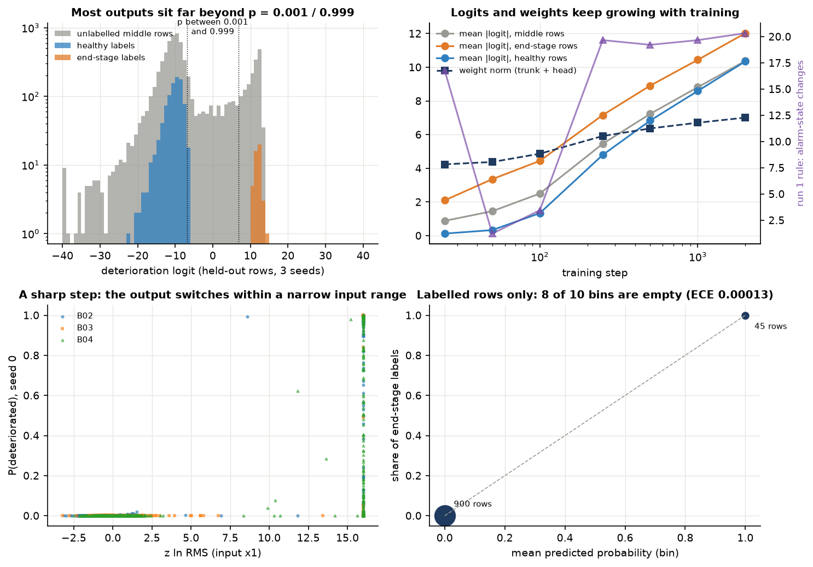

### 7.3 A temperature-input shortcut, tested

The temperature residual x8 is 0 by construction until a bearing's thermal model is calibrated. That window covers
every healthy label, while x8 is non-zero on every end-stage label, so x8 separates the classes for a reason that is not
physical. Re-scoring every trained network with x8 = 0 everywhere:

- the labelled rows stayed perfectly separated on all bearings and seeds;
- the latched first alarm moved by at most 20 measurements (about 6 min) on B02 and B04, and not at all on B03.

The vibration inputs carry the decision. The input should still be redesigned (section 12).

### 7.4 Diagnostic retrainings (not used to choose a model)

| Variant | State changes, Run 1 rule (B02 / B03 / B04) | Latched first alarm, min before end | Highest score on a healthy row |
|---|---|---|---|
| Run 1 settings | 9–17 / 1–3 / 43–47 | 76.6–79.5 / 7.4 / 194.6–204.4 | 0.0021 |
| Weight decay 0.001 | 1 / 1 / 15–31 | 80.1–80.3 / 17.5–17.8 / 208.6 | 0.005 |
| **Weight decay 0.01** | **1 / 1 / 1** | **80.7 / 17.8 / 208.6–208.9** | 0.035 |
| Weight decay 0.1 | 1 / 1 / 1 | 80.7 / 19.1–19.5 / 209.2 | 0.303 |
| Label smoothing 0.05 | 1–5 / 1 / 1–53 | 79.5 / 16.2–17.8 / 208.3–208.6 | 0.087 |

With weight decay 0.01, the flicker disappears even without the latch. The first alarms move to within 0.7–2.6 min of
the anomaly detector, while healthy rows stay far below the threshold.

> **Caution:** weight decay 0.01 was found by looking at the held-out bearings, so these numbers are optimistic. It is
> a candidate for a pre-declared Run 3, to be judged on bearings that played no part in choosing it.

### 7.5 INT8 and RTL check of the trained networks

| Check | Result |
|---|---|
| INT8 vs FP32, all 9 networks (golden model, 22-bit accumulator) | 0–5 decisions changed per network out of 614–1,065 rows; **none on a labelled row** |
| Latched first alarm in INT8 | identical to FP32 for all 9 networks |
| Logit error | mean 0.12–0.18, max 1.60 |
| RTL simulation of a trained network (B03 held out, seed 0; Icarus Verilog, `tb_mlp.sv`) | **PASS**, bit-exact; 1,642 cycles per 64 measurements, 382 cycles (1.78 µs at 214.286 MHz) per measurement |

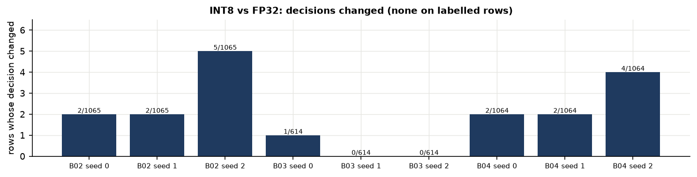

## 8. Training Run 3 Results (expanded dataset)

Run 3 added four development bearings (**B08, B09, B11, B12**: 6,360 files, CRC-verified, all four logs transcribed) to
B02–B04. That gives **7 labelled bearings**, 9,003 operating measurements, 700 healthy-reference and 35 provisional
end-stage labels. Full details are in `Machine_Guardian_Training_Run3_Report.pdf`.

### 8.1 What was run

- **Five candidates**, all with the unchanged 8 → 32 → 16 → 2 network:
  - A: Run 1–2 settings;
  - B: weight decay 0.01 (the pre-declared primary);
  - C: B with log-compressed inputs instead of the ±16 clip;
  - D: B without the temperature input;
  - E: C and D together.
- **Nested leave-one-bearing-out:** each bearing held out in turn, the candidate chosen on the other six by inner
  leave-one-out, 5 seeds; 1,225 trainings in all.
- **The selection rule** was fixed before training: healthy alarms, end-stage recall, stability, then log-loss.
- **Exploratory and unbiased folds.** Weight decay, the log inputs and the no-temperature option were all designed from
  Run 2's held-out results on B02–B04, so those three folds are exploratory. **B08, B09, B11 and B12 give the unbiased
  estimate.**
- **Health head and test set:** the Motor Health Index head stayed frozen, and B06, B07, B13 and B17 were never
  loaded.

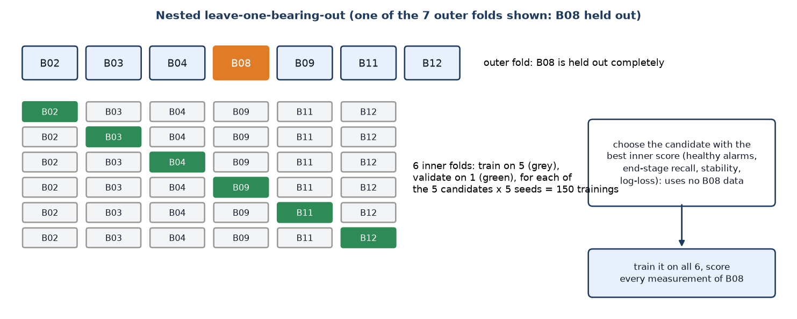

### 8.2 Results

- **Selected configuration: E** (weight decay 0.01, log-compressed inputs, temperature fed as 0). Its margin over C
  (the same with temperature) is 2 alarm transitions in 35 runs, so C and E are indistinguishable. Both were exported.
- **Healthy-reference false alarms:** 0. **End stage latched before the stop:** 6 of 7 bearings. **B12 is missed** by
  every candidate.
- **Stability:** the raw score's unlatched alarm-state changes fall from 30.3 (A) to 2.8 (E) per run on average.
- **Over-confidence:** scores below 0.001 or above 0.999 fall from 88.9 % (A) to 0.8 % (E).

| Bearings | E (selected) | C | B (primary) | A (Run 1–2 settings) | Nested selection | Anomaly detector | Trivial rule: latch right after commissioning |
|---|---|---|---|---|---|---|---|
| all 7 | 6/7 (0.42–1.00) | 6/7 (0.42–1.00) | 6/7 (0.42–1.00) | 6/7 (0.42–1.00) | 6/7 (0.42–1.00) | 7/7 (0.59–1.00) | 7/7 (0.59–1.00) |
| exploratory (B02–B04) | 3/3 (0.29–1.00) | 3/3 (0.29–1.00) | 3/3 (0.29–1.00) | 3/3 (0.29–1.00) | 3/3 (0.29–1.00) | 3/3 (0.29–1.00) | 3/3 (0.29–1.00) |
| unbiased new (B08, B09, B11, B12) | 3/4 (0.19–0.99) | 3/4 (0.19–0.99) | 3/4 (0.19–0.99) | 3/4 (0.19–0.99) | 3/4 (0.19–0.99) | 4/4 (0.40–1.00) | 4/4 (0.40–1.00) |
| all except B12 (descriptive) | 6/6 (0.54–1.00) | 6/6 (0.54–1.00) | 6/6 (0.54–1.00) | 6/6 (0.54–1.00) | 6/6 (0.54–1.00) | 6/6 (0.54–1.00) | 6/6 (0.54–1.00) |

Row-level metrics of the latched alarm on the labelled held-out rows are the same for every candidate: accuracy 0.9932,
precision 1.0000, recall 0.8571, F1 0.9231. (The raw score > 0.5 differs: for E 0.9924 / 0.9804 / 0.8571 / 0.9146,
with 3 raw scores above 0.5 on one B11 healthy row that never latched.) A trivial rule that latches an alarm right
after commissioning scores 1.0 on all of them, so these numbers say little.

### 8.3 Alarm timing against the anomaly detector

| Bearing | Anomaly detector first alarm (id) | Detector, min before last record | E: lag (measurements; + = later) | C: lag | B: lag |
|---|---|---|---|---|---|
| B02 | 865 | 81.0 | +2, +3 | +1 | +0, +2 |
| B03 | 549 | 20.4 | +12 | +12 | +9, +12 |
| B04 | 442 | 209.6 | +3 | +2, +3 | +2 |
| B08 | 614 | 424.5 | +602 | +602 | +601, +602 |
| B09 | 211 | 651.7 | +15, +19 | -4 | -9 |
| B11 | 706 | 339.7 | +6, +7 | +1, +3, +5 | -116, -7 |
| B12 | 563 | 40.8 | never | never | never |

The selected network **never warns earlier than the anomaly detector** (A, F42, speed):
- **B02, B03, B04, B11:** 2–12 measurements after it, essentially the same event.
- **B08:** 602 measurements (about 3.5 h) later.
- **B09:** 15–19 measurements later.
- **B12:** no alarm at all.

C's 4-measurement lead on B09 and B's leads on B09 and B11 come from the temperature input (on B11 before its T1 sensor
fault): with x8 = 0 they disappear.

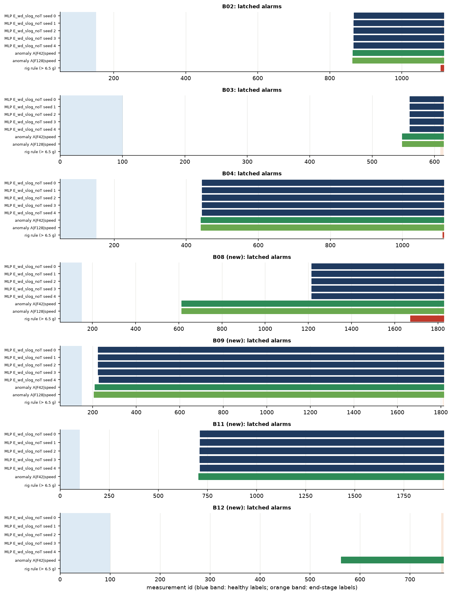

### 8.4 Why B12 is missed

B12's end-stage rows reach a largest vibration z-input of only 2.5–3.2, inside its own healthy range. On every other
bearing they reach 18–51. Two causes were found in the data review:
1. B12's stop was probably triggered by the **front** accelerometer, which the model does not use (8.5 g against 4.9 g
   on the rear).
2. An undocumented vibration step at **M0061**, inside the commissioning window, inflates its reference spread.

The network learned from extreme end-stage labels that only extreme deviation means damage. The anomaly detector, whose
threshold comes from the healthy reference, still alarms 40.8 min before the end.

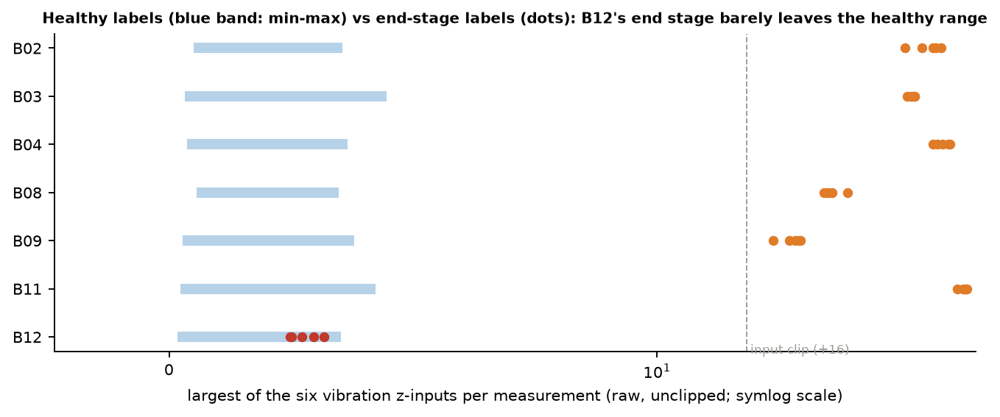

### 8.5 Input clipping and the temperature input

- **The ±16 clip hides gradual deterioration.** On B04 the raw ln-RMS keeps rising from 16 to about 39 while the network
  sees 16 (Spearman 0.83 among the clipped rows).
- **Log compression keeps that information,** and gave the largest stability gain (mean flicker 15.5 → 2.9).
- **The temperature study is inconclusive:**
  - x8 is 0 on every healthy label by construction;
  - B08's x8 is masked;
  - B11's T1 sensor fails, so its end-stage x8 is −60 σ;
  - removing x8 leaves healthy alarms and recall unchanged and makes no consistent difference to stability (D 20.7
    against B 15.5 changes; E 2.8 against C 2.9), but with x8 = 0 B's B11 alarms move 15–124 measurements later and
    C's B09 alarm 23 later.

### 8.6 Hardware

- **A real export bug, found and fixed.** Weight decay pushes dead neurons' weights to about 1e-35, which made their
  INT32 biases overflow in 31 of 175 models. It changed no INT8 decision (dead neurons output 0 either way), but the
  biases would not fit the hardware's 32-bit register. Fixed on the export path by zeroing negligible weights: the
  FP32 output changes by exactly 0.
- **INT8:** E changes 13 of 45,015 decisions (0.03 %).
- **RTL:** 16 trained networks, plus all 735 labelled rows of the final E and C models, pass bit-exact. 382 cycles =
  1.78 µs per measurement. Simulation only.

## 9. Run 1 vs. Run 2 Comparison (Run 3: section 8)

### 9.1 What improved, what got worse

| Metric (per bearing) | Run 1 | Run 2 | Change |
|---|---|---|---|
| Alarm-state changes, B02 | 9–17 | 1 | **improved** |
| Alarm-state changes, B03 | 1–3 | 1 | improved |
| Alarm-state changes, B04 | 43–47 | 1 | **improved** |
| First alarm (all bearings) | as in 6.3 | identical | unchanged |
| Healthy-reference false alarms | 0 of 300 rows | 0 of 300 rows | unchanged |
| End-stage recall | 100 % | 100 % | unchanged |
| Unlabelled rows alarmed, B04 | 27–32 % | 65–68 % | **higher**: one false streak would now stay on until reset |
| Raw score | as Run 1 | identical | unchanged by design |
| Trained model in INT8 / RTL | not checked | 0 labelled decisions changed; RTL PASS | **new evidence** |
| Calibration understanding | none | cause identified; not calibratable with current labels | **new evidence** |

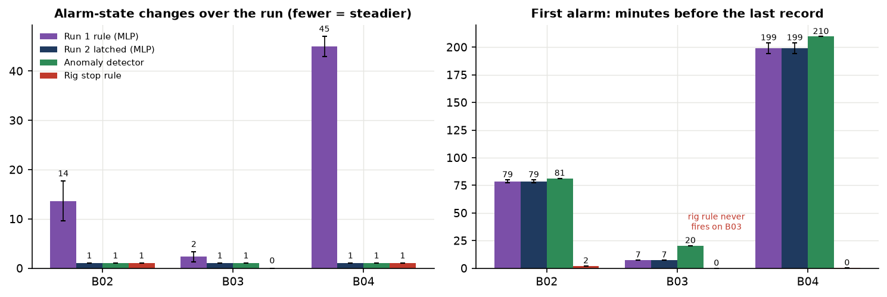

### 9.2 Does the MLP outperform the anomaly detector?

**Not yet.**

| Bearing | MLP (Run 2 latched), minutes before end | Anomaly detector | Detector earlier by |
|---|---|---|---|
| B02 | 76.6–79.5 | 81.3 | 1.9–4.7 min |
| B03 | 7.4 | 20.4 | 13.0 min |
| B04 | 194.6–204.4 | 209.6 | 5.2–15.0 min |

- **Labelled rows:** both detectors are perfect.
- **Steadiness:** with the latch, both are equally steady (1 state change).
- **First alarm:** the anomaly detector is earlier on every bearing. It also needs no labels.
- **Outlook:** the weight-decay diagnostic suggested the MLP could match the detector's timing. Run 3 tested this on
  seven bearings, four of them new: it comes close on five (B02–B04, B09, B11) but is never earlier, is 602
  measurements later on B08, and misses B12 (section 8).

## 10. FPGA Compatibility

### 10.1 The INT8 implementation

The trained network is converted with the project's export scheme (`export.py`, used by `mtl_model.int8_model`):

- **Inputs:** quantized with one scale. For the clipped models (Runs 1–2; Run 3's A, B and D) the step is 16/127, so
  ±16 maps to ±127. The exported Run 3 models E and C are not clipped: the ARM first log-compresses each input,
  x = sign(z) · ln(1 + min(|z|, 10⁴)), and the step is ln(10001)/127 ≈ 0.0725.
- **Weights:** a scale per output channel, max |W| / 127, then rounded to INT8.
- **Biases:** INT32.
- **Between layers:** a hidden layer's 22-bit sums are requantized to INT8 with a fixed-point multiplier and shift
  (m0, shift) per channel, chosen from the largest activation on the calibration rows. Rounding matches the hardware's
  `postproc.sv`.
- **Last layer:** the chip returns its raw sums; the ARM adds the bias and applies the sigmoid.
- **Bit-exact reference:** a Python golden model (`mac.golden_mlp`) reproduces the hardware bit for bit.

### 10.2 The 8 × 8 systolic array

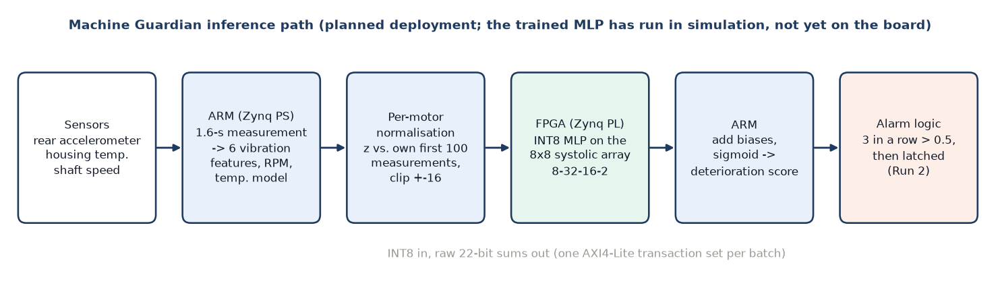

- **The array:** 64 processing elements, one DSP48E1 multiplier each, multiplying INT8 values into exact 22-bit
  accumulators. Matrices are up to 64 wide.
- **The interface:** the Zynq ARM drives it over AXI4-Lite.
- **The on-chip MLP engine:** runs a whole network of up to 4 layers with one control write. The weights are held in
  four 64 × 64 slots, and 8 post-processing units requantize each layer's output back into the input buffer.

| Build | Clock | Resources | Board result |
|---|---|---|---|
| Design 1: matrix multiplier | 250 MHz (timing met, WNS +0.008 ns) | LUT 1,170, FF 2,997, BRAM 4.5, DSP 64, 1.94 W | 24/24 tests passed (19 Oct); 64 × 64 × 64 in 293 µs, 7.6 × faster than the ARM |
| Design 2: on-chip MLP | 214.286 MHz (WNS +0.081 ns; 250 MHz missed by 0.029 ns) | LUT 4,402, FF 7,048, BRAM 7.5, DSP 80, 2.118 W | 30/30 tests with test models (24 Oct, recorded on branch `Alex_edit`); a 64-64-64-6 model on 64 rows in 113 µs, 47.9 × faster than the ARM |

### 10.3 Hardware simulation results for the models

| Model | Check | Result |
|---|---|---|
| Ottawa E3 (22 → 32 → 16 → 1) | RTL vs golden model, every window | PASS, every logit bit-exact; 566 cycles per window |
| Ottawa a1 (8 → 32 → 16 → 1) | RTL (Vivado xsim) | PASS; 382 cycles (1.78 µs) per window |
| Multi-task MLP, random weights | RTL (Vivado xsim), 896 + 10 rows | PASS, both output columns bit-exact; 382 cycles |
| **Multi-task MLP, trained (Run 2)** | RTL (Icarus Verilog), 576 + 10 measurements | **PASS**, bit-exact; 1,642 cycles per 64, 382 cycles per measurement |
| **Multi-task MLP, trained (Run 3)** | RTL (Icarus Verilog): 16 networks (final E and C, 14 held-out models), plus all 735 labelled rows of the final E and C | **PASS**, bit-exact; 1,642 / 382 cycles; exported to `export/MTL_run3_v2/` (E) and `export/MTL_run3_v2_C/` (C) |

One inference takes 1.78 µs, while Paderborn measurements arrive every 18–19 s, so compute time is not a constraint.
The ARM's feature extraction will dominate.

### 10.4 What remains before physical FPGA deployment

1. **Freeze one model.** A model with its threshold has to be frozen, then evaluated once on the locked bearings.
2. **Re-export INT8 from the frozen model** and rerun `rtl_check` on it. Run 3's export already does this for the
   candidates, with the dead-neuron fix; `export.py` itself should adopt the fix and an INT32 bias check.
3. **Port to the ARM:**
   - the feature extraction (RMS, peak, kurtosis, band energies, crest);
   - the per-motor commissioning fit;
   - the temperature model;
   - the latched alarm, with a reset.
4. **Check on the board** against the test vectors, and measure the end-to-end time including the AXI transfers.
5. **Connect the real sensors** (one accelerometer, a temperature probe, speed), and record a commissioning run on our
   own motor.
6. **Run the trained network on the ZedBoard.** So far only test models have run on the board.

## 11. Current Limitations

- **Small training set.** Seven labelled bearings (Run 3), 700 healthy and **35 end-stage** rows, from three of the four
  operating regimes. The bearing is the independent unit: 6 of 7 latched has a 95 % interval of 0.42–1.00. The
  constant-speed regime of locked test bearing B17 is not covered.
- **The learned boundary is extreme.** Every end-stage label is a worn-out state, so the network waits for large
  deviations; it misses B12 and is never earlier than the anomaly detector.
- **Provisional labels.** The end-stage labels stand for "found damaged after the test". They are not a verified state
  at those measurements, and they were not reviewed. For five of the seven labelled bearings (B02, B04, B09, B11, B12)
  the test was ended by the rig's vibration limit.
- **Unknown deterioration onset.** The middle of every run is unlabelled. So first-alarm times are not detection
  delays, and no detection rate can be stated.
- **Alarm instability.** The raw score flickers once training makes it over-confident. The latch hides this but does not
  remove it, and a false streak would keep the alarm on until it is reset.
- **Uncalibrated score.** The output is not a probability of failure and cannot be calibrated with the current labels.
- **Temperature-input shortcut.** "Not calibrated" and "exactly as expected" are both 0.
- **Easy healthy labels.** The healthy labels are the commissioning period the inputs are normalised on, so false alarms
  during later healthy operation are unmeasured.
- **Why the Motor Health Index is not trained.** A 0–100 % health output needs measurements whose true wear level is
  known: inspected at intervals, or with defects of known size. The run-to-failure data only document the start (new)
  and the end (damaged), with no measured levels between. Training the head on invented intermediate values would
  produce numbers that look meaningful but are not. It stays frozen until reliable severity labels exist.

## 12. Future Improvements

### 12.1 Reliability and generalisation

1. **Done in Run 3:** B08, B09, B11 and B12 were processed, and a nested leave-one-out over the 7 bearings was run.
   **Next bearings:** B10, then B14 and B15 (the constant-speed regime of B17). B05 (interrupted) and B16 (no stop
   criterion) were both found damaged at dismantling, so only their commissioning rows could serve as reference data.
2. **Run 4 should combine the two detectors** rather than ask the network to find early damage alone. For example, use
   the anomaly detector's per-bearing threshold as a gate or input, or score the MLP relative to its own commissioning.
   Choose the threshold on inner folds. Add a vibration commissioning-validity check (it would have flagged B12), and
   settle which accelerometer triggered the stops.
3. **Fix the temperature input**, so "not calibrated" is a separate flag rather than the value 0, with a T1/T2
   consistency check (B11's T1 failure); or keep it disabled, as in candidate E.
4. **Measure false alarms on long healthy operation:** for example the middle of B02 before its first change, and B05
   and B16 as healthy-reference data.
5. **Report the output as a "deterioration score"** everywhere until labelled intermediate states exist.

### 12.2 Training the health-index output

- **Severity labels:** use bearings with a known defect size (for example an external dataset with seeded damage), or
  inspections at intervals, to build labels.
- **Training the head:** train it only after the deterioration head is final, and keep the shared trunk frozen or nearly
  so, so the alarm does not change.
- **Validating it:** on held-out bearings, against the severity labels.

### 12.3 Preparing for FPGA deployment

- **Freeze, export, check:** freeze one model, export INT8, and run `rtl_check` on it.
- **Port the ARM side:** the feature extraction and the latched alarm with reset.
- **Test on the board:** run the end-to-end inference test on the ZedBoard against recorded vectors, then with live
  sensors.
- **Final test:** evaluate once on B06, B07, B13 and B17, and report it whatever the result.

## 13. Conclusion

**Accomplishments.**

- **Hardware:** a working INT8 accelerator: a board-tested 8 × 8 systolic array at 250 MHz, and an on-chip MLP engine
  at 214.286 MHz.
- **First model:** an Ottawa motor classifier that shaped the hardware-sized network (8 → 32 → 16 → 1).
- **Data pipeline:** a careful pipeline for the Paderborn run-to-failure data, with checks, a locked test set and
  stated labelling assumptions.
- **Network:** an 850-parameter, two-head network that fits the accelerator unchanged.

**Results.**

- **Runs 1–2 on unseen bearings (B02–B04):** the trained deterioration head separates documented-healthy from end-stage
  measurements perfectly, with zero false alarms on 300 healthy-reference rows and 100 % end-stage recall. Run 3's
  seven bearings break this: the end stage is latched on 6 of 7, because every candidate misses B12.
- **Run 2's latched alarm:** removes the flicker (from up to 47 state changes to 1) without moving the first alarm.
- **Run 3 on seven bearings:**
  - log-compressed inputs and weight decay make the raw score steady (mean flicker 30.3 → 2.8) and far less
    over-confident;
  - the end stage is latched before the stop on 6 of 7 bearings, with no healthy-reference false alarms;
  - first alarms 2–12 measurements after the anomaly detector's on four bearings.
- **Hardware fit:** on held-out bearings, Run 3's model E changes 13 of 45,015 decisions in INT8 (3 on labelled rows,
  no latched alarm state changed; Run 2 changed none on labelled rows). The trained networks run bit-exact on the RTL
  in 1.78 µs.
- **The cost of over-confidence:** the investigation showed why the scores are so extreme, and that they cannot yet be
  read as probabilities.

**Remaining work.**

- **Beat the baseline:** the network does **not** yet beat the label-free anomaly detector. On seven bearings it is
  never earlier, and it misses B12, whose end stage barely departs from its commissioning on the rear sensor.
- **More data and better labels:** the constant-speed regime, a commissioning-validity check, and labels or methods that
  teach intermediate stages.
- **Health index:** train it only when severity labels exist.
- **Board:** run the frozen model on the board.

The honest status is a working, hardware-ready pipeline whose learned model still has to prove its advantage on more
data.

## 14. Sources in the repository

| Topic | Files |
|---|---|
| Project decisions, hardware builds and board tests | `docs/log.md` (sections 1–3; board results 19 and 24 Oct; the 24 Oct on-chip MLP board run is on branch `Alex_edit`) |
| Ottawa models | `model/README.md`, `model/results/E0`–`E3/report.md`, `model/SINGLE_ACCEL_MODEL_REPORT.md`, `model/SINGLE_ACCEL_HARDWARE_REPORT.md`, `model/export/E3*/report.md` |
| Paderborn data, B01, anomaly detector | `model/paderborn.py`, `model/paderborn_experiments.json`, `model/results/B01/B01_analysis_report.md`, `model/results/paderborn/PADERBORN_BASELINE_REPORT.md` |
| Architecture and inputs | `model/mtl_model.py`, `model/mtl_inputs.py`, `model/results/multitask/MULTITASK_ARCHITECTURE_REPORT.md` |
| Validation, split, labels | `model/results/phase2/DATASET_VALIDATION_REPORT.md`, `model/splits.py`, `model/labels.py`, `model/results/supervised/LABEL_REVIEW_REPORT.md` |
| Run 1 | `model/train_deterioration.py`, `model/results/supervised/run1/` (`TRAINING_RUN1_REPORT.md`, `results.json`) |
| Run 2 | `model/train_deterioration_run2.py`, `model/results/supervised/run2/` (`TRAINING_RUN2_REPORT.md`, `results.json`, `checkpoints.csv`, `variants.csv`) |
| New bearings and Run 3 | `model/extract_paderborn_zips.py`, `model/run3_prep.py`, `model/train_deterioration_run3.py`, `model/run3_hardware.py`, `model/run3_final_c.py`, `model/run3_supplement.py`, `model/run3_b12_diagnostic.py`, `model/results/supervised/run3/`, `docs/Model/10_Training_run3.pdf` |
