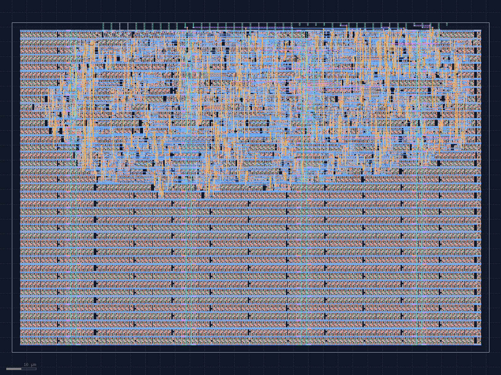
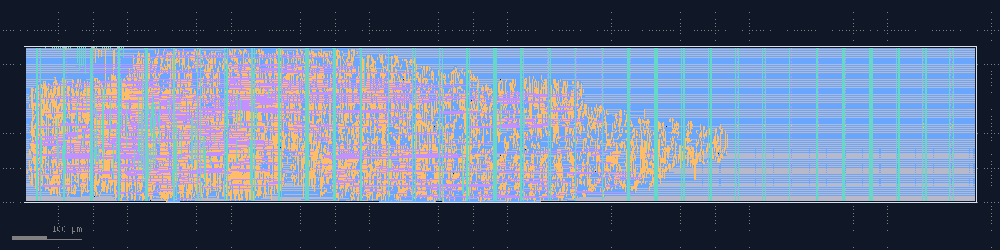

# MAC Attack — corrected Tiny Tapeout layout review

Updated November 16, 2026 for the November 17 review. **These layouts use Alex’s actual `tinytpu/chip/` and `tinytpu/chip_v2/` RTL**, byte-for-byte, from commit `84f407a761a48e0be67ace0a56991b94e2e0295b`. The previously shared November 14 derived implementations were different circuits; their results are superseded. [Source correction and repair history](CORRECTION.md).

## Interactive 3D layouts

- [Version 1 — correct chip/ RTL, one tile, 50 MHz](https://gds-viewer.tinytapeout.com/?pdk=sky130A&model=https%3A%2F%2Fraw.githubusercontent.com%2FTitaniumthunder%2FMAC-Attack%2Frefs%2Fheads%2Ftinytapeout-review-20261115%2Fdocs%2Ftinytapeout-review%2Fchip%2Ftt_um_titaniumthunder_tiny_tpu.oas)
- [Version 2 — correct chip_v2/ RTL, sixteen tiles, 25 MHz target](https://gds-viewer.tinytapeout.com/?pdk=sky130A&model=https%3A%2F%2Fraw.githubusercontent.com%2FTitaniumthunder%2FMAC-Attack%2Frefs%2Fheads%2Ftinytapeout-review-20261115%2Fdocs%2Ftinytapeout-review%2Fchip_v2%2Ftt_um_titaniumthunder_tiny_tpu_v2.oas)

These public links use the official Tiny Tapeout 3D viewer with files hosted on this branch. They do not require a local server or the author’s account. Rotate by dragging; scroll to zoom. A rendered layout is not proof of electrical signoff: use the results below.

## Results

| Check | Version 1 — chip/ | Version 2 — chip_v2/ |
|---|---|---|
| Architecture | One signed INT4 PE; 16-bit accumulator; host post-processing | Two signed INT8 PEs; 22-bit accumulators; on-chip bias/rescale/ReLU; ping-pong buffers |
| Model tested | Professor’s 8→4→2 INT4 | 13→32→16→4 INT8 plus professor’s INT4 bypass |
| Tiles | **1×1 = 1** | **8×2 = 16** |
| Area / I/O allocation | Fits | Fits the allocated 16-tile outline |
| Target clock | **50 MHz** | **25 MHz** (original 50 MHz attempt failed) |
| RTL simulation | **2/2 passed** | **5/5 passed** |
| Routed functional gate simulation | **2/2 passed** | **5/5 passed** |
| Official Tiny Tapeout precheck | **15/15 passed** | **15/15 passed** |
| Synthesis cells | 395 | 7,916 |
| Synthesis cell area (µm²) | 3,852.44 | 86,724.43 |
| Final non-fill cells | 700 | 15,530 |
| Final non-fill cell area (µm²) | 4,779.58 | 114,836.00 |
| Worst setup slack (ns) | +5.055 | +9.885 |
| Worst hold slack (ns) | +0.109 | +0.097 |
| Slew / capacitance / fanout violations | 0 / 0 / 0 | 32 / 0 / 2 |
| Routing DRC / Magic DRC / LVS / antenna | 0 / 0 / 0 / 0 | 0 / 0 / 0 / 0 |
| GDS generation | Completed | Completed |
| Overall local result | **All completed local checks passed** | **Electrical checks failed; diagnostic layout only** |

The internal STA clock estimates are 100.13 MHz for V1 and 33.21 MHz for V2. They are not validated board frequencies or permission to exceed the target clocks. Electrical violations, if present above, invalidate signoff even when timing slack is positive.

V2 still fails electrical signoff: worst transition **0.886521 ns exceeds 0.750 ns**, and two data nets drive 11 loads against a limit of 10. See [the remaining violations](chip_v2/remaining-electrical.txt). Targeted buffer/driver repair is required; reducing the model is not yet justified by this result.

Both use the standard Tiny Tapeout interface: 8 inputs, 8 outputs, 8 configurable bidirectional pins, clock, reset, and enable. V1 uses four uio inputs and two outputs; V2 uses all eight uio pins as inputs. Non-fill counts include physical cells and repair buffers. Gate tests use routed netlists with functional unit-delay cell models; extracted multi-corner STA assesses physical timing separately.

V1 verification includes all 256 signed INT4 products, golden inference sums, -8 operands, sticky overflow, CLEAR/NOP, and slow-host handshakes. V2 verification includes all 64 exported INT8 samples (3,072 intermediate outputs and 256 final sums), INT4 bypass, 60 randomized post-processing layers, buffer readback, overflow and command edge cases. Tests compare against their respective Python integer references; this does not establish model accuracy on new field data.

The historical derived layouts are preserved in the [superseded archive](archive/derived-20261114/README.md). Older public viewer URLs now load the corrected layouts through compatibility copies; the filenames are historical, but the top-cell names identify the real team RTL.

## Download and reproduce

| Files | Version 1 | Version 2 |
|---|---|---|
| GDS for KLayout | [GDS](chip/tt_um_titaniumthunder_tiny_tpu.gds) | [GDS](chip_v2/tt_um_titaniumthunder_tiny_tpu_v2.gds) |
| OASIS for the browser | [OASIS](chip/tt_um_titaniumthunder_tiny_tpu.oas) | [OASIS](chip_v2/tt_um_titaniumthunder_tiny_tpu_v2.oas) |
| Layer colors | [layout.lyp](chip/layout.lyp) | [layout.lyp](chip_v2/layout.lyp) |
| Exact RTL and physical config | [src](chip/src) | [src](chip_v2/src) |
| Tests and golden vectors | [test](chip/test) | [test](chip_v2/test) |
| Physical metrics | [physical.json](chip/physical.json) | [physical.json](chip_v2/physical.json) |
| Precheck | [results](chip/precheck.md) | [results](chip_v2/precheck.md) |
| Gate-test evidence | [log](chip/gate-tests.log) | [log](chip_v2/gate-tests.log) |

Select **Download raw file** for binary files on GitHub. [SHA256 manifest](SHA256.json) and [source RTL hashes](exact-rtl-verification.json) identify the artifacts. The original RTL remains unchanged in the main branch; only review files are added here. Physical configuration changes and the missing V2 test Makefile are isolated in the review copies.

**Recommendation: V1 for the first tapeout submission review**, because it uses one tile and passes the completed checks at 50 MHz. V2 uses sixteen tiles and a lower clock. No tapeout order or submission has been made; these local results still need the shuttle’s submission validation and team review.

The local flow uses [Tiny Tapeout’s SKY130 template](https://github.com/TinyTapeout/ttsky-verilog-template), LibreLane 3.0.14, and SKY130A PDK `8afc8346a57fe1ab7934ba5a6056ea8b43078e71`. [LibreLane repair/clock configuration documentation](https://librelane.readthedocs.io/en/stable/reference/step_config_vars.html). Browser links follow the [official Tiny Tapeout viewer workflow](https://github.com/TinyTapeout/tt-gds-action/blob/ttsky26d/viewer/action.yml).
