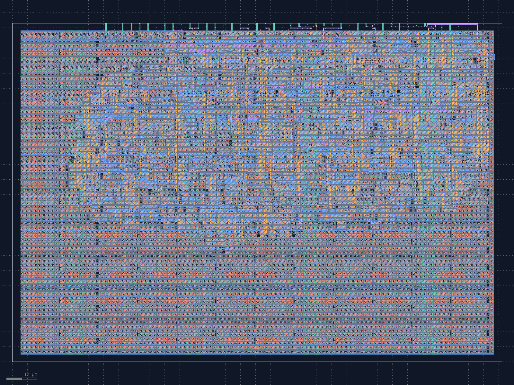
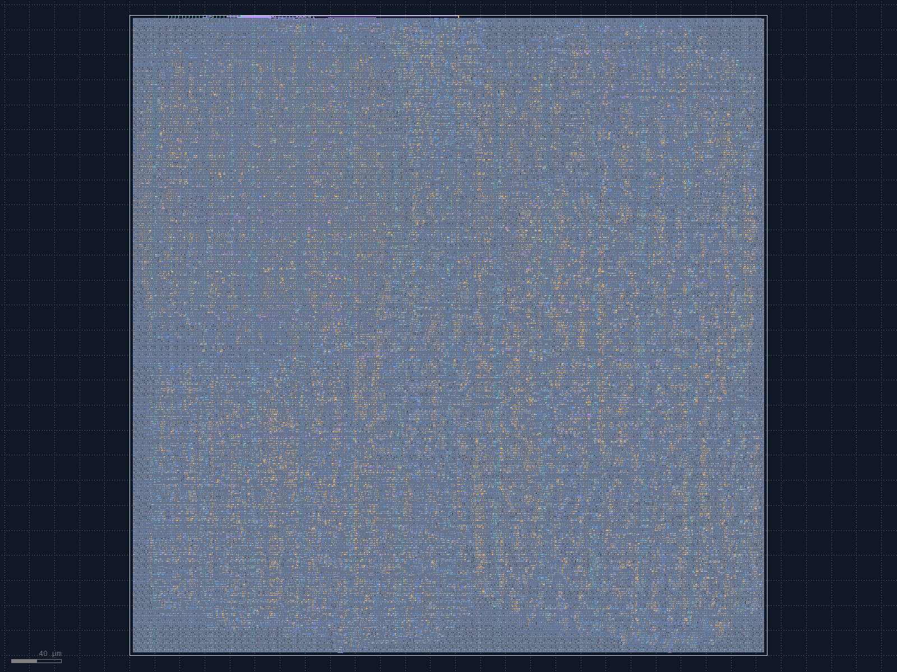

# Superseded derived implementations — archive only

**These are not the team-authored chip/ and chip_v2/ circuits. Use the [corrected review](../../README.md).**

# MAC Attack — Tiny Tapeout layout review

These are the saved November 14, 2026 SKY130A implementation results for the November 17 team review. Shared on November 15. **Version 1 passes the completed local checks. Version 2 is a diagnostic layout and is not tapeout-ready.** No synthesis or physical implementation was rerun to publish these files.

## Open the interactive 3D layouts

- **[Version 1 — one tile, local checks passed](https://gds-viewer.tinytapeout.com/?pdk=sky130A&model=https%3A%2F%2Fraw.githubusercontent.com%2FTitaniumthunder%2FMAC-Attack%2F84f407a761a48e0be67ace0a56991b94e2e0295b%2Fdocs%2Ftinytapeout-review%2Fversion1%2Ftt_um_mac_attack_v1.oas)**
- **[Version 2 — twelve-tile diagnostic layout, electrical signoff failed](https://gds-viewer.tinytapeout.com/?pdk=sky130A&model=https%3A%2F%2Fraw.githubusercontent.com%2FTitaniumthunder%2FMAC-Attack%2F84f407a761a48e0be67ace0a56991b94e2e0295b%2Fdocs%2Ftinytapeout-review%2Fversion2%2Ftt_um_mac_attack_v2.oas)**

These links use the official Tiny Tapeout viewer and the layout files in this GitHub branch. They work without the original author's computer or local server. Drag to rotate, scroll to zoom, and use the layer controls to inspect routing. If a browser cannot run the 3D viewer, use the preview images below or download the GDS for KLayout.

## Results

| Check | Version 1 | Version 2 |
|---|---|---|
| Model | 8→4→2 INT4 | 13→32→16→4 INT8 |
| Tile use | **1×1 = 1 tile, passes** | **3×4 = 12 tiles, diagnostic GDS**; 4×4 = 16-tile attempt failed |
| Python vs RTL | 115 inferences passed | 168 inferences passed |
| Routed functional gate simulation | Reference and reset/interface tests passed | Reference and reset/interface tests passed |
| Official Tiny Tapeout precheck | 15/15 passed | 15/15 passed |
| Routing DRC / Magic DRC / LVS / antenna errors | 0 / 0 / 0 / 0 | 0 / 0 / 0 / 0 |
| Slew / capacitance / fanout violations | 0 / 0 / 0 | **2,552 / 7 / 27** |
| Synthesis cells / area | 418 / 4,476.79 µm² | 7,949 / 86,591.80 µm² |
| Final non-fill cells / area | 849 / 6,601.33 µm² | 13,645 / 106,631 µm² |
| Target clock | 10 MHz | 10 MHz, but electrical signoff failed |
| Worst setup / hold slack | 74.96 / 0.114 ns | 69.52 / 0.114 ns |
| Internal STA frequency estimate | 61.91 MHz | 39.25 MHz, unqualified |

V2 numbers above are from the saved **12-tile** layout. The 16-tile run failed during `OpenROAD.RepairDesignPostGRT` with `GRT-0228`, reporting horizontal edge usage 65535 against a limit of 3000. **There is no final 16-tile GDS.** This tool failure does not prove that every V2 implementation is impossible within sixteen tiles. [16-tile failure log](version2/16-tile-failure.log).

The V2 12-tile layout's worst transition is 1.950 ns against a 0.750 ns limit. Positive setup/hold slack and a clean geometry precheck do not override electrical violations. Next work is high-load net/buffer repair and investigation of the routing failure. Host-streamed weights or exact serialized scaling could reduce area while changing latency/traffic; INT4 retraining, pruning or smaller layers could change predictions and need discussion. No model behavior changes were made.

Both designs use the standard Tiny Tapeout interface (8 inputs, 8 outputs, 8 bidirectional pins, clock/reset/enable). Non-fill cell counts include physical tap cells and repair buffers. Internal STA frequency estimates are not validated board frequencies. Gate tests use functional routed netlists with unit delays; physical timing was assessed separately with extracted multi-corner STA.

## Download the layouts and evidence

| Files | Version 1 | Version 2 — diagnostic |
|---|---|---|
| GDS for KLayout | [Download GDS](version1/tt_um_mac_attack_v1.gds) | [Download GDS](version2/tt_um_mac_attack_v2.gds) |
| OASIS for browser viewer | [OASIS](version1/tt_um_mac_attack_v1.oas) | [OASIS](version2/tt_um_mac_attack_v2.oas) |
| KLayout layer colors | [layout.lyp](version1/layout.lyp) | [layout.lyp](version2/layout.lyp) |
| Physical measurements | [physical.json](version1/physical.json) | [physical.json](version2/physical.json) |
| Precheck results | [15 checks](version1/precheck.md) | [15 checks](version2/precheck.md) |
| Gate verification | [test log](version1/gate-tests.log) | [test log](version2/gate-tests.log) |

Open a binary file above and select **Download raw file** on GitHub. Original layout hashes are in [SHA256.json](SHA256.json).

### Version 1 — one tile

### Version 2 — twelve tiles; electrical signoff failed

**Recommendation: Version 1 for the first tapeout submission review.** Model accuracy and board firmware still need project validation: V1 uses synthetic starter-kit demonstration weights; V2's frozen Paderborn-only A export does not establish the developing class as a learned stage. Neither design was submitted or purchased.

The flow used the [official SKY130 template](https://github.com/TinyTapeout/ttsky-verilog-template), LibreLane 3.0.14, and PDK revision `8afc8346a57fe1ab7934ba5a6056ea8b43078e71`. Viewer links follow the [official Tiny Tapeout GDS viewer workflow](https://github.com/TinyTapeout/tt-gds-action/blob/ttsky26d/viewer/action.yml). Source model commit: `ae1fdfe73b63780308cd3d45447c5d22b045b975`.
