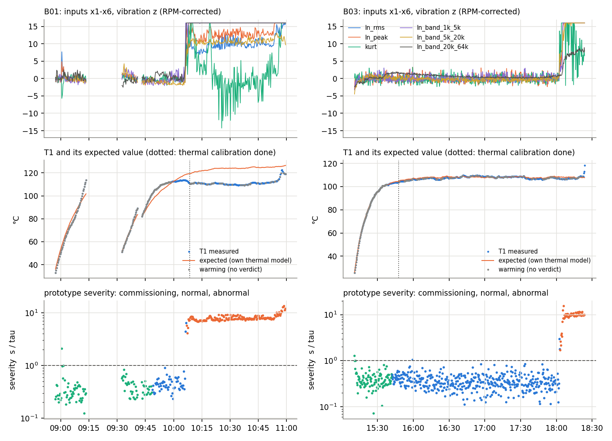
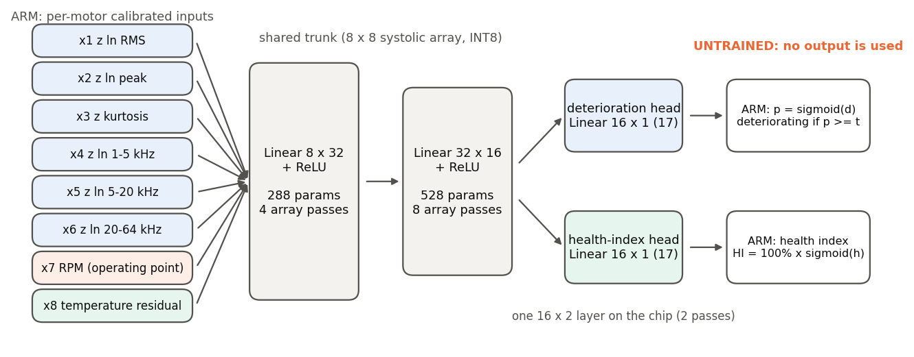

# Machine Guardian multi-task MLP: architecture, sensor pipeline and working prototype

*1 November 2026. Paderborn B01 and B03; one accelerometer, temperature and RPM. Nothing in this report is a trained
deterioration or health result.*

## 1. Summary

- **A new, separate model now exists.** It has a pipeline for the three final sensors and a two-head multi-task MLP,
  8 → 32 → 16 → 2 with 850 parameters. One head is binary deterioration; the other is a 0–100% Motor Health Index.
- **No existing file was changed.** That covers every Ottawa model, weight, export and result, and every Paderborn
  result. A test checks this with `git status`.
- **The network is not trained.** There are no independent deterioration or health labels yet. Its weights are random,
  and the code refuses to report predictions from an untrained network.
- **Inputs:** the 8 inputs per measurement are built from one accelerometer, the measured RPM and the measured
  temperature. Each motor is calibrated on its own first 100 operating measurements. Rows stay in measurement order.
- **Excluded:** load, the second accelerometer and the other two temperature sensors are not used. Tests show that
  changing them does not change the inputs.
- **Hardware fit:**
  - It runs on the existing 8 × 8 systolic array in INT8.
  - The Vivado xsim RTL check passes: both output columns are bit-exact against the Python model over 896 real
    measurements.
  - It takes **382 cycles per measurement (1.78 µs at 214 MHz)**, the same as the deployed single-accelerometer E3.
- **Working prototype:**
  - It is the anomaly baseline, unchanged, wrapped as the system's current output.
  - It reports a status (commissioning / normal / abnormal) and a severity score, s / τ.
  - It confirms the same alarms as before: B01 at M0210, two measurements after onset M0208, and B03 at M0549, after
    onset M0547.
  - The severity is a distance from the motor's own commissioning baseline. **It is not a health percentage.**
- **Temperature is its own input,** with a per-motor warm-up model:
  - On B03 the model follows the warm-up and plateau within about 0.3 °C. It flags the final temperature runaway
    (18:23:40), 20 minutes after the vibration alarm.
  - On B01 the model is poorly identified, because two stops interrupt B01's commissioning. That is a real limit,
    described in section 4.4.
- **30 automated tests pass,** covering shapes, numerics, inference, INT8, the pipeline and the prototype.
- **Still needed before the two heads can be trained:** independent labels for both heads, more bearings, and a
  defined end of life (section 8).

## 2. What was reviewed

| Component | What it is | Relevance here |
|---|---|---|
| Ottawa E3 / E3_single_accel (`train.py`, `single_accel.py`) | MLP 8 → 32 → 16 → 1, healthy-vs-faulty classifier, one accelerometer + ln f | Trunk sizes and training rules reused; **not modified** |
| Ottawa H1 (`health.py`) | A distance-based health index computed beside the network (not a second network head) | The "multi-task" Ottawa model is therefore a classifier plus a separate distance; the new model is the first with two network heads |
| `export.py`, `rtl_check.py`, `mac.py` | INT8 per-channel quantization, `golden_mlp` bit-exact model, xsim testbench | Reused by import, unchanged |
| `paderborn.py` | Feature extraction for any Paderborn experiment | Source of every input; unchanged |
| `anomaly_baseline.py` | Per-bearing commissioning, RPM correction, RMS-of-z score, 99th-percentile threshold, 3-in-a-row persistence | Becomes the working prototype; imported, unchanged |

## 3. What was built

| File | Purpose |
|---|---|
| `mtl_inputs.py` | Sensor input pipeline: per-motor calibration, the 8 inputs, the temperature model, the prototype outputs, leave-one-bearing-out folds. `python mtl_inputs.py` → `results/multitask/inputs_<EXP>.csv`, `calibration_<EXP>.json`, `summary.json`, `figures/mtl_inputs.png` |
| `mtl_model.py` | The multi-task MLP, its masked loss, INT8 build and inference, cycle count, optional RTL run. `python mtl_model.py --rtl` → `results/multitask/architecture.json`, `figures/mtl_architecture.png` |
| `test_mtl.py` | 30 tests (`python -m pytest test_mtl.py -q`) |
| `results/multitask/` | All outputs of the above, and this report |

No weights are saved for the new model: there is nothing trained to save.

## 4. Sensor input pipeline

### 4.1 Exact inputs

One row per vibration measurement (a 1.6-s window every ~12 s), in measurement order. Accelerometer A (the rear one,
the anomaly baseline's primary channel). Every vibration input is corrected for RPM and standardized on the motor's own
commissioning period, the first 100 operating measurements (about 30 min).

| # | Name | Definition | Sensor |
|---|---|---|---|
| x1 | `z_ln_rms` | z of ln RMS | accelerometer |
| x2 | `z_ln_peak` | z of ln peak (largest absolute value) | accelerometer |
| x3 | `z_kurt` | z of kurtosis | accelerometer |
| x4 | `z_ln_band_1k_5k` | z of ln RMS in 1–5 kHz | accelerometer |
| x5 | `z_ln_band_5k_20k` | z of ln RMS in 5–20 kHz | accelerometer |
| x6 | `z_ln_band_20k_64k` | z of ln RMS in 20–64 kHz (128-kHz chain) | accelerometer |
| x7 | `rpm_z` | (ln RPM − mean) / std over commissioning: the operating point | RPM |
| x8 | `temp_resid_z` | (T − T_expected) / σ_T; 0 until the thermal calibration is complete | temperature |

with, for each vibration feature f_j: **z_j = (f_j − b0_j − b1_j · ln RPM) / σ_j**, b0, b1, σ fitted by least squares on
commissioning only. A test confirms that z has mean 0, standard deviation 1 and zero correlation with ln RPM over
commissioning, and that changing anything after commissioning leaves every calibration value unchanged.

- **42-kHz chain.** A second profile (`A42`) replaces x1, x2, x3 and x6 with the 42.67-kHz versions (ln lr_RMS,
  ln lr_peak, lr_kurtosis, lr_crest) for a sensor chain that samples at 42 kHz. The baseline report found that 42 kHz
  gives the same alarms. Which chain is used is a hardware decision still open.
- **Clipping.** All inputs are clipped to ±16 before the network, so the INT8 input step is 16/127 ≈ 0.13σ. The
  anomaly score itself is computed unclipped.

### 4.2 Calibration stored per motor

`calibration_<EXP>.json` holds everything the ARM would keep for one motor:
- 6 × (b0, b1, σ) for the vibration correction;
- the RPM mean and standard deviation;
- the thermal model (T_amb, a, τ, σ_T, when it was calibrated);
- the anomaly baseline's coefficients and threshold τ.

That is about 50 numbers. Nothing is shared between motors. The leave-one-bearing-out check of the baseline report
showed that a model fitted on another bearing raises false alarms.

### 4.3 Temperature handling

Temperature is its own input. It is not used to correct vibration; the baseline report showed that doing so made false
alarms worse.

- **Thermal model, per motor.** It is a first-order heat-up driven by the measured RPM:
  - T_ss = T_amb + a · RPM/1000;
  - T relaxes toward T_ss with time constant τ;
  - it is simulated from the measured temperature at each (re)start;
  - T_amb is the first measured temperature (cold motor).
- **Warm-up state** (no temperature verdict):
  - before calibration: the measured T1 rises ≥ 0.5 °C/min over the last 5 min, or the run is younger than 5 min;
  - after calibration: the *model* expects a rise ≥ 0.5 °C/min.

  A rise the model does not expect in steady state is therefore not hidden as "warming". An earlier version used the
  measured slope throughout, and it masked B03's final runaway.
- **Calibration** finishes at the later of two points: the end of the vibration commissioning, and 10 minutes without
  warming. σ_T is the steady-state residual, but at least 0.5 °C.
- These thresholds were chosen from the shape of the temperature curves. They were not tuned on any alarm result.

### 4.4 What the temperature model does on B01 and B03

| | B01 | B03 |
|---|---|---|
| Fitted a, τ | 38.7 °C per 1000 rpm, 14.6 min | 30.6 °C per 1000 rpm, 10.4 min |
| Thermal calibration complete | M0215 (10:08), **after** the vibration onset M0208 | M0118 (15:47) |
| Residual after calibration (1st / 50th / 99th percentile) | −14.6 / −13.3 / −4.2 °C | −1.6 / −0.6 / +1.3 °C |
| "Above expected" (residual > 3σ_T, 3 in a row) | never | once, at **18:23:40** (T1 118.2 °C; residuals +3.7, +5.2, +10.5 °C), 20 min after the vibration alarm |

- **B03:** the model behaves as intended.
- **B01:** two stops interrupted the warm-up, and the motor never reached a clean plateau before its behaviour changed.
  The model overestimates the plateau by about 13 °C. For B01 the temperature input is unreliable.

**Requirement for our motor:** an uninterrupted commissioning run that reaches thermal steady state.



## 5. Architecture



| Layer | Shape | Weights | Biases | Activation | 8 × 8 array passes |
|---|---|---|---|---|---|
| Trunk 1 | 8 → 32 | 256 | 32 | ReLU | 4 |
| Trunk 2 | 32 → 16 | 512 | 16 | ReLU | 8 |
| Deterioration head | 16 → 1 | 16 | 1 | none (sigmoid on ARM) | together: 2 |
| Health-index head | 16 → 1 | 16 | 1 | none (sigmoid on ARM) | together: 2 |
| **Total** | | **800** | **50** | | **14** |

**850 parameters**: 800 INT8 weights (800 bytes) and 50 INT32 biases (200 bytes). This is 17 more than the deployed
E3 single-accelerometer model (833), which has one output instead of two. On the chip the two heads are one 16 × 2
layer. A test checks that this is exactly the two-head network.

### Output definitions

| Output | Computed as | Meaning once trained | Today |
|---|---|---|---|
| Deterioration | p = sigmoid(d); deteriorating if p ≥ t, with t chosen on validation bearings | Probability that the motor is past an independently labelled deterioration onset | Untrained; not reported |
| Motor Health Index | HI = 100% · sigmoid(h) | Position between the motor's commissioned state (100%) and a defined end-of-life state (0%) | Untrained; not reported; **no anchors exist yet** |

### Training loss (implemented and tested, not used)

- **Formula:** L = BCE(d, y_det) + w · MSE(HI/100, y_HI/100). Each term covers only the rows that have that label;
  missing labels are NaN.
- **Partial labels:** a measurement can carry a deterioration label without a health label, or the other way round.
- **Tested numerically:**
  - unlabelled rows get exactly zero gradient;
  - a batch with no labels contributes nothing;
  - the gradient matches finite differences.

  These tests use random tensors only. No optimizer step was taken.

### Hardware

| Check | Result |
|---|---|
| INT8 scheme | `export.py`'s, unchanged. Input scale 16/127. Per-channel weight scales. Hidden scales from the largest ReLU activation on calibration inputs. 22-bit accumulator with no overflow on any real input |
| INT8 vs FP32 (random weights, 940 real B01 + B03 rows) | Mean absolute error 0.007 (deterioration) and 0.006 (health); max 0.033 and 0.030, on outputs that span about 1.5 and 0.7 |
| RTL, Vivado 2019.1 xsim (`tb_mlp.sv`, ZedBoard settings) | **PASS.** 896 measurements at M = 64 (14 runs) and 10 at M = 1. Every raw sum of both columns, the last layer's INT8 inputs and all counters equal the Python model |
| Cycles | **382 per single measurement (1.78 µs at 214.286 MHz)**; 1,642 per 64. Same as E3 single-accelerometer, because the 2-column last layer still fits one 8-wide tile |

The hidden scales must be recalibrated after training. With random weights they only prove that the arithmetic and the
data path work.

## 6. Tests

`python -m pytest test_mtl.py -q`: **30 passed**.

| Group | Tests |
|---|---|
| Shapes | Layer sizes and the 850-parameter count. Outputs for M = 1, 3, 64 and 1000 dummy rows. Probabilities in (0, 1) and HI in [0, 100] |
| Numerics | Two heads = one 16 × 2 layer. Deterministic initialization. A measurement's output does not depend on the rest of the batch. Finite at ±16 on every input. Loss gradient check. Masking |
| Inference | INT8 on 940 real rows, with INT8 weights in range, no accumulator overflow and a close match to FP32. Cycle count equals E3 single-accelerometer. An untrained network refuses to predict |
| Pipeline | Exact input names and order. Rows chronological. No NaN. Inputs within ±16. Only accelerometer A, RPM and T1 used. Commissioning standardized and RPM-independent. Calibration uses only the motor's own commissioning. Temperature states. Leave-one-bearing-out folds |
| Prototype | Scores and thresholds equal `scores_<EXP>.csv`. The confirmed alarm is the baseline's alarm + 2. Severity = s/τ. No health or percentage column |
| Preservation | No tracked file under `weights/`, `export/` or `results/`, and none of the existing scripts, is modified |

The RTL run is separate (`python mtl_model.py --rtl`, about 2 min) and passed (section 5).

## 7. Working prototype (what the system reports today)

The anomaly baseline is the working prototype, unchanged. It uses accelerometer A, the 128-kHz features and RPM
correction; its threshold τ is the 99th percentile of commissioning, with 3 in a row. Per measurement it reports:

| Output | Definition |
|---|---|
| `status` | "commissioning" during the first 100 operating measurements; afterwards "abnormal" when the last 3 scores are all above τ (causal, so it is confirmed 2 measurements, about 25 s, after the onset), else "normal" |
| `severity` | s / τ: how far the vibration is from the motor's own commissioning baseline, in units of the threshold (1 = threshold). **Not a health percentage, not a remaining life** |
| `temperature_state` | "calibrating", "warming", "normal" or "above expected". Reported next to the status, not merged into it (section 4.4 shows why: the temperature model is not yet reliable on every motor) |

| | B01 | B03 |
|---|---|---|
| Threshold τ | 2.27 | 2.23 |
| Onset (baseline) → confirmed abnormal | M0208 → **M0210** (10:07:03) | M0547 → **M0549** (18:03:16) |
| After confirmation | 100% abnormal; median severity 7.7 | 100% abnormal; median severity 9.7 |
| Temperature | no reliable verdict (section 4.4) | "above expected" at 18:23:40, the last measurement before the logged stop |

These are the same label-free results as the baseline report. They show that the system separates normal from abnormal
behaviour on these two bearings. They do **not** show that the abnormal period is physical deterioration, because no
inspection confirms it.

## 8. Remaining requirements for supervised training

### Labels (independent of the vibration the network sees)

| Needed | For | Status |
|---|---|---|
| Deterioration onset per bearing, from inspection, intermediate stops or a measured damage size, never from thresholding these features | Deterioration head targets; a label taken from the vibration would make the network re-learn the baseline's threshold | missing |
| A defined end-of-life state (damage size, or a limit fixed in advance) | HI = 0% anchor | only a 110 °C stop on B03, not tied to damage |
| The commissioned state | HI = 100% anchor | available (each motor's commissioning) |
| Intermediate severity levels (inspected stages or seeded defects of increasing size) | HI values between 100% and 0%; without them any percentage is invented | missing |
| Healthy-only runs | False-alarm rate; negatives for the deterioration head | missing |

### Data

- **More bearings.** Two bearings give one leave-one-bearing-out fold each way; about 8–10 or more are needed. One or
  two should be locked as a final test set before anyone looks at them.
- **Our own motor**, logged synchronously:
  - the final accelerometer position and sample rate;
  - RPM and temperature;
  - the drive's commanded frequency, which gives slip as a load proxy;
  - an uninterrupted commissioning run that reaches thermal steady state.

### Open model decisions (made with labels, in the inner loop, never on the test bearings)

- **Input saturation.** After the onset almost every measurement has at least one input at ±16: B01 168 of 168, B03 63
  of 66. Pre-onset is unaffected. That is fine for the deterioration head. A health index that must keep ranking severe
  states may need a compressed input, such as sign(z)·ln(1 + |z|), or a wider clip.
- **Loss weight and threshold:** the weight w between the heads, and the decision threshold t.
- **Monotonicity:** whether HI should be forced to be non-increasing over a run.
- **Retraining and validation:** retrain the hidden INT8 scales and rerun `--rtl` with the trained weights.
- **Temperature input:** validate it on motors whose commissioning reaches steady state, or drop x8 if it does not
  help.

### Training protocol (from the baseline report, unchanged)

- The bearing is the unit, with leave-one-bearing-out outer and inner loops.
- A held-out bearing contributes only its own commissioning.
- Metrics: per-bearing detection delay, missed changes and false alarms per hour.
- **The trained MLP must beat the prototype on the same held-out bearings before it replaces it.**

## 9. Reproduce

```
python paderborn.py B01 B03          # if results/paderborn/<EXP>/ is missing
python anomaly_baseline.py           # if results/paderborn/anomaly/ is missing
python mtl_inputs.py                 # inputs, calibration, prototype -> results/multitask/
python mtl_model.py --rtl            # architecture.json, INT8 and RTL check (Vivado xsim, about 2 min)
python -m pytest test_mtl.py -q      # 30 tests
python report/make_multitask_report.py   # docs/Multitask_architecture_report.pdf
```
