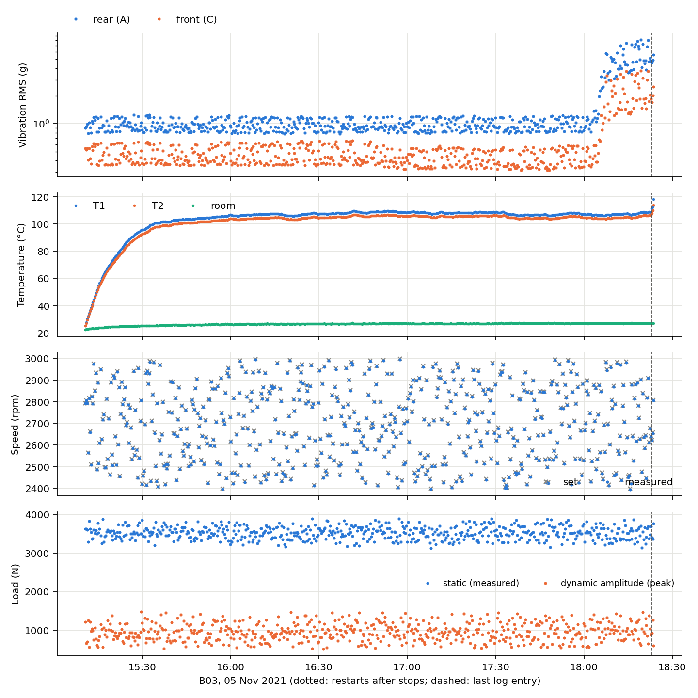
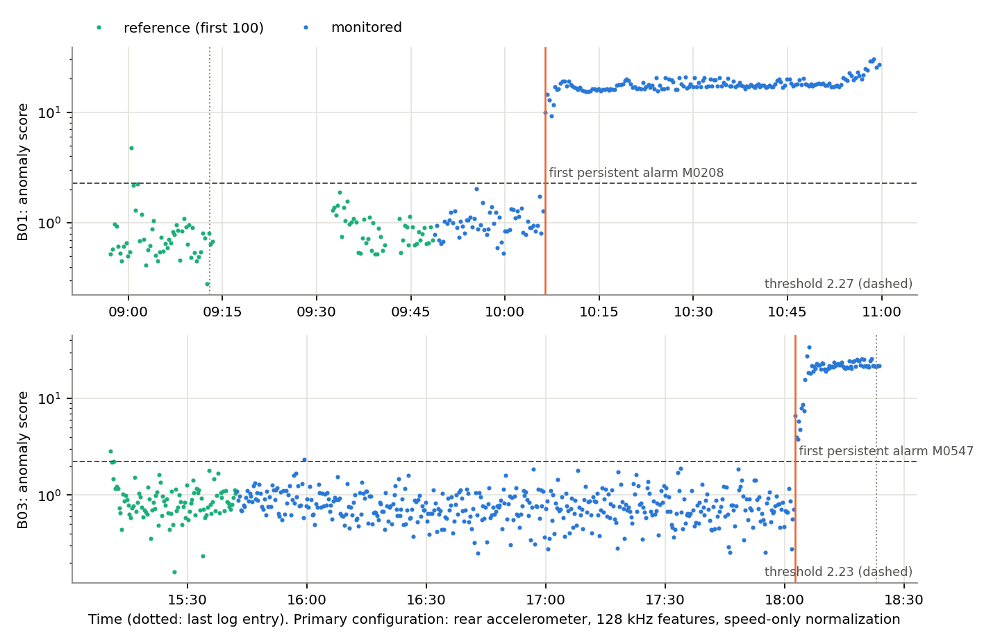
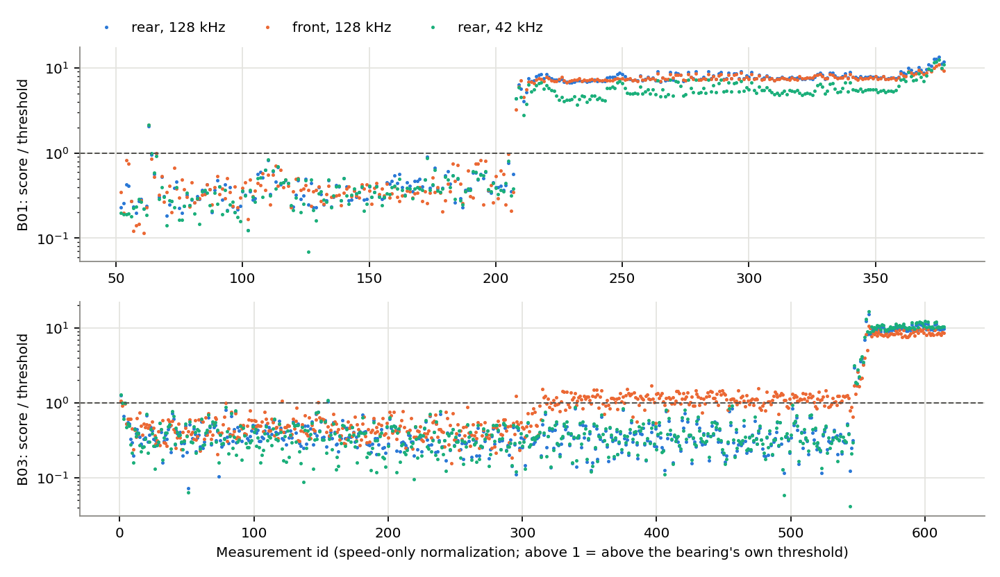
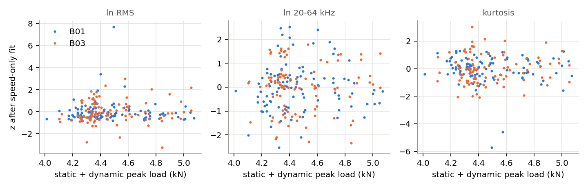

# Machine Guardian on Paderborn data: anomaly-detection baseline and training plan

1 November 2026. Experiments B01 and B03 (Paderborn LDM run-to-failure test bench). This is an analysis phase: the
existing Ottawa model and the B01 results were not changed, and no supervised model was trained.

> **What this is and is not.** The baseline below says when a bearing's vibration stops looking like its own first
> half hour of operation (**normal / abnormal**). It does not say the bearing is deteriorating: neither experiment
> has an inspection or any other independent record of the bearing's condition. No health score and no failure label
> is produced anywhere.

## 1. Summary

- **The pipeline now handles any Paderborn experiment.** `paderborn.py` runs the same feature extraction, merging and
  checks as the B01 work for any `data_<EXP>_MXXXX.mat` folder. For B01 it reproduces all 47 original columns exactly,
  and adds 14 columns: the same statistics at a 42.67 kHz sample rate. **B03 was already in the data folder and is now
  processed** (`model/newdata/B03/`): 614 of 614 measurements, one continuous run (15:10–18:23 on 5 Nov 2021), with no stop and no gap.
  Its warm-up is in the log but not in the data. It ended with the logged automatic stop at a 110 °C housing
  temperature.
- **Anomaly baseline:** one accelerometer, corrected for measured RPM only (no load, no temperature), calibrated on
  each bearing's first 100 operating measurements (about 30 min). The design was fixed before any score was computed.

  | | B01 | B03 |
  |---|---|---|
  | Exceedances after calibration, before the first persistent alarm | **0 of 56** | **1 of 446** (about 2.3 h; no persistent false alarm) |
  | First persistent alarm | **M0208** (10:06), the same change the B01 analysis found by another method | **M0547** (18:02:39), **20 min before** the logged 110 °C stop |
  | After the alarm | every measurement abnormal, median 7.7× the threshold | every measurement abnormal, median 9.7× the threshold |

- **One accelerometer is enough to see these changes.** RMS, peak, kurtosis and the 1–5 kHz and 5–20 kHz bands change
  at the same measurement on the rear sensor in both bearings. A 42 kHz sensor chain gives the same alarm times. The
  20–64 kHz band (128 kHz only) is the strongest feature on B01 but weak on B03. The **front** sensor of B03 showed an
  unexplained level shift about 75 minutes earlier that the rear did not: mounting position matters.
- **Missing load costs little on this bench,** because the bench's load barely varies. Adding load to the correction
  changes neither alarm time, and across its full range load moves any feature by at most 0.5σ. The bench only varies
  load by ±7%, though; a real motor will vary much more (section 6).
- **Temperature should not be used to correct vibration.** Doing so raised B03's exceedances from 1 to 22, because the
  calibration period is the warm-up.
- **Models do not transfer between bearings without recalibration.** Calibrated on the other bearing, 24% (B01) and
  51% (B03) of the held-out bearing's own first half hour already scores as abnormal, and B03 gets a false alarm 114 min
  before its stop. Speed sensitivity differs between the two bearings (RMS ∝ speed^0.9 in B01, speed^2.0 in B03).
  **Per-motor calibration is required,** and any evaluation must hold out whole bearings.
- **Supervised training is not possible yet.** There are two bearings and no independent condition records. Section 8
  lists the evidence needed before deterioration labels and a health index can be defined.

## 2. What was built

| File | Purpose |
|---|---|
| `paderborn.py` | One pipeline for any experiment: `python paderborn.py B01 B03` → `results/paderborn/<EXP>/` (processed table, checks, overview figure). Checks: complete and contiguous files, sample rate, timestamps, file-to-row alignment, stops, warm-up, conditions against the protocol and the log. |
| `paderborn_experiments.json` | The protocol and each experiment's log, transcribed by hand (B01, B03). A new experiment runs without an entry; the checks then note that its log has not been transcribed. |
| `anomaly_baseline.py` | The baseline, its variants, the load and single-sensor studies, and the leave-one-bearing-out check → `results/paderborn/anomaly/` |
| `report/make_paderborn_baseline_report.py` | This report as a PDF (`docs/Paderborn_baseline_report.pdf`) |
| Unchanged | `b01_preprocess.py`, `b01_analysis.py`, `results/B01/`, the Ottawa model, weights and exports |

To add a new experiment, e.g. B04: copy its folder to `model/newdata/B04/`, run `python paderborn.py B04`, add its log to
`paderborn_experiments.json`, then run `python anomaly_baseline.py` (it picks up every processed experiment).

## 3. B03 at a glance

| Check | B03 |
|---|---|
| Files / CSV rows | 614 / 614, contiguous, no missing ids, 204,800 samples at 128 kHz each |
| Alignment | step-to-step vibration changes follow speed changes at lag 0, r = +0.94 (r ≈ −0.5 at ±1 is a known effect of differencing) |
| Timeline | 15:10:43–18:23:40, one segment, 14–24 s between records; the last record is 40 s after the log's 18:23 entry |
| Log | "Begin with a new bearing"; 10-min warm-up at 750 rpm (**not in the data**: recording starts at operating conditions with T1 = 25.6 °C); "automatically stopped because the bearing housing temperature exceeded the specified limits of 110 °C" |
| Conditions | all speed setpoints within 2400–3000 rpm and reached; combined set load at exactly 4300 N in 313 of 614 rows (clipped, as in B01); static load off by more than 150 N in 92 rows |
| Temperature | T1 25.6 → about 103 °C in the first 30 min, then a plateau of 105–109 °C for 2.5 h; it rises to 118.2 °C only in the last minute |



The B03 limit was 110 °C. B01's unlogged segment 3 ran above 110 °C for over an hour, which supports the earlier
suspicion that its limit had been lifted.

## 4. The anomaly-detection baseline

**Design** (written into `anomaly_baseline.py` before any score was computed):

- **Calibration ("commissioning")**: each bearing's first 100 operating measurements, about 30 min, as a new motor
  would be calibrated in its first half hour. B01: 08:57–09:48 (it includes the two stops and the restart), T1 33 →
  102 °C. B03: 15:10–15:42, T1 26 → 103 °C.
- **Features from one accelerometer** (rear, A): ln RMS, ln peak, kurtosis, crest, and ln RMS in the 1–5 kHz, 5–20 kHz
  and 20–64 kHz bands.
- **Operating-condition correction**: for each feature, feature = b0 + b1·ln(measured RPM), fitted on the calibration
  period. A feature's z-value is its distance from that fit in calibration standard deviations.
- **Score**: s = √(mean of z²) across the features, the same form as the Ottawa health index H1.
- **Threshold**: the 99th percentile of the calibration scores. An alarm counts as **persistent** from the first of 3
  consecutive measurements above the threshold; single exceedances are counted, not alarmed.



| | B01 | B03 |
|---|---|---|
| Threshold | 2.27 | 2.23 |
| Calibration measurements above it | 1 / 100 | 1 / 100 |
| Exceedances after calibration, before the first persistent alarm | 0 / 56 (about 20 min) | 1 / 446 (about 2.3 h) |
| First persistent alarm | M0208, 10:06:24 | M0547, 18:02:39 |
| Time to the end | 53 min before the last record (the stop reason is not logged) | 20.4 min before the logged temperature stop |
| After the alarm | 100% abnormal, median 7.7× threshold | 100% abnormal, median 9.7× threshold |

**How to read it.** In both bearings the score stays flat for a long time, then rises abruptly by a factor of about 10
within a few measurements and stays high until the end. In B03 that happens 20 minutes before the temperature limit
stops the test, while the temperature is still on its plateau (106.6 °C at the alarm). Vibration therefore moved
before temperature in this run. Whether the change is physical damage cannot be confirmed: neither bearing was
inspected, or the result was not provided.

## 5. One accelerometer: which features, which sensor, which sample rate

Every feature used here can be computed from a single accelerometer; only cross-channel features (phase, coherence)
would need two. Per-feature first persistent |z| > 3 (rear sensor, RPM correction) and the median z over the last 20
measurements:

| Feature | B01 first / end z | B03 first / end z | Needs |
|---|---|---|---|
| ln RMS | M0208 / 14 | M0547 / 38 | any rate |
| ln peak | M0208 / 20 | M0549 / 21 | any rate |
| kurtosis | M0208 / 9 | M0547 / 7 | any rate |
| crest factor | M0218 / 3 | none / −0.3 | any rate |
| ln RMS 1–5 kHz | M0208 / 37 | M0551 / 31 | ≥ 10 kHz |
| ln RMS 5–20 kHz | M0208 / 12 | M0547 / 19 | ≥ 40 kHz |
| ln RMS 20–64 kHz | M0208 / 33 | M0556 / 8 | ≥ 128 kHz |

Comparing sensors and sample rates (RPM correction; ratio = median score after the alarm divided by the threshold):

| Configuration | B01: first alarm, exceedances before it, ratio | B03: first alarm, exceedances before it, ratio |
|---|---|---|
| Rear, 128 kHz (primary) | M0208, 0/56, 7.7× | M0547, 1/446, 9.7× |
| Rear, 42 kHz | M0208, 0/56, 5.4× | M0547, 1/446, 10.3× |
| Front, 128 kHz | M0208, 0/56, 7.5× | **M0315**, 3/214, 1.2× (79% of later points abnormal) |
| Front, 42 kHz | M0208, 1/56, 5.7× | **M0315**, 2/214, 1.3× |



- **Recommended single-sensor features:** ln RMS, ln peak, kurtosis, ln 1–5 kHz and ln 5–20 kHz. They agree on both
  bearings, and a 42 kHz chain can compute all of them. Crest factor is too weak. The 20–64 kHz band helps on B01 only
  and needs 128 kHz sampling.
- **42 kHz versus 128 kHz:** same alarm times on both bearings. The margin after the alarm is smaller on B01 (5.4× vs
  7.7×) and similar on B03. A 42 kHz sensor chain is viable for these two cases; 128 kHz adds margin on one.
- **The front sensor of B03** shifts from about M0300 (16:45). Its kurtosis drops from 2.97 to about 2.77 (a more tonal,
  less impulsive signal) while the rear sensor stays unchanged, until both change at about M0547. This could be a
  subtle early change that only the front position sees, or a sensor or mounting effect. Two bearings cannot settle
  it. It shows that **where the single accelerometer is mounted changes what the system reports.**

## 6. Operating load not available on the final hardware

Our final system measures vibration, temperature and RPM, but not load. On the bench, load was recorded, so I tested
what leaving it out does:

| Correction | B01: exceedances before alarm, first alarm, ratio | B03: exceedances before alarm, first alarm, ratio |
|---|---|---|
| none | 0/56, M0208, 4.7× | 4/446, M0547, 6.4× |
| RPM (primary) | 0/56, M0208, 7.7× | 1/446, M0547, 9.7× |
| RPM + load | 0/56, M0208, 7.9× | 0/446, M0547, 9.4× |
| RPM + temperature | 1/56, M0208, 8.6× | **22/446**, M0547, 13.7× |
| RPM + load + temperature | 2/56, M0208, 9.0× | 10/446, M0547, 13.1× |



- **Load hardly matters here.** In the calibration periods, after the RPM correction, every feature correlates with the
  total load at |r| ≤ 0.11. Moving the load across its whole range shifts a feature by at most 0.5σ (B01) and 0.47σ
  (B03). Adding load to the correction leaves both alarms unchanged and changes the exceedance counts by one.
- **RPM correction matters.** Without it, B03 has 4 exceedances before the alarm instead of 1, and the post-alarm
  margins are about 35% lower.
- **Why this does not settle the question for our motor:** the bench's combined load only spans 4300–4900 N (±7%),
  and half the draws sit at exactly 4300 N. A motor going from light to full load would change its vibration far more,
  and with no load input that change would look like an anomaly. Ways to deal with it on our hardware:
  1. calibrate across the motor's real load range during commissioning;
  2. estimate load from **slip**: an induction motor's speed falls below the drive frequency as load rises, so the RPM
     sensor plus the drive's commanded frequency (already used by the Ottawa model) gives a load proxy;
  3. measure motor current, if a sensor can be added.

  Option 2 needs the drive frequency to be logged together with RPM.
- **Temperature should not correct vibration.** Fitted on a calibration period that is mostly warm-up, the temperature
  term extrapolates badly to the plateau: B03's false exceedances rise from 1 to 22. Use temperature as its own
  channel (compared with the temperature expected from running time, RPM and room temperature), not as a regressor
  for vibration.

## 7. Recommended training and evaluation strategy

**Leave-one-bearing-out check.** Calibrated on the other bearing instead of its own first half hour:

| Held-out bearing | Own calibration measurements above threshold | Before the first alarm | First persistent alarm |
|---|---|---|---|
| B01 (model from B03) | 24 / 100 | 12 / 56 | M0208 |
| B03 (model from B01) | 51 / 100 | 18 / 149 | **M0250**, 114 min before the stop (false; afterwards only 36% abnormal) |
| Per-bearing calibration (primary) | 1 / 100 and 1 / 100 | 0 / 56 and 1 / 446 | M0208 and M0547 |

The RPM sensitivity of the same feature differs between the two bearings (exponent of RPM: RMS 0.90 vs 2.02; 1–5 kHz
0.71 vs 1.99; 20–64 kHz 2.36 vs 0.69), even on the same bench under the same protocol. **A model fitted on some
bearings does not describe the next one without recalibration.**

**Rules for every future experiment (supervised or not):**

1. **The bearing is the unit.** All measurements of one experiment go into the same fold. Measurements from the same
   run are never split across training and test.
2. **Outer loop: leave-one-bearing-out,** while there are fewer than about 10 bearings (then grouped k-fold by bearing).
   Every reported number is from a held-out bearing.
3. **Inner loop: leave-one-bearing-out on the training bearings** for every choice (features, threshold percentile,
   persistence, network size). The held-out bearing is never used for a decision.
4. **Commissioning is part of the model.** A held-out bearing may contribute its own first 100 operating measurements,
   and only those, to calibrate the RPM correction and the threshold, exactly as a deployed unit would. Nothing after
   that point is used for fitting.
5. **A locked final test set.** Choose one or two bearings now, and our own motor's recordings later, and evaluate them
   once, at the end.
6. **Metrics:**
   - before labels exist: persistent false alarms per operating hour in each bearing's undisturbed period; lead time
     from the first alarm to the logged stop;
   - once independent labels exist: per-bearing detection delay, missed changes, and false alarms per hour, with the
     spread across bearings (not pooled across measurements).
7. **Labels must not come from the features.** An onset found by thresholding vibration (as at M0208) can't be used as
   ground truth for a model that sees the same vibration (section 8).

**Recommended architecture** (staged; the existing E3 MLP stays untouched until stage 4 is justified):

| Stage | Where | What | Status |
|---|---|---|---|
| 1. Features | ARM | One accelerometer: ln RMS, ln peak, kurtosis, ln 1–5 kHz, ln 5–20 kHz (+ ln 20–64 kHz if sampled at ≥ 128 kHz); ln measured RPM; T1; the drive's commanded frequency for slip | `paderborn.py` computes all of these |
| 2. Commissioning correction | ARM | Per motor: feature = b0 + b1·ln RPM (+ slip, once logged), fitted on the first ~30 min; z-values | this baseline |
| 3. Anomaly output | ARM | s = RMS of z; threshold = 99th percentile of commissioning; 3-in-a-row persistence → normal / abnormal | this baseline |
| 4. Multi-task MLP | 8×8 accelerator | Inputs: the corrected z-values (5–6), ln RPM, a temperature residual; two heads, (a) deterioration and (b) health index. About 8 → 32 → 16 → 2, which fits the existing array like E3 does | **only after the labels in section 8 exist** |

Stage 4 deliberately takes *corrected* inputs. The between-bearing differences above show that raw features would
make the network learn each bearing's individual vibration rather than its condition, which is the same problem the
Ottawa model had with its single healthy motor.

## 8. Evidence needed for deterioration labels and a health index

| Evidence | Why it is needed | Status |
|---|---|---|
| **Post-test inspection of every bearing** (damage type, location, size; photos or profilometry) | Confirms that the end state is damage, not a sensor, mounting or bench effect, and which kind | missing for B01 and B03 |
| **Intermediate inspections** (stop, inspect, continue) or damage measured during the run | The only way to date the start of physical damage and to know whether the M0208 / M0547 changes are damage | missing |
| **More bearings** run to the same stop criterion | Two bearings cannot show how variable onset, alarm lead time and false-alarm rates are; leave-one-bearing-out needs about 8–10 or more | 2 processed (B01, B03) |
| **Long healthy-only runs** under the same random protocol | False-alarm rate per hour on bearings known not to fail | missing |
| **Documentation of interventions** (B01: the 09:13 and 09:40 stops, why it continued, why it stopped at 10:59; B03: the unrecorded warm-up) | Whether segments belong together and what the stop means | missing |
| **A defined end-of-life criterion** (e.g. a damage size, or a vibration or temperature limit fixed in advance) | Anchors 0% of any health scale | only a temperature limit (110 °C, B03); not tied to damage |
| **Damage severity at several levels** (seeded defects of increasing size, or inspected stages) | Anchors the points between 100% and 0%; without them a percentage is an invention | missing |
| **Our own motor**: the final sensor position and mounting, RPM, temperature, the drive frequency and a load proxy, synchronised | The bench motor and sensors differ; per-motor calibration has to be tested where it will be used | not started |

Until these exist, the honest outputs are **normal / abnormal** (this baseline) and, if a number is wanted, the
**distance from the motor's own commissioning baseline** (the score s). Neither should be presented as a percentage of
health or remaining life.

## 9. Next steps before supervised training

1. Ask the Paderborn LDM team for the inspection results of B01 and B03, the B01 stop history, and how many further
   experiments (B02, B04, …) exist and can be shared.
2. Process every further experiment with `paderborn.py` and rerun `anomaly_baseline.py` unchanged (its design is now
   fixed), to measure false alarms per hour and alarm lead time across bearings.
3. Lock one or two bearings as the final test set before looking at them.
4. Decide the sensor chain: accelerometer position (the front/rear disagreement on B03), sample rate (42 kHz suffices
   for these two cases), and logging of the drive frequency so slip can stand in for load.
5. Record our own motor: commissioning runs across its real speed and load range, then long healthy runs.
6. Only when independent condition labels exist: train the multi-task MLP (stage 4) with leave-one-bearing-out, and
   compare it against this baseline on the same held-out bearings.

## 10. Reproduce

```
python paderborn.py B01 B03                         # about 35 s; results/paderborn/<EXP>/
python anomaly_baseline.py                          # results/paderborn/anomaly/ (baseline.json, scores_<EXP>.csv, figures/)
python report/make_paderborn_baseline_report.py     # docs/Paderborn_baseline_report.pdf
```

`results/paderborn/anomaly/baseline.json` holds every number in this report, including all 20 configurations
(2 sensors × 2 feature sets × 5 corrections) per bearing.
