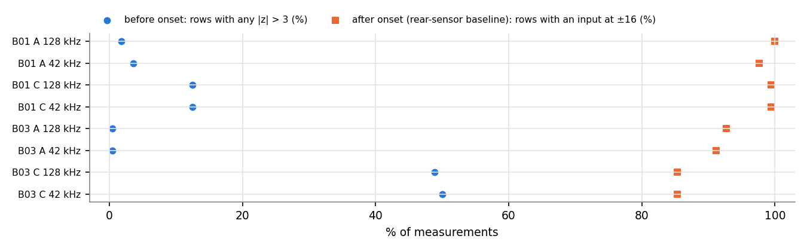
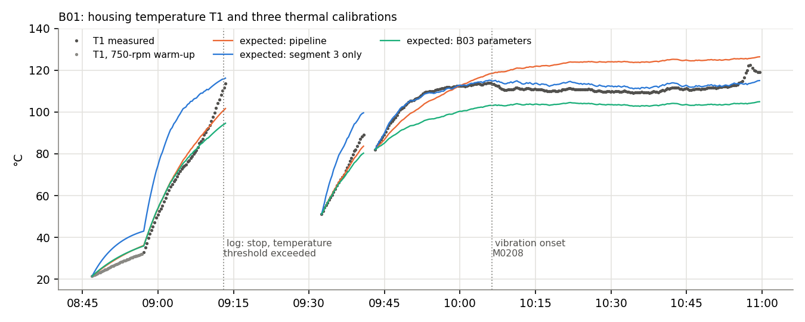

# Machine Guardian: dataset validation and the path to supervised training

*2 November 2026. Covers the Paderborn run-to-failure data set (B01–B17), external datasets, the final sensor chain,
B01's temperature calibration, and the exact steps before the multi-task MLP can be trained. Nothing was trained and no
label was created.*

## 1. Summary

**What the Paderborn documentation does and does not give us**

- **Independent labels exist, but only for the end state.** The official dataset description, which is not in our local
  folders, lists the **defect type found after dismantling each of the 17 bearings**: inner race, outer race and/or
  rolling element. That evidence does not come from vibration.
- **It has no damage size, no inspection date and no intermediate inspection** for any bearing. So there is no verified
  degradation trajectory, and no time at which damage began.
- **The published "transition times" (B01 208, B03 562) cannot be labels.** They come from clustering the vibration
  features (2-means), the same kind of information our network sees, and they agree with our own anomaly onsets.
- **The published RUL percentages cannot be labels either.** They are linear in time and were defined by the authors.

**External datasets**

- **No public dataset found gives verified intermediate stages along one bearing's life.**
- **The closest is the Paderborn KAt set.** It has 14 bearings with real damage from lifetime tests, graded by
  measured damage length into levels 1–3, plus 6 healthy bearings. Each bearing has one end state, measured after its
  test. It uses a different bearing, rig and temperature regime, and its licence is non-commercial.
- **Seeded-defect sets** (Torino 0/150/250/450 µm; CWRU; KAIST) give known sizes, but the defects are artificial.

**Our pipeline and test set**

- **The preprocessing now runs all 17 experiments.** `paderborn.py` handles the 64-kHz experiments (B10–B17), each experiment's own
  set-point ranges, and constant-speed runs. B01 and B03 still reproduce **byte for byte**.
- **Test set locked before any new data was seen:** **B06, B07, B13, B17**, one per operating regime, drawn by a
  pre-declared seeded rule.
  - The 13 other bearings form the development set, evaluated leave-one-bearing-out.
  - Code refuses to hand out the test bearings without a frozen model's hash.
  - Limitation: none of the four test bearings has an outer-race defect.

**The final sensor chain**

- **Use the 42.67-kHz feature profile (A42) for training.** It is the only one that exists for all 17 experiments, and it
  gives the same alarms as 128 kHz. The accelerometer is only flat to 10 kHz and resonates at 25 kHz, so the 20–64 kHz
  band mostly measures that resonance.
- **Mounting position matters more than sample rate.** Before the onset, the front sensor has inputs beyond ±3σ in
  12–49% of measurements. The rear sensor has them in 0.4–4%.

**B01's temperature calibration is not fixable from its data**

- **It mixes three segments** separated by stops.
- **It ends after the vibration onset.**
- **Its steady-state residual is 2.6 °C,** against 0.3 °C on B03.
- **B01 also ran hotter.** Its log records a temperature stop at 09:13, 16 minutes into the test, and the run then
  continued twice without documentation.
- A three-part validity check (section 8) rejects B01 and accepts B03. B01 is excluded from training of the temperature
  input.

**Recommendation**

- **Deterioration head:** train it next, with labels only where the evidence holds:
  - "healthy" during each bearing's commissioning (new bearing, no defect introduced);
  - "deteriorated" at the end, confirmed by dismantling;
  - "unknown" (masked) in between.
- **Health-index head:** keep it untrained until measured severity levels exist. Our own stop-and-inspect tests or
  seeded-defect tests would provide them, with KAt for external checking.
- **Prototype:** keep the anomaly baseline's severity score as the reported number until then.

## 2. What changed, and what was preserved

| File | Change | Preservation check |
|---|---|---|
| `paderborn.py` | Sample rate read per file (128 or 64 kHz, anything else refused). 20–64 kHz band left empty above Nyquist. 42.67-kHz signal by 2/3 resampling at 64 kHz. Ranges and warm-up per experiment | B01 and B03 reprocessed: **both CSVs byte-identical**, every check value identical |
| `paderborn_experiments.json` | All 17 experiments: sample rate, set-point ranges (description Table 2), duration, files, stop criterion, defect after dismantling (Table 3), sensor and bearing data, sources | B01/B03 log transcriptions unchanged |
| `mtl_inputs.py` | Two guards: no RPM term when the set speed is constant (B14–B17); refuse a profile whose features are missing (A128 on 64-kHz data) | B01/B03 inputs, statuses and temperature states identical to `results/multitask/` |
| `splits.py` (new) | The locked split | `results/splits/splits.json` with its SHA-256 |
| `phase2_review.py` (new) | Sensor-chain and temperature review | writes `results/phase2/` only |
| `test_phase2.py` (new) | 14 tests | 44 of 44 pass with `test_mtl.py` |

Unchanged:
- `mtl_model.py`, the architecture;
- `anomaly_baseline.py` and its results;
- every Ottawa file, weight, export and result;
- every file in `results/` written before today.

`test_mtl.py` now protects `mtl_model.py` instead of `paderborn.py`, whose outputs are checked by reproduction.

## 3. What the Paderborn documentation contains

Sources:
- the local logs B01 and B03;
- the dataset description v2 (Aimiyekagbon, 25 Mar 2024, Zenodo doi:10.5281/zenodo.10805042, CC BY 4.0);
- the paper by Javanmardi et al. (PHM Society Europe 2024).

| Exp. | Sample rate | Speed (rpm) | Approx. duration | Files | Stop criterion | Defect after dismantling | Split |
|---|---|---|---|---|---|---|---|
| B01 | 128 kHz | 2400–3000 | 2 h | 377 | none pre-set | IR, OR, B | dev |
| B02 | 128 kHz | 2400–3000 | 6 h | 1116 | vibration | IR | dev |
| B03 | 128 kHz | 2400–3000 | 3 h | 614 | temperature | IR | dev |
| B04 | 128 kHz | 1500–3000 | 6 h | 1114 | vibration | IR, B | dev |
| B05 | 128 kHz | 1500–3000 | 3 h | 572 | interrupted | B | dev |
| B06 | 128 kHz | 1500–3600 | 67 h | 12965 | vibration | IR, B | **test** |
| B07 | 128 kHz | 1500–3000 | 37 h | 6393 | temperature | IR | **test** |
| B08 | 128 kHz | 1500–3000 | 11 h | 1827 | temperature | IR, B | dev |
| B09 | 128 kHz | 1500–3000 | 13 h | 1813 | vibration | OR, B | dev |
| B10 | 64 kHz | 1500–2700 | 19 h | 3224 | vibration | OR, B | dev |
| B11 | 64 kHz | 1500–2700 | 8 h | 1953 | vibration | IR, OR, B | dev |
| B12 | 64 kHz | 1500–2700 | 3 h | 767 | vibration | IR, B | dev |
| B13 | 64 kHz | 1500–2700 | 66 h | 19417 | vibration | IR, B | **test** |
| B14 | 64 kHz | 2700 | 41 h | 12317 | vibration | B | dev |
| B15 | 64 kHz | 2700 | 76 h | 22567 | temperature | IR, B | dev |
| B16 | 64 kHz | 2700 | 20 h | 5891 | none listed | IR, OR, B | dev |
| B17 | 64 kHz | 2700 | 17 h | 2733 | vibration | B | **test** |

*Defect codes: IR inner race, OR outer race, B rolling element. The stop limits are a vibration level of 6–10 g, or a
housing temperature of 110 °C.*

**What this evidence supports:**

| Question | Answer | Source |
|---|---|---|
| Was each bearing new and undamaged at the start? | Yes: "no defect was initiated in the bearings before the experiments"; logs say "new bearing" | description, logs |
| Was each bearing damaged at the end? | Yes, with the defect type, after dismantling | description Table 3 |
| How large was the damage? | **Not given** | — |
| When did damage start, or how did it grow? | **Not given**: no intermediate inspection, no damage measured during a run | — |
| Photos? | One example in the paper (B06: inner-race defect, spalls on a ball) | paper Fig. 3c |

**Not usable as labels:**
- the paper's transition times, which come from 2-means clustering of vibration spectra;
- its linear RUL percentages, which are defined by time;
- our own anomaly onsets.

All three are derived from the vibration the network would learn from, which makes them circular. They agree with each
other (B01: paper 208, ours M0208; B03: paper 562, ours M0547), but that shows only that the methods are consistent, not
that damage existed at that time.

**Documentation problems found:**
- **B01's stop is contradictory.** The description says no criterion was pre-set. Its log says the run "successfully
  completes because the temperature threshold value was exceeded" at 09:13 (T1 113.6 °C). Yet the data continue in two
  more segments until 10:59, with no log entry.
- **B03's 10-minute warm-up is in the log but not in the data.**
- **B14–B15's dynamic-load range** is 700–1500 N in the description and 750–1500 N in the paper.
- **The B accelerometer** (vertical, on the lever) is not distributed.

## 4. Preparing B02–B17

`paderborn.py` was checked against the facts that differ from B01/B03:

| Difference | Effect before | Now |
|---|---|---|
| B10–B17 sampled at 64 kHz | Frequency axis assumed 128 kHz: every band would have been placed wrongly, silently | Sample rate read per file. The 20–64 kHz band is left empty (NaN, nothing invented). 42.67-kHz features via 2/3 resampling; a test confirms they match 128-kHz ones for the same signal |
| Other set-point ranges (B04–B17) | Every measurement flagged out of range | Ranges per experiment from the registry |
| Constant 2700 rpm (B14–B17) | RPM correction fitted on sensor jitter; operating-point input blown up by a near-zero spread | No RPM term; operating-point input stays near 0 (tested) |
| 128-kHz-only feature (20–64 kHz) | NaN inputs | `mtl_inputs` refuses the A128 profile; A42 works on every experiment (tested) |

Download size on Zenodo (152 GB in total):

| Set | Experiments | Approx. size |
|---|---|---|
| Development, not yet downloaded | B02, B04, B05, B08–B12, B14–B16 | 77 GB |
| Test (process only, then leave alone) | B06, B07, B13, B17 | 72 GB |

**To add an experiment:**
1. Unzip all of its parts into `model/newdata/<EXP>/`.
2. Transcribe its log into `paderborn_experiments.json`.
3. Run `python paderborn.py <EXP>`, then read `checks.json`. Check that:
   - files are complete;
   - the sample rate is as expected;
   - lag-0 alignment holds;
   - stops and warm-up match the log.
4. For development bearings only, run the analyses.

Processing time for the long experiments (13,000–22,000 files) has not been measured yet.

## 5. Train / validation / test strategy

`splits.py` declares the rule in code, draws once with seed 20261102, and stores the result with its SHA-256 in
`results/splits/splits.json`:

1. **The bearing is the unit.** No experiment is ever split across sets.
2. **Not eligible for testing:**
   - B01 and B03, which have already been analysed;
   - B05, which was interrupted;
   - B01 and B16, which have no stop criterion.
3. **One test bearing per operating regime** (table below).

| Regime | Members | Test bearing | Its stop and defect |
|---|---|---|---|
| Sinusoidal load, 128 kHz, variable speed | B01–B06 | **B06** | vibration; IR, B |
| Noise load, 128 kHz, variable speed | B07–B09 | **B07** | temperature; IR |
| Noise load, 64 kHz, variable speed | B10–B13 | **B13** | vibration; IR, B |
| Noise load, 64 kHz, constant speed | B14–B17 | **B17** | vibration; B |

- **Development set (13 bearings):** B01, B02, B03, B04, B05, B08, B09, B10, B11, B12, B14, B15, B16.
   - Every model choice uses leave-one-bearing-out over these bearings.
   - Each held-out bearing contributes only its own commissioning to calibration.
- **Lock:**
   - `assert_development()` raises an error if a test bearing appears in any fitting list.
   - `test_bearings()` raises an error unless it is given the frozen model's SHA-256.
   - A test checks that the stored split equals the declared draw and has not been edited.

**Caveats:**
- **No outer-race defect is in the test set.** Outer-race damage appears only in B01, B09, B10, B11 and B16, all
  development bearings. Results on outer-race damage will rest on leave-one-bearing-out only.
- **Some facts about the test bearings are already public:** duration, defect type, and the paper's transition times.
  None of them may be used for a model decision.

## 6. External datasets with degradation information

| Dataset | What is verified | Intermediate stages over one life? | Temperature / speed | Use for us |
|---|---|---|---|---|
| **Paderborn KAt** (Lessmeier et al. 2016) | 6 healthy; 12 artificial (levels 1–2); **14 real damages from accelerated lifetime tests**: type (fatigue pitting, indentations), location, damage length → extent level 1–3, all measured after the test | **No**: one end state per bearing | Oil temperature kept at 45–50 °C; 4 fixed settings (900/1500 rpm); vibration and motor current at 64 kHz | External check of the deterioration head (healthy vs real damage), and of severity ordering across bearings. Bearing 6203, different rig. **Licence CC BY-NC 4.0** |
| **Politecnico di Torino** (Daga et al. 2019) | Indentations of 0/150/250/450 µm on a roller or the inner ring; many speeds and loads; an endurance test of about 230 h with the 450 µm defect | Endurance test monitors "damage evolution"; whether size was measured over time **not verified** | Thermocouple, recorded by hand | Seeded severity ladder (artificial). CC BY 4.0 |
| **UORED-VAFCLS** (Sehri et al. 2023) | 20 bearings, each recorded as healthy / developing / faulty; 42 kHz; constant load and speed | Three states per bearing; how "developing" was produced and measured **not verified** | Thermocouples listed | Worth reading the article: closest to stages, and 42 kHz like our chain. CC BY 4.0 |
| **KAIST** (Jung et al. 2023) | Inner- and outer-race faults at 3 severity levels (seeded); 3 torque loads | No | Two housing thermocouples; motor current; 3010 rpm | Seeded severities with temperature |
| **CWRU** | Seeded electro-discharge machining (EDM) faults, 0.007–0.040 in | No | No temperature | Severity ordering only (artificial) |
| **FEMTO/PRONOSTIA, XJTU-SY, IMS** | Run-to-failure; failed element known for some | No (end state only) | Varies | Same limitation as the Paderborn set; more trajectories for anomaly evaluation |

**Conclusion.** None of the datasets found gives measured damage at several points in one bearing's life.
- Datasets with known severity are either cross-sectional (KAt, real damage) or artificial (Torino, CWRU, KAIST).
- That supports ordinal severity classes, not a validated continuous 0–100% index.
- Two leads still need reading before they are ruled in or out: the Torino endurance test, and how UORED's "developing
  fault" state was defined.

## 7. Behaviour with the final sensors (one accelerometer, temperature, RPM)

The same 8-input pipeline was run for both accelerometer positions and both sample-rate profiles. "Onset" is the
rear-sensor baseline's alarm (B01 M0208, B03 M0547).



| Bearing, sensor, rate | Before onset: rows with any input beyond ±3σ | Largest before onset | After onset: rows at ±16 | Baseline alarm (same channel) |
|---|---|---|---|---|
| B01 rear, 128 kHz | 1.8% | 3.3 | 100% | M0208 |
| B01 rear, 42 kHz | 3.6% | 4.0 | 98% | M0208 |
| B01 front, 128 kHz | 12.5% | 4.8 | 99% | M0208 |
| B03 rear, 128 kHz | 0.4% | 3.3 | 93% | M0547 |
| B03 rear, 42 kHz | 0.4% | 3.7 | 91% | M0547 |
| B03 front, 128 kHz | **49%** | 7.8 | 85% | **M0315** (front-sensor drift, 232 measurements early) |

**Conclusions:**

- **Sample rate: 42.67 kHz is enough.** It gives the same alarms and the same input behaviour as 128 kHz on the rear
   sensor.
   - It is the only profile available on all 17 experiments.
   - The accelerometer is specified flat only to 10 kHz (±3 dB) and resonates at 25 kHz, so the 20–64 kHz band
     measures the mounting resonance more than the bearing.

   Recommendation: train on profile **A42**. The 8 inputs keep the same count and order; only the profile changes:
   - ln RMS, ln peak and kurtosis at 42.67 kHz;
   - ln 1–5 kHz and ln 5–20 kHz;
   - crest factor in place of the 20–64 kHz band.
- **Sensor position: it matters more than sample rate.** On B03 the front sensor drifts from about M0300, which
   per-motor calibration cannot remove. The final sensor should be rigidly mounted, as close to the load zone as
   possible, and its position recorded as part of the commissioning record.
- **Saturation.** After the onset, 85–100% of measurements have an input at the ±16 clip. That is fine for a
   deterioration decision, but it makes the inputs uninformative about how severe the damage is. This is another reason
   the health-index head cannot be trained on these inputs as they stand.
- **RPM.** With constant speed (B14–B17) the RPM term is dropped automatically. With varying speed, the correction is
   fitted per motor; the earlier leave-one-bearing-out check showed it does not transfer between bearings.
- **Temperature sensor.** The bench's Pt100 is accurate to ±0.85 °C at 110 °C. Our σ_T floor (0.5 °C) assumes a
   repeatable sensor rather than an accurate one: a constant bias cancels in calibration, but drift would not. Our own
   sensor's repeatability needs measuring.

## 8. B01 temperature calibration



**What happened:**
- B01 warmed up at 750 rpm, rising from 21 to 33 °C.
- At test conditions it then heated from 33 to **106 °C in 15 minutes**, reaching 113.6 °C at 16 minutes. The log
  records a temperature-threshold stop at that point. B03 reached 89 °C in its first 15 minutes and plateaued at
  105–109 °C.
- B01 was then restarted twice from a hot state, at 51 and 82 °C, without a log entry.
- It plateaued at about 110 °C before its vibration changed at M0208.

**Why the thermal model failed:**

| Calibration | a (°C per 1000 rpm) | τ (min) | Plateau residual, 10:15–10:50 |
|---|---|---|---|
| Pipeline: three segments, up to M0215 | 38.7 | 14.6 | −13.7 °C |
| Segment 3 only, before M0208 | 34.0 | 5.6 | −2.4 °C |
| B03's parameters (another bearing) | 30.6 | 10.4 | +6.7 °C |

- With these restarts the heating rate and time constant cannot be separated: the plausible fits disagree by 16 °C.
- Even the best fit (segment 3 only) needs a time constant half of B03's.
- B01 runs about 7 °C hotter than B03's model predicts. Each bearing has its own thermal behaviour, so this cannot be
  fixed by borrowing another bearing's parameters.

**Validity rule.** It can be checked on the device at the end of commissioning, without future data:

| Check | B01 | B03 |
|---|---|---|
| V1: one uninterrupted segment from a cold start (T1 within 10 °C of ambient) | **fails** (3 segments) | passes |
| V2: steady state reached before the first vibration alarm | **fails** (M0215 after M0208) | passes (M0118, alarm M0547) |
| V3: steady-state residual ≤ 1 °C | **fails** (2.6 °C) | passes (0.3 °C) |

The rule was written after seeing these two bearings, so it is a proposal to test on B02–B17 (development set only).

**Decisions:**
- **Invalid calibration means no temperature input.** The input x8 is set to 0 and marked invalid, as already happens
  before calibration.
- **Train with x8 randomly masked**, so the network never depends on it being present.
- **B01 contributes no temperature information** to training.
- **Our own motor needs a commissioning procedure** that satisfies V1–V3.

## 9. Recommended training strategy (no invented labels)

### Deterioration head: train on evidence-anchored partial labels

| Period of each development bearing | Label | Evidence |
|---|---|---|
| Commissioning (first 100 operating measurements, about 30 min) | 0, healthy | New bearing, "no defect was initiated" (description); every bearing ran for hours afterwards |
| Last 5 measurements before the documented stop (about 1 min) | 1, deteriorated | Damage confirmed by dismantling after the stop (Table 3) |
| Everything in between | **masked** (NaN) | No evidence. The masked loss in `mtl_model.py` already ignores these rows |
| B05 (interrupted), B01 and B16 (no stop criterion) | end label only if the documents confirm the bearing was dismantled straight after the last measurement | Their stop is undocumented |

- **Choices fixed in advance:** the counts (100 at the start, 5 at the end) are set before any development data are
  looked at, and checked for sensitivity (3, 10, 20) only within the development set.
- **Evaluation without onset labels**, per held-out bearing:
  - false alarms per hour in the commissioning-like early life;
  - whether, and how long, before the stop the head becomes persistently "deteriorated";
  - persistence (no flip-flopping);
  - all compared with the anomaly baseline on the same bearings.

  The MLP replaces the prototype only if it is better on the development leave-one-bearing-out folds, and then once on
  the locked test set.
- **External check:** apply the frozen head to KAt (healthy vs real damage, at 64 kHz, profile A42). It must flag the
  damaged bearings without false alarms on the healthy ones. A different bearing and rig make this a strong test of
  generalisation, not a training source.

### Health-index head: do not train yet

- **The 100% anchor exists:** each motor's commissioning.
- **The 0% anchor is weak:** the documented end-of-test state, whose damage size is unknown.
- **Nothing exists in between.** A time-based or vibration-based percentage would be invented; the published linear
  RUL percentages are exactly that kind of label.
- **Path to a defensible index:**
  1. **Ordinal severity first.** Classes come from measured damage size (healthy / level 1 / 2 / 3, following KAt's
     length-based levels), not a continuous percentage.
  2. **Data that would support it**, in order of value:
     - our own stop-and-inspect run-to-failure tests, where damage is measured at fixed intervals;
     - seeded defects of increasing size on our own motor;
     - KAt real-damage levels as external evidence.
  3. **Map ordinal levels to 0–100% only once** at least three measured levels exist per defect type, and say in every
     output that the percentage is a calibrated severity scale, not remaining life.
- **Until then:**
  - the health head stays untrained and masked;
  - the system reports the prototype's severity score (s/τ) as a distance from the motor's own commissioning baseline.

### Unchanged rules

- No label is ever derived from the features the network sees: no thresholds, clusters, transition times or
  time-to-failure fractions.
- Labels come with a documented source: experiment, measurement range, label, source document and page.
- The architecture (8 → 32 → 16 → 2), INT8 export and RTL check are reused as they are. The hidden scales are
  recalibrated on the trained network, and the RTL check is run again.

## 10. Data still needed and the exact steps

**Data:**

| Needed | For | How |
|---|---|---|
| B02, B04, B05, B08–B12, B14–B16 (77 GB) | Development set: start and end labels, leave-one-bearing-out | Zenodo download (needs your go-ahead) |
| B06, B07, B13, B17 (72 GB) | Locked test set, used once | Zenodo download; process only |
| Damage size, photos and dismantling dates per bearing; B01's stop history; B03's warm-up; any intermediate inspections | Severity, end-label timing, B01/B05/B16 eligibility | Ask the authors at Paderborn's Chair of Dynamics and Mechatronics (LDM) (O. K. Aimiyekagbon) |
| KAt healthy and real-damage data | External check of the deterioration head; severity ordering | KAt-DataCenter download; check that CC BY-NC fits the project |
| UORED-VAFCLS article, Torino endurance description | Whether either has measured intermediate stages | Read the papers |
| Our motor: commissioning runs, long healthy runs, then seeded and/or stop-and-inspect damage, with drive frequency, RPM, temperature and the final accelerometer mount | The only data from the real hardware; health-index levels | Plan an experiment campaign |

**Steps, in order:**

1. Download the development bearings and transcribe their logs into `paderborn_experiments.json`. Run
   `paderborn.py`, and review each `checks.json` against the log.
2. Download and preprocess the test bearings. Do not plot, score or inspect them (`splits.test_bearings()` stays
   locked).
3. On the development set only:
   - rerun `anomaly_baseline.py` unchanged, to measure false alarms per hour and alarm lead time across 13 bearings;
   - compare profiles A42 and A128 on the 128-kHz bearings, then fix A42;
   - apply the thermal validity rule.
4. Write the label table from documents only, using the rules in section 9: start = healthy, end = deteriorated,
   middle masked. Have someone check it against the description before any training.
5. Ask the authors for damage sizes and inspection records. If they exist, update the end labels and the health-index
   plan.
6. Train the deterioration head with leave-one-bearing-out, masked health head, x8 dropout and fixed seeds. Choose the
   threshold and persistence in the inner folds. Compare against the prototype per bearing.
7. Freeze the model (weights, scales, threshold; SHA-256). Evaluate once on B06, B07, B13 and B17. Report per bearing.
8. Apply the frozen head to KAt (external check). Re-export INT8 and rerun the RTL check.
9. Start our own motor campaign. Train the health-index head only when measured severity levels exist (section 9).

## 11. Reproduce

```
python paderborn.py B01 B03              # unchanged results for B01, B03 (byte-identical)
python splits.py                         # verifies the locked split (never rewrites it)
python phase2_review.py                  # results/phase2/review.json and figures
python -m pytest test_phase2.py test_mtl.py -q    # 44 tests
python report/make_phase2_report.py      # docs/Multitask_MLP_reports/Dataset_validation_report.pdf
```

Sources:
- Aimiyekagbon, Run-to-failure data set of ball bearings subjected to time-varying load and speed conditions,
  doi:10.5281/zenodo.10805042.
- Javanmardi et al., PHM Society European Conference 2024, doi:10.36001/phme.2024.v8i1.4101.
- Lessmeier et al., PHM Society European Conference 2016 (KAt-DataCenter).
- Daga et al., MSSP 120 (2019), Zenodo doi:10.5281/zenodo.3559553.
- Sehri et al., Data in Brief 49 (2023) 109327.
- Jung et al., Data in Brief 48 (2023) 109049.
