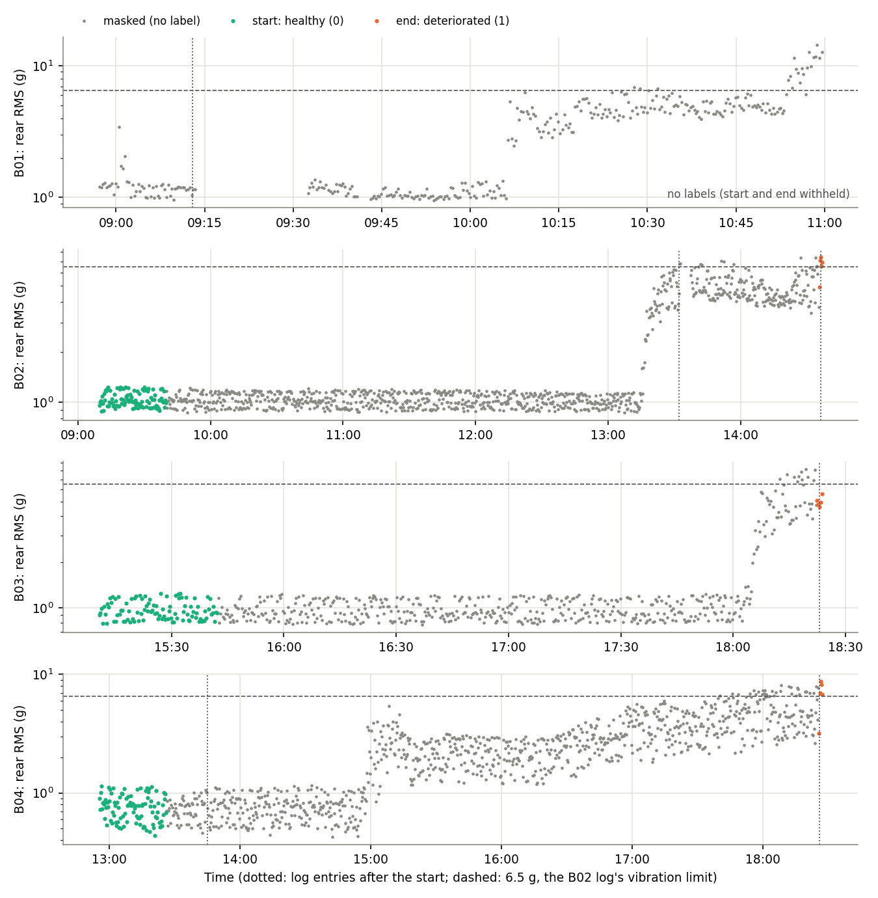

# Machine Guardian: B02 and B04 processed, and the label review

*2 November 2026. Covers processing and verification of Paderborn B02 and B04, the training readiness check, the
evidence-anchored label table, and the labels that need a person to check them. Nothing was trained. The locked test
bearings (B06, B07, B13, B17) were not downloaded, processed or opened.*

## 1. Summary

- **Ready for label review.** B02 and B04 pass every hard data check. Four development bearings are now processed
  (B01–B04). B02, B03 and B04 are labelled; B01 has no labels (decided in review). The only thing blocking training is the manual label review.
- **B02 and B04 were processed by the existing pipeline**, with no code change: 1,116 and 1,114 measurements at
  128 kHz. File counts match the dataset description, nothing is missing, and the file-to-row alignment is clear.
- **Both logs were transcribed** into `paderborn_experiments.json`. Both experiments started with a new bearing and
  stopped on a vibration limit.
- **Two findings:**
  - **B04's measured speed and dynamic-load columns read about half the set values.** This is a suspected logging or
    scaling discrepancy. The vibration analysis supports it, but the dataset authors have not confirmed it. The model
    inputs are not affected (section 4).
  - **B01 has no labels at all** (decided in review, 2 November). Its housing temperature reached the 110 °C stop
    temperature 16 minutes after warm-up. That is not a documented healthy start, and its end label was already
    withheld. B01 is left out of training and of the folds (section 6).
- **One limitation to accept or reject:** the B02 and B04 end labels sit where the rig's own vibration stop rule
  fired, on the same rear accelerometer the model uses. The comparison now includes that rule as a reference
  detector, so a trained head cannot look good just by relearning the stop criterion.
- **Labels:**
  - 300 healthy start rows (100 each for B02, B03, B04);
  - 15 deteriorated end rows (B02, B03, B04);
  - 2,754 masked rows;
  - no health-index labels.

## 2. What was done

| Step | Result |
|---|---|
| Read the B02 and B04 log PDFs | Transcribed into `paderborn_experiments.json`, with the source page |
| `python paderborn.py B02 B04` | `results/paderborn/B02/`, `results/paderborn/B04/` (processed CSV, checks, overview figure) |
| Verified files and sensors | Section 3; one recording fault found and explained (section 4) |
| `python labels.py` | `results/supervised/labels_B0x.csv`, `label_table.json` (SHA-256 4eff40d8...) |
| `python supervised_prep.py` | A42 datasets, folds, baseline comparison, `readiness.json` |
| `python label_review.py` | Figure, and `label_review.TEMPLATE.json` with the 15 items to confirm |
| Tests | 58 pass (`test_supervised.py`, `test_phase2.py`, `test_mtl.py`) |

Code added in this step:
- `supervised_prep.py` now has two more checks: a measured-speed check, and that every review item is confirmed.
- The comparison also includes the rig's stop rule as a reference detector.
- New script: `label_review.py`.
- Four new tests.

`baseline.json`, the B01/B03 results, the Ottawa model and `mtl_model.py` are unchanged.

## 3. Data verification

| Check | B02 | B04 |
|---|---|---|
| .mat files / CSV rows / description | 1116 / 1116 / 1116 | 1114 / 1114 / 1114 |
| Missing or extra ids | none | none |
| Sample rate, samples per file | 128 kHz, 204,800 | 128 kHz, 204,800 |
| All samples finite | yes | yes |
| Timestamps increasing, no duplicates | yes | yes |
| File-to-row alignment (lag 0) | clear, r = +0.88 | clear, r = +0.96 |
| Warm-up recorded | 51 rows (10 min) | 50 rows (10 min) |
| Segments | 2 (stop 13:32:36–13:37:18) | 1 |
| Last record vs logged stop | 36 s after 14:36 | 58 s after 18:26 |
| Set speed and loads within the logged ranges | yes | yes (T_high set) |
| Measured speed / set speed (median) | 1.003 | 0.499 (section 4) |
| Static load off by more than 150 N | 182 rows | 433 rows |
| Housing temperature T1 | 25.3–73.6 °C | 22.2–66.0 °C |
| T1 vs T2 (largest difference) | 2.6 °C | 1.1 °C |
| Rear RMS above 6.5 g | 15 rows (M0920 first) | 36 rows (M0964 first) |
| Front RMS above 6.5 g | none | none |
| Thermal validity rule V1–V3 | valid | valid |

- **The B02 log matches the data.** The log says the rig stopped at 13:32 after the accelerometer RMS crossed 0.65 V
  (6.5 g) twice. In our data, the rear sensor A is above 6.5 g at exactly two measurements before that stop, M0920 and
  M0921. The front sensor never reaches it, so the rig's stop rule used sensor A.
- **The static-load deviations** (more than 150 N in 182 and 433 rows) are of the same kind as in B03 (92 rows). They
  are reported, not corrected.
- **The B02 and B04 thermal calibrations are valid** (residual 0.50 °C and 0.17 °C). Their temperature input is
  used. B01's is still masked.

## 4. B04: suspected logging or scaling discrepancy in speed and dynamic load

- **In every B04 row:**
  - the recorded measured speed is 0.50 times the set speed (0.498–0.500);
  - the peak dynamic load is about 0.52 times the set value;
  - the static load is normal.

  B02 and B03 show ratios of 1.00 and about 1.06.
- **The vibration analysis supports a scaling discrepancy.** The vibration spectrum's strongest low-frequency line is
  the shaft frequency:
  - M0150: 35.6 Hz, where the set speed gives 35.6 Hz and the recorded speed gives 17.8 Hz;
  - M0300: 48.75 Hz (set 48.8 Hz);
  - M0600: 39.4 Hz (set 39.5 Hz).

  There is no line at the recorded speed. This supports, but does not prove, that the shaft ran at the set speed and
  that the two columns were logged at half scale. It is a suspected discrepancy, not confirmed by the dataset authors.
  Neither the description nor the B04 log mentions it.
- **Kept as recorded:** the processed data still hold the recorded values. A note in the registry explains them.
- **The model inputs do not change.** Every input is normalized per bearing, so a constant scale cancels out. With
  the speed doubled, all 8 inputs are identical (difference at most 1e-6) and so is the anomaly score; a test checks
  this.
- **What does change:** the thermal model's coefficient. It is 35.0 °C per 1000 rpm with the recorded speed and 17.5
  with the corrected speed. It is a per-bearing number and is not compared across bearings.
- **Before any cross-bearing use of raw speed or load**, B04's columns must be multiplied by 2. Nothing does that
  today.

## 5. The label table

| Bearing | Start: 0 (healthy) | End: 1 (deteriorated) | Masked | Stop (log) | Defect after dismantling |
|---|---|---|---|---|---|
| B01 | withheld | withheld | 326 (all) | none pre-set; data run 1 h 47 min past the log's stop | IR, OR, B |
| B02 | M0052–M0151 | M1112–M1116 (14:35:29–14:36:36) | 960 | rear RMS above 0.65 V four times | IR |
| B03 | M0001–M0100 | M0610–M0614 (18:22:25–18:23:40) | 509 | housing above 110 °C | IR |
| B04 | M0051–M0150 | M1110–M1114 (18:25:44–18:26:58) | 959 | RMS above the limit (value not stated) | IR, B |

- **Rule:** the rule fixed on 2 November in `labels.py` (before B02 and B04 were seen), plus one review decision.
- **Start rows:** the first 100 operating measurements. Evidence: the bearing was new.
- **Start rows withheld for B01.** This was decided in the review: its start is not a documented healthy condition
  (see section 6).
- **End rows:** the last 5 measurements, and only when the recording ends within 2 minutes of a documented stop.
  Evidence: the damage found at dismantling.
- **Everything else is masked.** The health index has no labels.
- **Measurements are never read.** Labelling uses only the documents, the measurement order, the timestamps and the
  warm-up flags. A test shuffles every sensor column and gets the same labels.
- **Assumptions,** stated in `label_table.json` for every bearing:
  - **A1, provisional end-stage proxy:** the last 5 measurements (about 1 minute) stand for the end-of-test state;
    damage in them is assumed, not verified.
  - **A2:** the bearing defect caused the stop. The rig stopping at its threshold does not by itself prove this.
  - **A3:** the exact damage onset is unknown; the deteriorated label is not an onset time.
  - **A4:** the bearing was healthy during its start rows.



## 6. Labels that need manual verification

Each item below is in `label_review.TEMPLATE.json`. Training stays blocked until every one is confirmed and signed.

**Decisions (the labels may change):**

- **B01: no labels (decided 2 November).**
  - **The issue:** the housing temperature T1 rises from 32.8 to 113.6 °C during B01's first 54 operating
    measurements. It reaches the 110 °C stop temperature (description p.4) at 09:12:49, about 16 minutes after the
    warm-up. That matches the log's 09:13 entry: "successfully completes because the temperature threshold value was
    exceeded".
  - **More against a healthy start:**
    - the test then restarts twice;
    - the bearing had already run for up to 15 minutes the day before (log, 08:45).
  - **What changed:** B01 has no healthy labels. With its end label already withheld, it has no labels at all and is
    left out of training and of the folds. To confirm: the template's B01 item.
- **Vibration-defined end timing.**
  - **The issue:** the B02 and B04 end labels sit where the rig's RMS limit on sensor A fired, and sensor A is the
    model's input sensor.
  - **What it means:** the damage itself is confirmed independently, by dismantling. The timing, however, was chosen
    by a vibration threshold.
  - **To accept it:** require every trained head to beat the reference detector "rear RMS above 6.5 g". Also report
    the temperature-stopped bearing (B03) on its own.
- **B04 speed and load columns** (section 4): documented as a suspected logging or scaling discrepancy, not confirmed
  by the authors.

**Transcriptions to check against the source documents:**

- **Defect types after dismantling:** B01 IR, OR, B; B02 IR; B03 IR; B04 IR, B. They come from Table 3 of the
  official dataset description (Zenodo 10.5281/zenodo.10805042), which is not in our local folders.
- **B02:**
  - start M0052–M0151 (log 08:59, "Begin with a new bearing");
  - end M1112–M1116 (log 14:36).
- **B02's 13:32 stop is not a label.** The test continued and the bearing was not dismantled, so M0920–M0921 and
  their neighbours stay masked.
- **B02 crossing count:** our 1.6-s RMS exceeds 6.5 g 13 times after the restart, while the log counts four
  crossings. The rig's RMS window differs from ours. No label depends on this count.
- **B03:**
  - start M0001–M0100 (its warm-up is not in the recording);
  - end M0610–M0614 (log 18:23, automatic stop above 110 °C).
- **B04:**
  - start M0051–M0150 (log 12:45);
  - end M1110–M1114 (log 18:26). The log does not state the limit's value.

**Fixed choices to confirm:**

- **The counts:** START_N = 100 and END_N = 5, fixed before B02 and B04 were seen.
- **The assumptions:** A1–A4 are acceptable.

## 7. Training readiness

`results/supervised/readiness.json`, after processing:

| Requirement | Status |
|---|---|
| B02 and B04 processed | done |
| Hard data checks pass on B01–B04 | done |
| At least 2 bearings with an end label | done: B02, B03, B04 |
| Label table reviewed and signed (`label_review.json`) | **blocking** |
| MLP is still 8 → 32 → 16 → 2, 850 parameters | done |
| Locked test bearings untouched | done (refused by `splits.py`, `labels.py`, `supervised_prep.py`) |
| Health-index head | not to be trained (no severity labels) |

**Folds (leave-one-bearing-out, A42):**
- B02, B03 and B04 are each held out once, with the model trained on the other two.
- Every fold's training set has two bearings with both labels.
- B01 has no labels, so it is in no fold.

**Size of the labelled data:**

- **300 healthy rows and 15 deteriorated rows.** That is enough to check the training setup and the comparison end to
  end. It is not enough for a detection claim.
- **More data needed for one:** the remaining 7 development bearings (B05, B08–B12, B14–B16).

## 8. Comparison with the anomaly detector (before any training)

Per bearing, on its own commissioning. "End alarmed" is the fraction of the end-labelled rows in the confirmed alarm
state (3 in a row). The minutes are from the first confirmed alarm to the last record; they are not a detection
delay, because the onset is unknown.

| Bearing | Detector | Start rows above threshold | End alarmed | First confirmed alarm | Minutes before last record | State changes after |
|---|---|---|---|---|---|---|
| B01 | prototype A, F128 | – (no labels) | – | M0210 | 52.5 | 0 |
| B01 | rig rule (rear RMS above 6.5 g) | – | – | M0362 | 5.0 | 2 |
| B02 | prototype A, F128 | 1% | 100% | M0864 | 81.3 | 0 |
| B02 | A, F42 | 1% | 100% | M0865 | 81.0 | 0 |
| B02 | rig rule | 0% | 40% | M1109 | 2.1 | 2 |
| B03 | prototype A, F128 | 1% | 100% | M0549 | 20.4 | 0 |
| B03 | rig rule | 0% | 0% | none | – | 0 |
| B04 | prototype A, F128 | 1% | 100% | M0442 | 209.6 | 0 |
| B04 | A, F42 | 1% | 100% | M0442 | 209.6 | 0 |
| B04 | rig rule | 0% | 40% | M1113 | 0.3 | 0 |

- **The anomaly detector meets the end labels on all three bearings.** It alarms on every end-labelled row and stays
  in alarm once it starts. The 42-kHz version matches the prototype within one measurement.
- **The start rows are part of its own reference,** so the 1% there is in-sample by design.
- **The rig rule catches only part of the end rows** (0–40%), and on B01 and B02 it switches off and on again.
- **B04's early alarm:**
  - The detector alarms at M0442 (about 14:57), 3.5 hours before the stop.
  - The set-speed and load ranges are the same before and after; the rear RMS median rises from 0.76 to 2.15 g.
  - This fits a change in the bearing, but it is not a verified onset.
- **This is the bar the trained deterioration head must clear** on the same leave-one-bearing-out folds.

## 9. How to sign off

1. Open `results/supervised/label_review.TEMPLATE.json` and the figure in section 5, and check each item against the
   dataset description and the logs.
2. If a label changes, tell me. I will change the rule in `labels.py`, rerun it,
   and regenerate the template, because the hash changes.
3. Copy the template to `results/supervised/label_review.json`. Set every `confirmed` to true and fill in
   `checked_by` and `date`. A second person fills in `independent_check_by` and `independent_check_date`.
4. `python supervised_prep.py` must then print "ready". Training starts only after that, and only on B02–B04 with
   leave-one-bearing-out.

## 10. Reproduce

Inside `model/`:

```
python paderborn.py B02 B04
python labels.py
python supervised_prep.py
python label_review.py
python -m pytest test_supervised.py test_phase2.py test_mtl.py -q
python report/make_label_review_report.py
```
