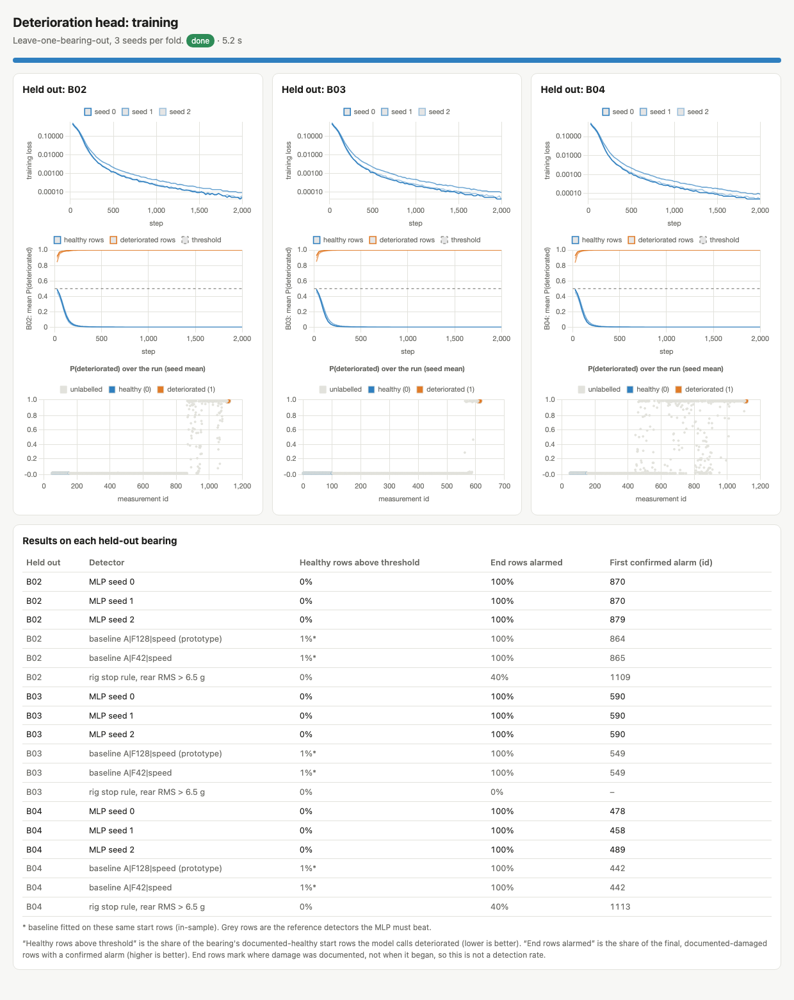
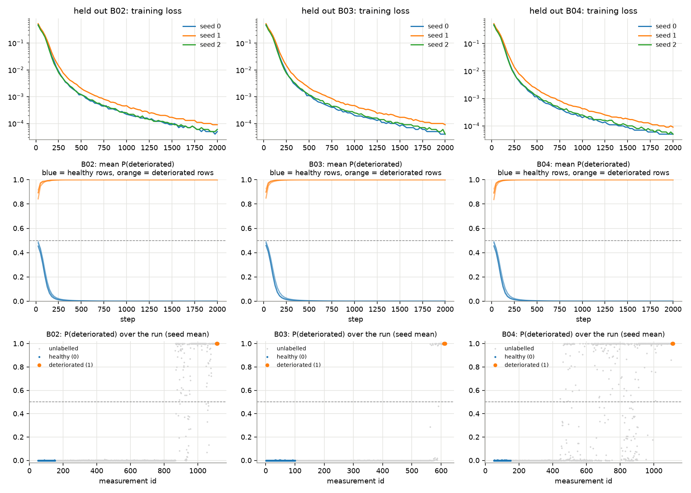
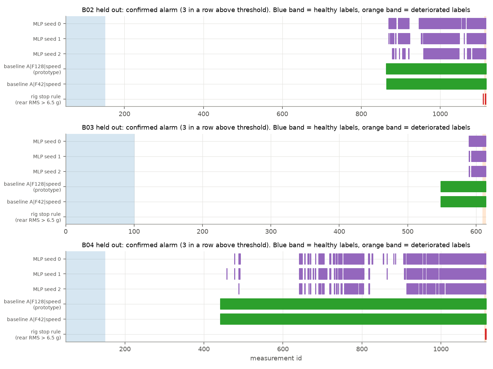

# Deterioration head: first training run (run 1)

Machine Guardian multi-task MLP, Paderborn run-to-failure bearings B02–B04. Prepared with Claude Code, 3 November 2026.
Run folder: `model/results/supervised/run1/`. Label table SHA-256 `4eff40d8…`.

## 1. Summary

- **The model had never been trained.** James's training script, `train_deterioration.py`, was complete but refused
  to start until two people signed off a manual label review (`label_review.json`). The team asked for that sign-off to
  be removed, because it was not meant to be a requirement.
- **What was done:** the sign-off check was removed (every other safety check was kept), live progress output and a
  browser dashboard were added, and the model was trained: 3 folds × 3 seeds = 9 networks, 2,000 steps each,
  5.2 seconds in total on an Apple-silicon Mac.
- **Headline result:** on every held-out bearing, with every seed, the model flags **0 %** of the documented-healthy
  rows and confirms an alarm on **100 %** of the documented-damaged rows. Every predicted probability on a healthy row
  is below 0.003, and every one on a damaged row is 1.000.
- **But it does not beat the existing anomaly baseline yet.** The baseline also alarms on 100 % of the damaged rows,
  alarms slightly earlier on every bearing, and its alarm stays on once raised, whereas the MLP's flickers. Both clearly
  beat the rig's own stop rule (vibration above 6.5 g), which confirms only 0–40 % of the damaged rows.
- **Why the perfect scores are less impressive than they sound:** there are only 15 damaged rows in total, all from
  the last minutes of a test, when the bearing is worn out. Separating those from a brand-new bearing is easy. This run
  shows that the pipeline works and that the model generalises to an unseen bearing. It does not show how early real
  damage can be detected.

## 2. Where the model stood

The deterioration head is one of the two outputs of the 8 → 32 → 16 → 2 multi-task MLP in `mtl_model.py` (850
parameters). The other output, the Motor Health Index, has no labels yet and is kept frozen.

James had prepared everything needed for a first supervised run:

| Piece | File | State before this work |
|---|---|---|
| Data processing and checks for B01–B04 | `paderborn.py`, `results/paderborn/` | done; B02 and B04 pass every hard data check |
| Labels (healthy start, damaged end, middle unlabelled) | `labels.py`, `results/supervised/label_table.json` | done, protected by a SHA-256 hash |
| Inputs, folds, baseline to beat | `supervised_prep.py`, `folds.json`, `baseline_comparison.json` | done |
| The training run | `train_deterioration.py` | written, **never run** |
| The gate that decides whether training may start | `supervised_prep.ready()` | blocked by one item: *label_review.json missing* |

So the only thing stopping training was the manual sign-off: one reviewer and a second, independent person had to
confirm 15 statements about the labels against the dataset documents.

### What the labels are

The dataset does not say which measurements are healthy or damaged. It only says each bearing started new and was
found damaged when it was taken apart. The labels are therefore a rule chosen in advance:

| Bearing | Healthy (label 0) | Damaged (label 1) | How the test ended | Measurements recorded |
|---|---|---|---|---|
| B01 | none | none | no stop rule was set; left out of training | 377 |
| B02 | M0052–M0151 (100) | M1112–M1116 (5) | rig vibration stop | 1,116 |
| B03 | M0001–M0100 (100) | M0610–M0614 (5) | rig temperature stop (above 110 °C) | 614 |
| B04 | M0051–M0150 (100) | M1110–M1114 (5) | rig vibration stop | 1,114 |

Everything between the start and the end is unlabelled and is not used for training.

## 3. What was changed

| File | Change |
|---|---|
| `model/supervised_prep.py` | Removed the `label_review.json` check from `ready()`. Kept: B02/B04 processed, hard data checks pass, at least two bearings with an end label, `label_table.json` unedited since `labels.py` wrote it (its hash still matches), and the network still 8 → 32 → 16 → 2 with 850 parameters. Docstring updated. |
| `model/test_supervised.py` | Removed the test of the review file's contents (`test_an_unconfirmed_review_does_not_unblock_training`). Kept the check that an edited label table still blocks training (renamed `test_an_edited_label_table_blocks_training`). Renamed two tests that mentioned the sign-off. |
| `model/train_deterioration.py` | Added live progress: every 25 steps the script records the training loss and the mean predicted probability on the held-out bearing's healthy and damaged rows, and writes them to `run1/progress.json`. This only reads the network, so the training itself is unchanged. At the end it also writes `run1/figures/training.png`. |
| `model/training_dashboard.html` (new) | A live browser dashboard that reads `progress.json` while training runs (section 5). |
| `.claude/launch.json` (new) | Starts a local web server for the dashboard (`python -m http.server 8765 --directory model`). |
| `model/report/make_training_run1_report.py` (new) | Builds this PDF, the alarm-timeline figure and the dashboard screenshot. |
| `model/.venv` (not in git) | Installed `pandas` and `pytest`, which the code needs but `requirements.txt` does not list. |

**Tests after the change:** `test_supervised.py`, `test_mtl.py` and `test_phase2.py`: 60 passed, 1 skipped (61 before:
one review-file test was removed).

## 4. How the model was trained

Nothing below was changed from James's design. Every setting was fixed before training, and none was tuned on a
held-out bearing.

| Setting | Value |
|---|---|
| Inputs (8 per measurement) | rear accelerometer at 42.67 kHz (profile A42), each standardised against the bearing's own commissioning period: ln RMS, ln peak, kurtosis, ln band energy 1–5 kHz, ln band energy 5–20 kHz, crest factor, speed (`rpm_z`), temperature residual (`temp_resid_z`) |
| Network | `MultiTaskMLP`, 8 → 32 → 16 → 2, ReLU; the health-index head is frozen and checked to be bit-identical after training |
| Validation | leave one bearing out: train on two of B02, B03, B04 and test on the third, once for each bearing |
| Training rows per fold | 200 healthy, 10 damaged (from the two training bearings) |
| Class balance | every batch of 64 is half healthy, half damaged (by sampling, not by loss weights) |
| Optimiser | Adam, learning rate 0.001, no weight decay, 2,000 steps |
| Temperature dropout | the temperature input is set to 0 in 50 % of training rows, as a unit without temperature calibration would see it |
| Seeds | 0, 1, 2 |
| Decision | damaged when P(damaged) > 0.5; an alarm is **confirmed** after 3 measurements in a row above that |
| Compared with | the anomaly baseline (A, F128, speed: the prototype) and (A, F42, speed: the same sensor information as the MLP), and the rig's stop rule (rear RMS > 6.5 g) |
| Never touched | the locked test bearings B06, B07, B13 and B17 |

## 5. Watching it train

`training_dashboard.html` shows the run live in a browser. Start the server, open
`http://localhost:8765/training_dashboard.html`, then run `train_deterioration.py`. For each held-out bearing it shows:
the training loss of every seed; the mean predicted probability on that bearing's healthy rows (blue) and damaged rows
(orange) as training goes on; and, when the fold finishes, the prediction for every measurement of the run, with the
results table underneath. The screenshot below was taken after the run.



The run was short: 9 trainings of 2,000 steps in 5.2 s. The curves tell the same story for all three folds: the
held-out healthy and damaged rows are already on opposite sides of the 0.5 threshold after the first 25 steps, and
the training loss falls steadily from about 0.5 to below 0.0001 by step 2,000.

## 6. Results

### 6.1 Main table: every detector on every held-out bearing

*Healthy flagged* = share of the bearing's 100 healthy rows above the threshold (lower is better). *Damaged
confirmed* = share of its 5 damaged rows with a confirmed alarm (higher is better). *First alarm* = the first confirmed
alarm after the healthy period, as a measurement id, and how many minutes before the last recording it came. This is
not a detection delay, because the real onset of damage is unknown. *Middle alarmed* = share of unlabelled middle
rows with a confirmed alarm (descriptive only: nobody knows whether those rows are damaged). *Flips* = how many times
the alarm switched on or off after it first fired.

| Held out | Detector | Healthy flagged | Damaged confirmed | First alarm (id) | Minutes before end | Middle alarmed | Flips | Final train loss |
|---|---|---|---|---|---|---|---|---|
| B02 | MLP seed 0 | 0 % | 100 % | 870 | 79.5 | 21.5 % | 8 | 6.6e-5 |
| B02 | MLP seed 1 | 0 % | 100 % | 870 | 79.5 | 19.1 % | 14 | 6.6e-5 |
| B02 | MLP seed 2 | 0 % | 100 % | 879 | 76.6 | 15.2 % | 16 | 4.2e-5 |
| B02 | Baseline A, F128, speed (prototype) | 1 % (in-sample) | 100 % | 864 | 81.3 | 25.8 % | 0 | – |
| B02 | Baseline A, F42, speed | 1 % (in-sample) | 100 % | 865 | 81.0 | 25.7 % | 0 | – |
| B02 | Rig stop rule, rear RMS > 6.5 g | 0 % | 40 % | 1109 | 2.1 | 0.1 % | 2 | – |
| B03 | MLP seed 0 | 0 % | 100 % | 590 | 7.4 | 3.9 % | 0 | 3.5e-5 |
| B03 | MLP seed 1 | 0 % | 100 % | 590 | 7.4 | 3.3 % | 2 | 6.1e-5 |
| B03 | MLP seed 2 | 0 % | 100 % | 590 | 7.4 | 3.3 % | 2 | 4.4e-5 |
| B03 | Baseline A, F128, speed (prototype) | 1 % (in-sample) | 100 % | 549 | 20.4 | 12.0 % | 0 | – |
| B03 | Baseline A, F42, speed | 1 % (in-sample) | 100 % | 549 | 20.4 | 12.0 % | 0 | – |
| B03 | Rig stop rule, rear RMS > 6.5 g | 0 % | 0 % | never | – | 0 % | 0 | – |
| B04 | MLP seed 0 | 0 % | 100 % | 478 | 198.0 | 32.2 % | 46 | 3.6e-5 |
| B04 | MLP seed 1 | 0 % | 100 % | 458 | 204.4 | 32.1 % | 42 | 7.3e-5 |
| B04 | MLP seed 2 | 0 % | 100 % | 489 | 194.6 | 27.2 % | 44 | 8.1e-5 |
| B04 | Baseline A, F128, speed (prototype) | 1 % (in-sample) | 100 % | 442 | 209.6 | 69.7 % | 0 | – |
| B04 | Baseline A, F42, speed | 1 % (in-sample) | 100 % | 442 | 209.6 | 69.7 % | 0 | – |
| B04 | Rig stop rule, rear RMS > 6.5 g | 0 % | 40 % | 1113 | 0.3 | 0 % | 0 | – |

"In-sample": the baseline is fitted on these same healthy rows, so its 1 % is a fit, not a test. The MLP never saw the
held-out bearing at all. No detector raised a confirmed alarm during any healthy period.

### 6.2 How confident and consistent the MLP is

| Held out | Operating measurements scored | Highest P(damaged) on a healthy row (seeds 0, 1, 2) | Lowest P(damaged) on a damaged row | Rows where all 3 seeds agree |
|---|---|---|---|---|
| B02 | 1,065 | 0.0017, 0.0011, 0.0014 | 1.000, 1.000, 1.000 | 96.1 % |
| B03 | 614 | 0.0012, 0.0012, 0.0013 | 1.000, 1.000, 1.000 | 99.8 % |
| B04 | 1,064 | 0.0018, 0.0021, 0.0008 | 1.000, 1.000, 1.000 | 94.1 % |

The three seeds disagree only on some unlabelled middle rows, where the bearing is changing.

### 6.3 Training curves and predictions

Top: training loss per seed. Middle: mean P(damaged) on the held-out bearing's healthy rows (blue) and damaged rows
(orange) during training. Bottom: the final prediction for every measurement of the held-out run (seed mean).



### 6.4 When each detector alarms

Each bar shows where a detector's confirmed alarm is on. Blue band: healthy labels. Orange band (at the right edge):
damaged labels.



## 7. What the results mean

- **The pipeline works end to end.** Data, inputs, folds, training, the frozen health head, saving and scoring all ran
  without error, and the health-index head was confirmed unchanged after every training.
- **The model generalises to a bearing it has never seen.** Trained on two bearings, it separates the third bearing's
  healthy and damaged rows perfectly, with a wide margin (below 0.003 against 1.000), for all three seeds.
- **B03 is the most meaningful fold.** It is the only bearing whose end was set by temperature rather than by the
  vibration stop rule, so the model cannot score well there just by relearning "vibration is above 6.5 g". The rig's
  vibration rule never fires on B03, but the MLP catches all 5 damaged rows, from vibration data only. It alarms about
  7 minutes before the end, later than the baseline (20 minutes).
- **Compared with the anomaly baseline, it is a tie on the labelled rows,** and the baseline is ahead on two practical
  points:
  - the baseline's first alarm comes earlier on every bearing (by 6–15 measurements on B02, 41 on B03 and 16–47 on B04);
  - once the baseline alarms it stays on (0 flips), whereas the MLP's alarm switches on and off, about 45 times on B04
    and 8–16 times on B02.
- **The MLP alarms on fewer unlabelled middle rows** (for example 27–32 % on B04 against 70 % for the baseline). With
  no labels in the middle, this cannot be scored: it could mean fewer false alarms, or later detection of real damage.
- **The rig's stop rule is the weakest detector**, as expected: it is a last-resort limit. Both learned detectors catch
  far more of the damaged period.

## 8. Limits and caveats

- **The labels were not reviewed.** The manual sign-off was removed at the team's request, so the 15 label statements
  (in `label_review.TEMPLATE.json`) have not been checked against the dataset documents by anyone. If a label is
  wrong, these results are wrong in the same way.
- **15 damaged rows from 3 bearings.** This is enough to show that the model trains and separates the two ends of a
  run. It is far too few to state a detection rate or an accuracy figure for real deployments.
- **The damaged labels are end-of-test proxies.** They mark where damage was documented, not when it began, so "first
  alarm" and "minutes before end" are not detection delays.
- **For B02 and B04, the damaged labels sit where the rig's vibration rule fired,** on the same accelerometer the model
  uses. That is why every result is shown next to that rule, and why B03 matters most.
- **Healthy-period alarm rates are measured on 100 rows per bearing (about 1 % resolution),** and the healthy rows are
  the same commissioning period the inputs are standardised on, so they are easier than later healthy operation would be.
- **The Motor Health Index output is still untrained.** `MultiTaskMLP.predict()` keeps refusing, as designed, until it is.
- **The locked test bearings (B06, B07, B13, B17) were not used,** so nothing here is a final test result.

## 9. Suggested next steps

1. **Reduce alarm flicker** before comparing again: for example require more readings in a row, or keep the alarm on
   once confirmed, as the baseline does. Make it a new run (run 2) and keep run 1 as it is.
2. **Do the label review anyway, if time allows.** It is no longer required to train, but it is what a reviewer will
   ask about. The 15 statements and their sources are in `label_review.TEMPLATE.json` and `Label_review_packet.pdf`.
3. **Fix the requirements file:** add `pandas` to `model/requirements.txt`, so a fresh setup runs without extra installs.
4. **Process more bearings** (beyond B01–B04) to get more than 15 damaged rows before quoting any rates.
5. Decide whether the MLP should **replace or complement** the anomaly baseline on the chip, given that the two tie here.

## 10. How to reproduce

Inside `model/`, with the environment from `model/README.md` plus `pandas`:

```
.venv/bin/python -m pytest test_supervised.py -q        # 17 passed
mv results/supervised/run1 /tmp/run1_old                # the script never overwrites a run
.venv/bin/python train_deterioration.py                 # about 5 s; writes results/supervised/run1/
.venv/bin/python report/make_training_run1_report.py    # this PDF: docs/Multitask_MLP_reports/Training_run1_report.pdf
```

To watch training live: start the server (`.venv/bin/python -m http.server 8765 --directory model` from the repo's top
folder), open `http://localhost:8765/training_dashboard.html`, then start training.

Files in `results/supervised/run1/`: `results.json` (design and every metric), `predictions_<bearing>.csv` (every
measurement's probability per seed), `fold_<bearing>_seed<s>.pt` (the 9 trained networks, PyTorch `state_dict`),
`progress.json` (the training curves), and `figures/`.
