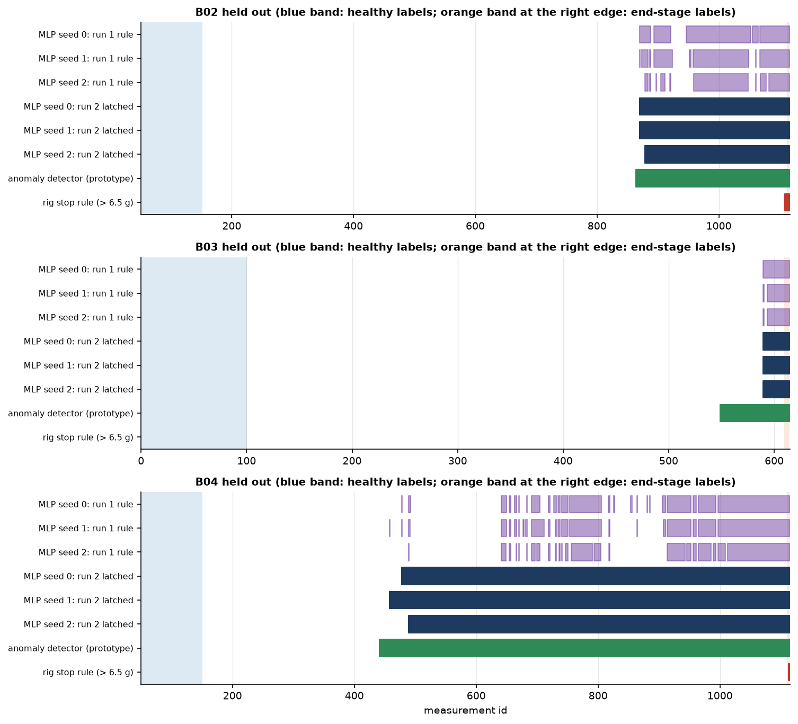
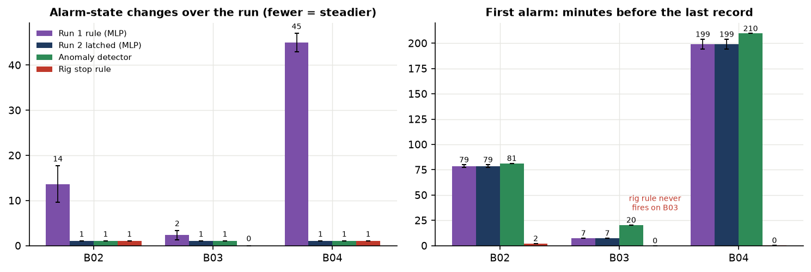
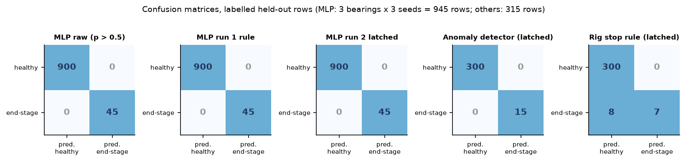
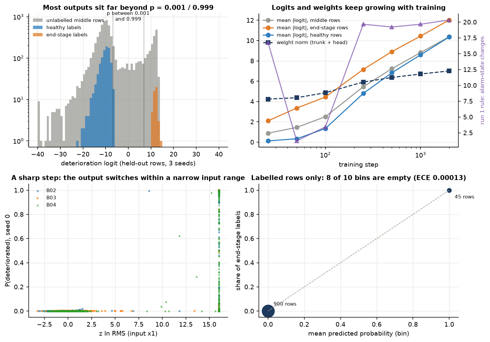
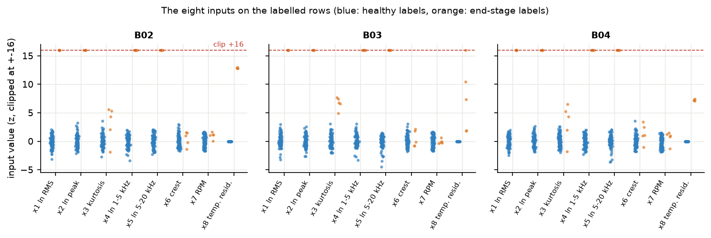
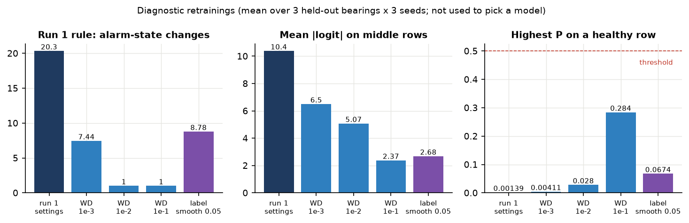
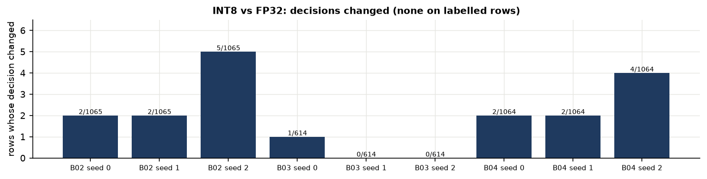

# Training Run 2: latched alarm, comparison and calibration

Machine Guardian multi-task MLP, deterioration head, Paderborn run-to-failure bearings B02–B04. Prepared with Claude
Code, 3 November 2026. Run folder: `model/results/supervised/run2/` (script `model/train_deterioration_run2.py`).

## 1. Summary

Run 2 tested one change to the alarm logic: the deterioration alarm now **latches**. It turns on after three consecutive
predictions above 0.5 and then stays on. The network, its training and its raw probability output are unchanged from
Run 1. The same nine networks were retrained, and they came out byte-identical to Run 1's files.

> **Key finding: the latch removes the flicker without moving the first alarm.** On every bearing and every seed the
> alarm now switches on once and stays on (1 state change). Under Run 1's rule it switched 9–17 times on B02, 1–3 times
> on B03 and 43–47 times on B04. The first alarm came at the same measurement as in Run 1. No healthy-reference row
> raised an alarm, and every end-stage row was alarmed (recall 100 %).

> **Key finding: the MLP still does not beat the original anomaly detector.** Both detectors confirm 100 % of the
> end-stage rows and raise no alarm on any healthy-reference row. Both are now equally steady (1 state change). But the
> anomaly detector alarms **earlier on every bearing**: by 1.9–4.7 min on B02, 13.0 min on B03 and 5.2–15.0 min on B04.

> **Key finding: the probabilities sit at 0 or 1 because the labelled data are trivially separable, and they are not
> calibrated in any useful sense.** 87.1 % of all held-out outputs are below 0.001 or above 0.999. Every end-stage row
> sits at the input clip limit (+16 standard deviations) on four vibration inputs, while healthy rows stay within about
> ±4.5. Unregularised cross-entropy on separable data keeps growing the logits: the mean |logit| on unlabelled rows goes
> from 0.9 at step 25 to 10.4 at step 2,000. The labelled rows look "perfectly calibrated" (ECE 0.00013), but only 2 of
> 10 probability bins contain any rows, so that check says nothing about the intermediate region.

> **Caution:** the output is a detector score, **not** a validated probability of physical failure. Nothing in Run 1 or
> Run 2 measures how likely a bearing is to fail, or how far it has deteriorated.

Other results:

- **Overconfidence and flicker are linked.** In diagnostic retrainings (not used to choose a model), L2 weight decay of
  0.01 kept the logits smaller. That removed the flicker even without the latch (1 state change on all bearings), and
  its first alarms came within 0.7–2.6 min of the anomaly detector. It is a candidate for Run 3, which must be checked on
  bearings that were not used here.
- **INT8 / hardware.** The trained networks were quantized to INT8 with the project's export scheme.
  - Between 0 and 5 decisions changed per network (out of 614–1,065 rows), and none was on a labelled row.
  - The latched first alarm was identical in INT8 for all nine networks.
  - One trained network was also run on the accelerator RTL (Icarus Verilog) and passed bit-exact: 1,642 cycles for 64
    measurements, 382 cycles (1.78 µs at 214.286 MHz) for one.
- **The architecture was kept** at 8 → 32 → 16 → 2. Nothing in Run 2 is evidence for changing it. The Motor Health Index
  head stayed frozen and untrained. The locked test bearings B06, B07, B13 and B17 were never loaded.

## 2. What Run 2 changed, and what it kept

| Item | Run 1 | Run 2 |
|---|---|---|
| Network | 8 → 32 → 16 → 2 MultiTaskMLP, 850 parameters | unchanged |
| Health-index head | frozen, untrained | unchanged (frozen, checked bit-identical after every training) |
| Training | 2,000 Adam steps, lr 0.001, batch 64 (half each class), temperature-input dropout 50 %, seeds 0, 1, 2 | unchanged; retrained into `run2/`, **all 9 weight files byte-identical to Run 1** (SHA-256) |
| Raw output | P(deteriorated) = sigmoid(logit) | unchanged (largest difference to Run 1's saved predictions: 0) |
| Data and folds | leave one bearing out over B02, B03, B04 | unchanged; B06, B07, B13, B17 refused by `splits.assert_development` |
| **Alarm** | on while the last 3 probabilities are above 0.5, off otherwise | **latched: on from the 3rd consecutive probability above 0.5, then stays on** |
| New analyses | – | per-bearing comparison, calibration investigation, temperature-input check, regularisation diagnostics, INT8 and RTL check of the trained networks |
| Run 1 files | – | read only; their SHA-256 digests were checked unchanged after Run 2 |

## 3. The latched alarm

The alarm state at measurement *t* is on if, at any measurement up to and including *t*, the probability was above 0.5
three measurements in a row. It is causal: it uses only past and present measurements. It never turns off by itself. In
a deployed unit it would need a maintenance reset, which is outside this experiment.

The anomaly detector's own rule (`anomaly_baseline.first_persistent`) is the same latch, but it reports the **first** of
the three measurements, whereas the alarm can only be raised at the **third**. The latched baseline below therefore
alarms exactly 2 measurements after the "persistent alarm" id in earlier reports (B02: 862 → 864; B03: 547 → 549; B04:
440 → 442). That was checked on all three bearings.

"Alarm-state changes" in this report counts every time the alarm switched on or off over the whole run, including the
first switch-on. Run 1's report counted only the changes **after** the first alarm, so its numbers are one lower (for
example 8 there and 9 here for B02, seed 0).

## 4. Results for each bearing

Columns:

- **First alarm:** the measurement id and clock time at which the alarm is first on, and how many minutes before the
  bearing's last record that was. This is not a detection delay, because the onset of damage is unknown.
- **Changes:** alarm-state changes over the run.
- **Healthy FA:** healthy-reference false alarms. The first number is the rows above threshold (out of 100); the second
  is the rows with the alarm on.
- **End recall:** the share of the 5 end-stage rows with the alarm on.
- **Middle on:** the share of unlabelled rows with the alarm on. This is descriptive only; nobody knows which of those
  rows are damaged.

### 4.1 B02 (stopped by the vibration limit; 1,065 operating measurements)

| Detector | First alarm (id, time) | Min. before end | Changes | Healthy FA (above / alarmed) | End recall | Middle on |
|---|---|---|---|---|---|---|
| MLP seed 0, Run 1 rule | 870, 13:17:07 | 79.5 | 9 | 0 / 0 | 100 % | 21.5 % |
| MLP seed 1, Run 1 rule | 870, 13:17:07 | 79.5 | 15 | 0 / 0 | 100 % | 19.1 % |
| MLP seed 2, Run 1 rule | 879, 13:19:59 | 76.6 | 17 | 0 / 0 | 100 % | 15.2 % |
| **MLP seed 0, Run 2 latched** | 870, 13:17:07 | 79.5 | **1** | 0 / 0 | 100 % | 25.2 % |
| **MLP seed 1, Run 2 latched** | 870, 13:17:07 | 79.5 | **1** | 0 / 0 | 100 % | 25.2 % |
| **MLP seed 2, Run 2 latched** | 879, 13:19:59 | 76.6 | **1** | 0 / 0 | 100 % | 24.3 % |
| Anomaly detector A, F128, speed (prototype), latched | 864, 13:15:16 | 81.3 | 1 | 1 / 0 (in-sample) | 100 % | 25.8 % |
| Anomaly detector A, F42, speed, latched | 865, 13:15:35 | 81.0 | 1 | 1 / 0 (in-sample) | 100 % | 25.7 % |
| Rig stop rule (rear RMS > 6.5 g), Run 1 rule | 1109, 14:34:28 | 2.1 | 3 | 0 / 0 | 40 % | 0.1 % |
| Rig stop rule, latched | 1109, 14:34:28 | 2.1 | 1 | 0 / 0 | 100 % | 0.3 % |

### 4.2 B03 (stopped by the temperature limit; 614 operating measurements)

B03 is the most informative fold. Its end was set by temperature, not by the vibration rule, so a model cannot score
well here just by relearning "vibration above 6.5 g".

| Detector | First alarm (id, time) | Min. before end | Changes | Healthy FA (above / alarmed) | End recall | Middle on |
|---|---|---|---|---|---|---|
| MLP seed 0, Run 1 rule | 590, 18:16:15 | 7.4 | 1 | 0 / 0 | 100 % | 3.9 % |
| MLP seed 1, Run 1 rule | 590, 18:16:15 | 7.4 | 3 | 0 / 0 | 100 % | 3.3 % |
| MLP seed 2, Run 1 rule | 590, 18:16:15 | 7.4 | 3 | 0 / 0 | 100 % | 3.3 % |
| **MLP seed 0, Run 2 latched** | 590, 18:16:15 | 7.4 | **1** | 0 / 0 | 100 % | 3.9 % |
| **MLP seed 1, Run 2 latched** | 590, 18:16:15 | 7.4 | **1** | 0 / 0 | 100 % | 3.9 % |
| **MLP seed 2, Run 2 latched** | 590, 18:16:15 | 7.4 | **1** | 0 / 0 | 100 % | 3.9 % |
| Anomaly detector A, F128, speed (prototype), latched | 549, 18:03:16 | 20.4 | 1 | 1 / 0 (in-sample) | 100 % | 12.0 % |
| Anomaly detector A, F42, speed, latched | 549, 18:03:16 | 20.4 | 1 | 1 / 0 (in-sample) | 100 % | 12.0 % |
| Rig stop rule, Run 1 rule and latched | never | – | 0 | 0 / 0 | 0 % | 0 % |

### 4.3 B04 (stopped by the vibration limit; 1,064 operating measurements)

| Detector | First alarm (id, time) | Min. before end | Changes | Healthy FA (above / alarmed) | End recall | Middle on |
|---|---|---|---|---|---|---|
| MLP seed 0, Run 1 rule | 478, 15:08:57 | 198.0 | 47 | 0 / 0 | 100 % | 32.2 % |
| MLP seed 1, Run 1 rule | 458, 15:02:35 | 204.4 | 43 | 0 / 0 | 100 % | 32.1 % |
| MLP seed 2, Run 1 rule | 489, 15:12:25 | 194.6 | 45 | 0 / 0 | 100 % | 27.2 % |
| **MLP seed 0, Run 2 latched** | 478, 15:08:57 | 198.0 | **1** | 0 / 0 | 100 % | 65.9 % |
| **MLP seed 1, Run 2 latched** | 458, 15:02:35 | 204.4 | **1** | 0 / 0 | 100 % | 68.0 % |
| **MLP seed 2, Run 2 latched** | 489, 15:12:25 | 194.6 | **1** | 0 / 0 | 100 % | 64.8 % |
| Anomaly detector A, F128, speed (prototype), latched | 442, 14:57:25 | 209.6 | 1 | 1 / 0 (in-sample) | 100 % | 69.7 % |
| Anomaly detector A, F42, speed, latched | 442, 14:57:25 | 209.6 | 1 | 1 / 0 (in-sample) | 100 % | 69.7 % |
| Rig stop rule, Run 1 rule and latched | 1113, 18:26:40 | 0.3 | 1 | 0 / 0 | 40 % | 0 % |

"In-sample": the anomaly detector is fitted on the same 100 healthy rows, so its 1 row above threshold is a fit, not a
test. Under Run 1's rule the anomaly detector also had only 1 state change on every bearing: its score stays above its
threshold once it rises, so the latch changes nothing for it.

### 4.4 The alarms over time

Purple: Run 1's rule (unlatched). Navy: Run 2's latched alarm. Green: the anomaly detector (prototype). Red: the rig's
stop rule.





### 4.5 Row-level confusion matrices on the labelled rows

The labelled rows are each bearing's 100 healthy-reference rows and 5 end-stage rows. The MLP is pooled over 3 bearings
× 3 seeds (945 rows); the other detectors over 3 bearings (315 rows).



| Detector | Accuracy | Precision | Recall | F1 |
|---|---|---|---|---|
| MLP raw output (p > 0.5) | 1.000 | 1.000 | 1.000 | 1.000 |
| MLP, Run 1 rule | 1.000 | 1.000 | 1.000 | 1.000 |
| MLP, Run 2 latched | 1.000 | 1.000 | 1.000 | 1.000 |
| Anomaly detector (prototype), latched | 1.000 | 1.000 | 1.000 | 1.000 |
| Rig stop rule, latched | 0.975 | 1.000 | 0.467 | 0.636 |

> **Caution:** these scores are perfect because the labelled rows are the two easiest extremes: brand-new against worn
> out. They are not the model's accuracy on a real machine.

## 5. What the latch costs

- **More of the unlabelled middle is alarmed.** On B04 the latched alarm is on for 65–68 % of the unlabelled rows,
  against 27–32 % under Run 1's rule. That matches the anomaly detector (70 %). Nobody knows whether those rows are
  damaged, so this is neither better nor worse on the evidence available.
- **A false streak becomes a permanent alarm.** With a latch, three consecutive false positives keep the alarm on until
  someone resets it. No healthy-reference row came close in Run 2: the highest probability on a healthy row was 0.0021,
  against the 0.5 threshold. But each bearing has only 100 healthy rows, from its first half hour.
- **The latch hides what the score does afterwards.** The raw probability is still recorded and should stay visible on
  the dashboard and in logs, next to the alarm state.

## 6. Does the MLP outperform the anomaly detector?

**No, not on this evidence.** On the labelled rows the two tie: both are perfect. Once latched, both are equally
steady. The anomaly detector alarms earlier on all three bearings:

| Bearing | MLP latched, minutes before end (seeds 0, 1, 2) | Anomaly detector (prototype) | Anomaly detector earlier by |
|---|---|---|---|
| B02 | 79.5, 79.5, 76.6 | 81.3 | 1.9–4.7 min |
| B03 | 7.4, 7.4, 7.4 | 20.4 | 13.0 min |
| B04 | 198.0, 204.4, 194.6 | 209.6 | 5.2–15.0 min |

The anomaly detector also needs no labels. It is fitted on each bearing's own first 100 measurements. What the MLP
offers, a learned decision and a second (health) output from one network, has not yet produced a measurable advantage.

## 7. Why the probabilities are so close to 0 or 1, and are they calibrated?

### 7.1 What we see

- **Most outputs are at the extremes.** Over all held-out rows and seeds, 87.1 % of the probabilities are below 0.001
  or above 0.999. Only 5.0 % of the unlabelled middle rows fall between 0.05 and 0.95.
- **The labelled rows are far from the threshold.** The highest probability on any healthy row is 0.0021. The lowest
  on any end-stage row is 0.99997.



### 7.2 Cause 1: the labelled rows are separable many times over

Each input is a z-score against the bearing's own first 100 measurements. The healthy labels **are** those first 100
measurements, so their inputs sit near 0 by construction: within about ±4.5 on every input. The end-stage rows sit at
the clip limit of **+16** on ln RMS, ln peak, ln 1–5 kHz and ln 5–20 kHz, on all three bearings.

Five of the eight inputs separate the two classes perfectly on their own, on every bearing. (Kurtosis does as well on
B03.) A model that only has to tell these two clusters apart becomes certain almost immediately: the held-out classes
were already on opposite sides of 0.5 after 25 steps (Run 1).



Clipping also matters for the hardware. The rows with at least one input clipped at ±16 number 252 of 1,065 on B02, 62
of 614 on B03 and 672 of 1,064 on B04. Above the clip, the network cannot see "how much worse" a bearing is.

### 7.3 Cause 2: unregularised cross-entropy keeps pushing the logits outward

On separable data the cross-entropy loss keeps falling as the weights grow, so nothing stops the logits from growing.
Measured at checkpoints during training (means over 3 bearings × 3 seeds):

| Step | Train loss | Weight norm | Mean abs. logit, healthy | Mean abs. logit, end-stage | Mean abs. logit, middle | Run 1 rule: state changes |
|---|---|---|---|---|---|---|
| 25 | 0.49 | 4.24 | 0.12 | 2.10 | 0.88 | 16.8 |
| 50 | 0.34 | 4.38 | 0.33 | 3.36 | 1.45 | 1.2 |
| 100 | 0.18 | 4.87 | 1.34 | 4.44 | 2.50 | 3.4 |
| 250 | 0.010 | 5.92 | 4.79 | 7.16 | 5.45 | 19.7 |
| 500 | 0.0015 | 6.37 | 6.84 | 8.91 | 7.23 | 19.2 |
| 1,000 | 0.0003 | 6.71 | 8.60 | 10.44 | 8.82 | 19.7 |
| 2,000 | 0.0001 | 7.01 | 10.35 | 12.03 | 10.38 | 20.3 |

The flicker grows with the logits. At step 50 the unlatched alarm changed state about once per run. From step 250
onward it changed about 20 times. Bigger logits make a steeper step between "healthy" and "damaged", so the noise of the
unlabelled middle rows flips the output across 0.5.

Stopping early is not a fix. At steps 25 and 50, healthy-reference rows were still above the threshold (highest 0.58)
in 17 of the 18 seed-and-bearing cases.

### 7.4 Cause 3: balanced sampling sets the prior to 50 %

Every training batch is half healthy, half end-stage. In the labelled training rows the end-stage share is only 4.8 %
(10 of 210). Relative to that share, the model's logits are shifted by +3.0. That is a deliberate design choice for
detection, but it means the output is not the frequency of damaged rows. The real-world frequency is unknown anyway.

### 7.5 A shortcut in the temperature input, and why it does not drive the results

The temperature residual (x8) is set to exactly 0 until the bearing's thermal calibration ends. That window covers every
healthy label, and the input is non-zero on every end-stage label. So x8 alone also separates the classes, but for a
reason that comes from how the input is built, not from the physics.

To test how much the networks use it, every trained network was rerun with x8 set to 0 on every held-out row:

| Bearing | Labelled rows still separated | Latched first alarm, normal → x8 = 0 (seeds 0, 1, 2) |
|---|---|---|
| B02 | yes, all seeds | 870 → 888, 870 → 870, 879 → 888 |
| B03 | yes, all seeds | 590 → 590 (all seeds) |
| B04 | yes, all seeds | 478 → 489, 458 → 478, 489 → 489 |

The vibration inputs carry the separation. The 50 % temperature dropout used in training works as intended. Without
temperature the first alarm comes slightly later on B02 and B04 (up to 20 measurements, about 6 min). Even so, the input
should be redesigned so that "not calibrated yet" is not the same value as "exactly as expected" (section 10).

### 7.6 Are the probabilities calibrated?

**It cannot be shown with the current labels.**

- On the labelled held-out rows the expected calibration error is 0.00013, the Brier score 6.4 × 10⁻⁸ and the log-loss
  0.00013. These look perfect only because the rows sit in the 0–0.1 bin (900 healthy, all correct) and the 0.9–1.0 bin
  (45 end-stage, all correct). The other 8 bins are empty.
- Calibration matters in between, and the unlabelled middle has no ground truth.
- A post-hoc fix such as temperature scaling would have to be fitted on labelled intermediate states, which do not
  exist. Fitted on the extremes, it would make the model even more confident.

**Conclusion:** treat P(deteriorated) as a detector score with a threshold, not as a probability of failure.

### 7.7 Diagnostic retrainings

These use the same architecture, data, folds and seeds, changing one training setting each time. They were evaluated
on the held-out bearings, so they are **diagnostics, not model selection**.

| Variant | Max P on healthy row | Min P on end-stage row | Mean abs. logit, middle | Run 1 rule: state changes (B02 / B03 / B04) | Latched first alarm, min before end (B02 / B03 / B04) |
|---|---|---|---|---|---|
| Run 1 settings | 0.0021 | 0.99997 | 10.4 | 9–17 / 1–3 / 43–47 | 76.6–79.5 / 7.4 / 194.6–204.4 |
| Weight decay 0.001 | 0.005 | 0.9998 | 6.5 | 1 / 1 / 15–31 | 80.1–80.3 / 17.5–17.8 / 208.6 |
| **Weight decay 0.01** | 0.035 | 0.998 | 5.1 | **1 / 1 / 1** | **80.7 / 17.8 / 208.6–208.9** |
| Weight decay 0.1 | 0.303 | 0.984 | 2.4 | 1 / 1 / 1 | 80.7 / 19.1–19.5 / 209.2 |
| Label smoothing 0.05 | 0.087 | 0.928 | 2.7 | 1–5 / 1 / 1–53 | 79.5 / 16.2–17.8 / 208.3–208.6 |



- **Weight decay 0.01 is the most promising setting.**
  - The flicker is gone even without the latch.
  - The first alarm moves to within 0.7 min (B02), 2.6 min (B03) and 0.7–1.0 min (B04) of the anomaly detector.
  - The labelled rows stay separated with a wide margin (healthy at most 0.035).
- **Weight decay 0.1** pushes healthy rows up to 0.30, too close to the 0.5 threshold.
- **Label smoothing** only caps the outputs near 0.06 and 0.94. It does not stop B04 flickering.

> **Caution:** weight decay 0.01 was identified by looking at the held-out bearings, so its numbers here are optimistic.
> It may be adopted only as a pre-declared Run 3 setting and judged on bearings that played no part in choosing it.

## 8. INT8 and RTL check of the trained networks

Each trained network was quantized with `mtl_model.int8_model`, the export scheme the accelerator uses:

- inputs at 16/127 per step (so ±16 maps to ±127);
- per-channel weight scales;
- hidden scales from the largest activation on the training bearings' rows.

The quantized networks were then run through the bit-exact golden model `golden_mlp` (22-bit accumulator) on every
held-out row.

| Held out | Seeds | Rows | Mean abs. logit error | Max abs. logit error | Decisions changed (all rows) | Changed on labelled rows | Latched first alarm, FP32 = INT8 |
|---|---|---|---|---|---|---|---|
| B02 | 0, 1, 2 | 1,065 | 0.13, 0.12, 0.18 | 0.60, 0.52, 0.75 | 2, 2, 5 | 0 | yes (870, 870, 879) |
| B03 | 0, 1, 2 | 614 | 0.16, 0.13, 0.18 | 0.73, 0.50, 0.75 | 1, 0, 0 | 0 | yes (590) |
| B04 | 0, 1, 2 | 1,064 | 0.15, 0.13, 0.17 | 0.66, 0.54, 1.60 | 2, 2, 4 | 0 | yes (478, 458, 489) |

**RTL simulation of a trained network** (B03 held out, seed 0) on the accelerator's MLP testbench (`tb_mlp.sv`, Icarus
Verilog, the settings of `rtl_check.py`): **PASS**, with every raw output sum and every counter matching the golden model.

| Batch size | Batches | Cycles per batch | Time at 214.286 MHz |
|---|---|---|---|
| 64 measurements | 9 | 1,642 | 7.66 µs |
| 1 measurement | 10 | 382 | 1.78 µs |

This is the first time a **trained** multi-task network has been run on the RTL. Earlier checks used random weights.
It is still simulation, not a run on the FPGA board.



## 9. Which Paderborn development bearings to process next

The dataset has 17 bearings: 13 for development and 4 locked for testing (B06, B07, B13, B17, which stay locked). Only
B01–B04 have been processed, and all four come from **one regime**: 128 kHz sampling with sinusoidal load. Three of the
four locked test bearings come from regimes the model has never seen: Gaussian random load (B07), 64 kHz with variable
speed (B13), and 64 kHz with constant speed (B17).

The selection rules follow from the label rule and the gaps found here:

1. A bearing needs a vibration or temperature stop and a transcribed log to get an end label (`labels.end_rule`), so
   B05 (interrupted) and B16 (no criterion) can never get one.
2. Temperature-stopped bearings matter most. They are the only check that the model is not just relearning the
   vibration stop rule, and B03 is the only one so far.
3. Cover every regime in the test set, and the outer-race defects that none of the processed bearings has.
4. Process the cheap bearings (fewest files) first.

| Priority | Bearing | Regime | Files | Duration | Stop | Defect | Why |
|---|---|---|---|---|---|---|---|
| 1 | **B08** | Gaussian load, 128 kHz | 1,827 | 11 h | temperature | IR, B | second temperature-stopped bearing; first of B07's regime |
| 1 | **B09** | Gaussian load, 128 kHz | 1,813 | 13 h | vibration | OR, B | first outer-race defect; same regime as B07 |
| 1 | **B12** | 64 kHz, variable speed | 767 | 3 h | vibration | IR, B | smallest bearing; first of B13's regime |
| 1 | **B11** | 64 kHz, variable speed | 1,953 | 8 h | vibration | IR, OR, B | all three defect types; B13's regime |
| 2 | B10 | 64 kHz, variable speed | 3,224 | 19 h | vibration | OR, B | second outer-race defect in that regime |
| 2 | B14 | 64 kHz, constant speed | 12,317 | 41 h | vibration | B | first of B17's regime (no RPM correction at constant speed) |
| 3 | B15 | 64 kHz, constant speed | 22,567 | 76 h | temperature | IR, B | temperature-stopped in B17's regime; largest download and processing job |
| – | B05, B16 | 128 kHz sine; 64 kHz constant | 572; 5,891 | 3 h; 20 h | none | B; IR, OR, B | no end label possible; useful only as extra healthy-reference data for false-alarm checks |

Priority 1 is four bearings, about 6,400 files. It would take the labelled bearings from 3 to 7 and the end-stage rows
from 15 to 35, and cover two of the three missing regimes.

Before training on these bearings:

- the logs must be transcribed;
- the hard data checks must pass;
- the 64 kHz bearings must be confirmed to work with the A42 profile (the only profile all 17 bearings support);
- B14 and B15 must be confirmed to work without an RPM term.

With seven bearings, a threshold or regularisation setting can be chosen on validation bearings and judged on different
ones (nested leave-one-out). With three bearings that is not possible.

## 10. Limitations

- **15 end-stage rows from 3 bearings**, all at the very end of a test. Nothing here estimates detection rate, delay,
  or accuracy in service.
- **The labels are provisional and were not reviewed.** The manual sign-off was removed at the team's request. The end
  labels mark where damage was documented, not when it began.
- **The healthy labels are the commissioning period that the inputs are normalised on,** so they are the easiest
  possible healthy rows. A false-alarm rate on later healthy operation is not measured.
- **Two of the three end labels sit where the rig's vibration rule fired,** on the same sensor the model uses.
- **The probabilities are not calibrated and cannot be checked yet.** They must not be reported as a failure
  probability.
- **The latch has no reset logic,** and its false-alarm cost on long healthy runs is unknown.
- **The weight-decay result is optimistic:** it was seen on the held-out bearings.
- **The temperature input's "not calibrated" value (0) is the same as "exactly as expected".** That creates a shortcut
  the network could learn.
- **The Motor Health Index head is untrained.** There are no severity labels.
- **INT8 and RTL are verified in simulation only.** The trained network has not been run on the FPGA board.

## 11. Recommended next steps

1. **Keep the latched alarm** as the deployed decision rule, with a documented maintenance reset. Log the raw
   probability next to it.
2. **Process B08, B09, B11 and B12** (priority 1 above), transcribe their logs, and run the data checks.
3. **Declare Run 3 before training it:**
   - the same architecture, with weight decay 0.01 and the latched alarm;
   - the threshold chosen on validation bearings only;
   - judged on bearings that were not used to choose it;
   - compared again with the anomaly detector on first-alarm time.
4. **Fix the temperature input's shortcut.** Give "not calibrated" its own signal: for example, exclude uncalibrated
   rows from x8's training or add a validity flag on the ARM. Do this as a new, declared change.
5. **Do not report P(deteriorated) as a probability of failure.** Call it a "deterioration score" in the dashboard and
   reports until labelled intermediate states exist.
6. **Keep B06, B07, B13 and B17 locked** until one model is frozen. Then evaluate it once.
7. **Leave the Motor Health Index head untrained** until reliable severity labels exist.
8. **Hardware:** re-export INT8 from the frozen model, run `rtl_check` on it, then run it on the ZedBoard.

## 12. Files and how to reproduce

Inside `model/`:

```
.venv/bin/python train_deterioration_run2.py     # about 35 s; writes results/supervised/run2/ (never overwrites)
.venv/bin/python report/run2_figures.py          # the figures in results/supervised/run2/figures/
.venv/bin/python report/make_run2_reports.py     # this PDF and the ML development report
```

Files in `results/supervised/run2/`:

- `results.json`: design, every metric, calibration, INT8 and RTL results.
- `predictions_<bearing>.csv`: per measurement, each seed's probability and logit, both alarm states, the probability
  with x8 = 0, the anomaly score and its threshold, and the rear RMS.
- `checkpoints.csv`: training diagnostics at steps 25–2,000.
- `variants.csv`: the regularisation diagnostics.
- `fold_<bearing>_seed<s>.pt`: the 9 networks, byte-identical to Run 1.
- `figures/`.
